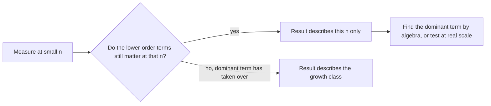

import Scenario from "../../../components/Scenario.astro";
import LevelIntro from "../../../components/LevelIntro.astro";
import PracticeCheck from "../../../components/PracticeCheck.astro";

export const unit = {
  track: "applied-math",
  unitSlug: "asymptotic-analysis",
};

<Scenario label="Two taxi fare plans: which one is cheaper?">
  <Fragment slot="facts">
    

      
🚕 <strong>Plan A</strong> — $10 start fee, then $1 per km

      
🚖 <strong>Plan B</strong> — no start fee, $2 per km

      
⚖️ <strong>Break-even</strong> — 10 km, both cost $20

      
🛣️ <strong>Long trips</strong> — the per-km rate decides everything

    

  </Fragment>

Plan A charges a $10 start fee plus $1 per km. Plan B charges no start fee
but $2 per km. You test both on a 5 km ride: A costs $15, B costs $10, so B
looks like the clear winner. **Would you still recommend B for a 50 km ride?**

Run the numbers: at 50 km, A costs $60 and B costs $100. Your test was
honest, but it was taken too close to the start to show which cost grows
faster.

</Scenario>

<LevelIntro
  items={[
    "Why a small test can mislead",
    "The dominant term of a cost formula",
    "Big-O, Big-Omega and Big-Theta in one line each",
  ]}
/>

## Why does the winner flip as the trip gets longer?

**What decides the price once the trip is long?** The part that keeps
growing. The start fee is paid once; the per-km rate is paid again for every
km.

| Distance | Plan A (10 + 1·d) | Plan B (2·d) | Cheaper |
| -------- | ----------------- | ------------ | ------- |
| 2 km     | $12               | $4           | B       |
| 5 km     | $15               | $10          | B       |
| 10 km    | $20               | $20          | tie     |
| 20 km    | $30               | $40          | A       |
| 50 km    | $60               | $100         | A       |
| 100 km   | $110              | $200         | A       |

Asymptotic analysis asks the question a short test cannot answer: **what
happens as the input keeps getting bigger?** In the fare formulas, the input
is the distance `d`, and the thing that matters at large `d` is how fast each
cost grows, not the fixed start fee.

<PracticeCheck
  track={unit.track}
  unitSlug={unit.unitSlug}
  topicId="small-n-trap"
/>

## The same trap in an algorithm

An algorithm's cost, `T(n)`, counts the work done for `n` items. Read the
symbols as bookkeeping:

| Symbol or word | Plain meaning                                       |
| -------------- | --------------------------------------------------- |
| `n`            | How many items are in the input                     |
| `T(n)`         | The amount of work the algorithm does for `n` items |
| `100n`         | 100 steps for each item                             |
| `3n²`          | Three chunks of `n × n` work                        |
| Linear         | Double the items, roughly double the work           |
| Quadratic      | Double the items, roughly quadruple the work        |

Take `T(n) = 3n² + 100n`. The `100n` part plays the role of "the part that
looks big early"; the `3n²` part plays the role of "the part that keeps
growing faster". At `n = 5` the `100n` part is 500 steps and the `3n²` part
is 75. At `n = 100,000` the `3n²` part is 30,000,000,000 steps and the `100n`
part is 10,000,000.

<PracticeCheck
  track={unit.track}
  unitSlug={unit.unitSlug}
  topicId="dominant-term"
/>

## Key terms

- **Growth rate** — how the amount of work scales as input size `n` grows,
  independent of hardware or language.
- **Dominant term** — in a sum like `3n² + 100n`, the term that grows fastest;
  eventually it overwhelms the others, however large they looked at small `n`.
- **Big-O, O(f(n))** — an upper bound: the work grows no faster than `f(n)`,
  once `n` is large enough.
- **Big-Omega, Ω(f(n))** — a lower bound: the work grows at least as fast as
  `f(n)`, once `n` is large enough.
- **Big-Theta, Θ(f(n))** — a tight bound: both bounds at once, so the work
  grows at exactly the rate of `f(n)`.
- **Doubling ratio** — `T(2n) / T(n)` measured at one `n`: about 2 looks
  linear, about 4 looks quadratic, but only _near that n_.

## What this unit covers

L2 states the formal definitions with their constants `c` and `n₀`, finds
exactly where `3n²` overtakes `100n`, and shows how the doubling ratio drifts
with `n`. L3 puts the whole growth curve on a log-log plot, separates best,
worst and average cases of one algorithm, and counts real operations to
measure a growth exponent.
