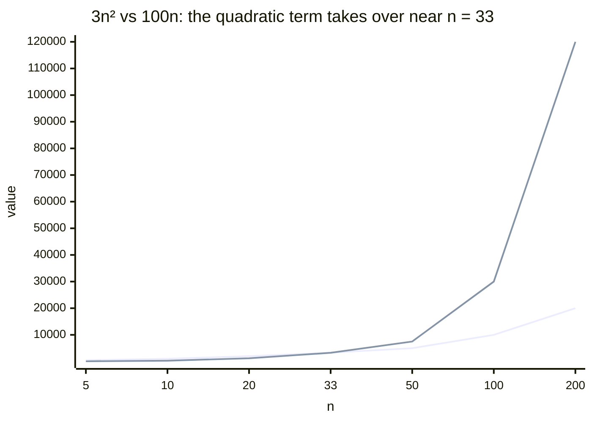

import LevelIntro from "../../../components/LevelIntro.astro";
import Checkpoint from "../../../components/Checkpoint.astro";
import PracticeCheck from "../../../components/PracticeCheck.astro";

export const unit = {
  track: "applied-math",
  unitSlug: "asymptotic-analysis",
};

L1 showed taxi fares flipping winners as the trip got longer, and named the
three bounds. L2 pins down what those bounds mean exactly, where the
crossover happens for `3n² + 100n`, and what a doubling ratio does and does
not prove.

<LevelIntro
  items={[
    "The precise O, Ω and Θ definitions",
    "Finding where the dominant term takes over",
    "What a doubling ratio does and does not prove",
  ]}
/>

## What does "grows no faster than" mean, exactly?

**"O(n²) means roughly n² operations" is the intuition. What is the
statement you could actually check?** `T(n)` is `O(f(n))` if there are
positive constants `c` and `n₀` such that:

$$T(n) \le c \cdot f(n) \quad (n \ge n_0)$$

Past the starting point `n₀`, `T(n)` never exceeds a constant multiple of
`f(n)`. The constant `c` absorbs hardware speed and per-step cost; `n₀` is
what lets the claim ignore small-`n` behavior. That is also why a benchmark
run only at small `n` can neither confirm nor refute a Big-O claim.

The lower bound flips the inequality, and the tight bound needs both:

| Notation  | Meaning                             | Condition                                |
| --------- | ----------------------------------- | ---------------------------------------- |
| `O(f(n))` | grows no faster than `f(n)`         | `T(n) ≤ c·f(n)` for all `n ≥ n₀`         |
| `Ω(f(n))` | grows at least as fast as `f(n)`    | `T(n) ≥ c·f(n)` for all `n ≥ n₀`         |
| `Θ(f(n))` | grows at exactly the rate of `f(n)` | both an `O(f(n))` and an `Ω(f(n))` bound |

Worked check for `T(n) = 3n² + 100n`:

- Upper: `3n² + 100n ≤ 4n²` exactly when `100n ≤ n²`, i.e. `n ≥ 100`. So
  `c = 4`, `n₀ = 100` proves `O(n²)`.
- Lower: `3n² + 100n ≥ 3n²` for every positive `n`. So `c = 3` proves `Ω(n²)`.
- Both hold, so `T(n)` is `Θ(n²)`. It is also true, but loose, that it is
  `O(n³)`.

<Checkpoint question="T(n) = 3n² + 100n is O(n²). Is it also correct to call it O(n³)? Is O(n³) the best description?">

Yes to the first and no to the second. `O` is only an upper bound, and
`n³` is above `3n² + 100n` for large `n`, so the statement is true. But it
is loose: the work never actually grows like `n³`. `Θ(n²)` is the precise
statement because it pins the growth from both sides, which `O(n³)` cannot do.

</Checkpoint>

<PracticeCheck
  track={unit.track}
  unitSlug={unit.unitSlug}
  topicId="formal-bounds"
/>

## When exactly does the dominant term take over?

**At what `n` does `3n²` overtake `100n`?** They are equal when
`3n² = 100n`. Dividing by the positive `n` gives `3n = 100`, so
`n = 100/3 ≈ 33.3`. The chart shows both terms, then the table puts numbers
on how far apart they are.

| n   | 100n   | 3n²    | Which term is bigger     |
| --- | ------ | ------ | ------------------------ |
| 5   | 500    | 75     | 100n, by about 6.7 times |
| 10  | 1,000  | 300    | 100n, by about 3.3 times |
| 33  | 3,300  | 3,267  | about equal              |
| 100 | 10,000 | 30,000 | 3n², by 3 times          |

At `n = 5` or `n = 10` a benchmark mostly measures the `100n` part, which is
linear. The `n₀` in the Big-O definition is this crossover region: below it,
lower-order terms dominate what you observe.

## What does a doubling ratio prove?

**Doubling `n` and seeing the work roughly double is real evidence. Evidence
of what, exactly?** Of the growth rate near the `n` you tested. For anything
that is not a pure power of `n`, the ratio `T(2n)/T(n)` itself changes with
`n`. For `3n² + 100n`:

| Measured between        | T(n)           | T(2n)           | T(2n)/T(n) | Looks like        |
| ----------------------- | -------------- | --------------- | ---------- | ----------------- |
| n = 5 and 10            | 575            | 1,300           | 2.26       | close to linear   |
| n = 50 and 100          | 12,500         | 40,000          | 3.20       | in between        |
| n = 100,000 and 200,000 | 30,010,000,000 | 120,020,000,000 | 4.00       | clearly quadratic |

The arithmetic for the first row: `T(5) = 3·25 + 500 = 575`,
`T(10) = 3·100 + 1000 = 1300`, and `1300 / 575 ≈ 2.26`. The ratio is honestly
close to 2 there; the mistake is assuming it stays near 2.

<Checkpoint question="A colleague doubles n from 50 to 100, sees the work grow about 3.2 times, and concludes: 'it's neither linear nor quadratic, so it must be some other class.' What is wrong?">

The in-between ratio is a sign that the measurement sits in the crossover
region, not that a third class exists. `3n² + 100n` is `Θ(n²)`; at
`n = 50` its ratio has simply not finished climbing toward 4. Reading an
in-between ratio as a new class repeats the mistake of reading a near-2 ratio
as "definitely linear": both treat one local measurement as the whole story.

</Checkpoint>

<PracticeCheck
  track={unit.track}
  unitSlug={unit.unitSlug}
  topicId="ratio-drift"
/>

## Does this make small benchmarks useless?

No. They describe performance at the sizes you really run, if production
stays small. The error is treating a small-`n` ratio as proof of the
asymptotic class. Validate a growth claim either by measuring at real scale or
by finding the dominant term algebraically, as above.
