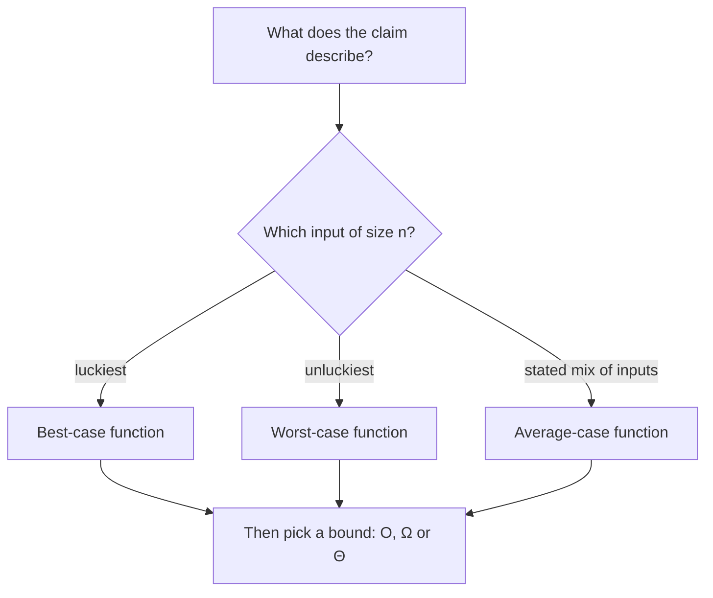

import Scenario from "../../../components/Scenario.astro";
import LevelIntro from "../../../components/LevelIntro.astro";
import Checkpoint from "../../../components/Checkpoint.astro";
import PracticeCheck from "../../../components/PracticeCheck.astro";
import Plot from "../../../components/Plot.astro";

export const unit = {
  track: "applied-math",
  unitSlug: "asymptotic-analysis",
};

<Scenario label="Looking for a name in a list of 1,000">
  <Fragment slot="facts">
    <div class="not-prose flex flex-col gap-2 text-sm text-slate-700 dark:text-slate-300">
      <div class="flex items-center gap-1.5"><span>📋</span> <strong>The list</strong> — 1,000 names, unsorted</div>
      <div class="flex items-center gap-1.5"><span>🍀</span> <strong>Best case</strong> — the name is first: 1 check</div>
      <div class="flex items-center gap-1.5"><span>💥</span> <strong>Worst case</strong> — last, or missing: 1,000 checks</div>
      <div class="flex items-center gap-1.5"><span>🎲</span> <strong>Average</strong> — present, equally likely anywhere: 500.5 checks</div>
    </div>
  </Fragment>

You look for one name in an unsorted list of 1,000 by checking names one at a
time from the top. Sometimes it is the very first name; sometimes it is last
or not there at all. **If someone asks "how long does this take?", which
number do you give them, and does the answer change which Big-O you write?**

</Scenario>

<LevelIntro
  items={[
    "Best, worst and average cases of one algorithm",
    "Reading the whole curve on a log-log plot",
    "Measuring a growth exponent from real counts",
  ]}
/>

## How is "which case" different from O versus Ω?

**Is "worst case" the same thing as "Big-O"?** No, and mixing them up is a
common slip. The two choices are independent:

- The **case** (best, worst, average) chooses _which function_ you are
  describing: the work on the luckiest input of size `n`, the unluckiest, or
  the expected over a stated mix of inputs.
- The **bound** (O, Ω, Θ) chooses _how you describe_ that function's growth.

Each case is its own function of `n`, and each can be given its own `O`, `Ω`
or `Θ`. For the linear search in the scenario (counting name comparisons):

| Case                                | Checks for n items | n = 1,000 | Growth |
| ----------------------------------- | ------------------ | --------- | ------ |
| Best (name is first)                | 1                  | 1         | Θ(1)   |
| Worst (last, or missing)            | n                  | 1,000     | Θ(n)   |
| Average (present, uniform position) | (n + 1) / 2        | 500.5     | Θ(n)   |

The average comes from adding `1 + 2 + ... + n = n(n+1)/2` and dividing by the
`n` equally likely positions, giving `(n+1)/2`. The average is only meaningful
once you state the input mix: "present and equally likely anywhere" is an
assumption, not a fact about every real list.



A second case with a bigger gap: insertion sort counts comparisons while
moving each item left into place. On 10 items already in order it makes 9
comparisons; on 10 items in reverse order it makes 45, which is
`n(n−1)/2` for `n = 10`. The same algorithm is `Θ(n)` on one input shape and
`Θ(n²)` on another, so "its complexity" without a case is an incomplete
sentence.

<Checkpoint question="Someone says 'linear search is O(1)' because the name was first in their test. What exactly is wrong with that sentence?">

They described the best-case function and ignored that the worst case grows
with `n`. Linear search is `Θ(1)` only in its best case; in its worst and
average cases it is `Θ(n)`. A single lucky test says nothing about the other
cases, the same way a single small-`n` measurement says nothing about the
asymptotic class.

</Checkpoint>

<PracticeCheck
  track={unit.track}
  unitSlug={unit.unitSlug}
  topicId="case-analysis"
/>

## What does the whole curve look like?

**Why did the doubling ratio drift from 2.26 to 4.00?** Because on a log-log
plot, a pure power `n^k` is a straight line with slope `k`. `3n² + 100n` is
not a pure power, so its line has slope near 1 while `100n` dominates and
bends toward slope 2 as `3n²` takes over. The values below are exact.

<Plot
  mark="line"
  x="n"
  y="work"
  series="curve"
  xScale="log"
  yScale="log"
  xLabel="Input size (n)"
  yLabel="Work, T(n)"
  caption="Exact values: T(n) = 3n² + 100n bends from the 100n line toward the 3n² line as n grows."
  data={[
    { n: 1, work: 103, curve: "3n² + 100n" },
    { n: 10, work: 1300, curve: "3n² + 100n" },
    { n: 100, work: 40000, curve: "3n² + 100n" },
    { n: 1000, work: 3100000, curve: "3n² + 100n" },
    { n: 10000, work: 301000000, curve: "3n² + 100n" },
    { n: 100000, work: 30010000000, curve: "3n² + 100n" },
    { n: 1, work: 100, curve: "100n alone" },
    { n: 10, work: 1000, curve: "100n alone" },
    { n: 100, work: 10000, curve: "100n alone" },
    { n: 1000, work: 100000, curve: "100n alone" },
    { n: 10000, work: 1000000, curve: "100n alone" },
    { n: 100000, work: 10000000, curve: "100n alone" },
    { n: 1, work: 3, curve: "3n² alone" },
    { n: 10, work: 300, curve: "3n² alone" },
    { n: 100, work: 30000, curve: "3n² alone" },
    { n: 1000, work: 3000000, curve: "3n² alone" },
    { n: 10000, work: 300000000, curve: "3n² alone" },
    { n: 100000, work: 30000000000, curve: "3n² alone" },
  ]}
/>

The slope at each point is the _local growth exponent_, `log₂` of the doubling
ratio. Computed exactly from `T(2n)/T(n)`:

| Measured at n | Doubling ratio | Local exponent |
| ------------- | -------------- | -------------- |
| 5             | 2.26           | 1.18           |
| 50            | 3.20           | 1.68           |
| 500           | 3.88           | 1.95           |
| 5,000         | 3.99           | 2.00           |
| 100,000       | 4.00           | 2.00           |

Asymptotic analysis is the claim about where this exponent settles. Any single
row is a claim about one place on the curve.

<Checkpoint question="On the log-log plot, 100n alone is a straight line with slope 1 and 3n² alone is straight with slope 2. Why does the combined curve not simply follow whichever line is higher?">

It does follow the higher line at the extremes: near `n = 1` it hugs `100n`
and at large `n` it hugs `3n²`. In between, the sum is larger than either part,
and the curve changes slope gradually over the crossover region around
`n ≈ 33`. A log-log plot makes that bend visible; a plain wall-clock number at
one `n` cannot.

</Checkpoint>

## Measuring a growth exponent from real counts

**If you cannot do the algebra, how do you estimate the exponent honestly?**
Count operations rather than wall-clock time (timing adds noise), then compute
the local exponent from a doubling. This is one case where reading the code is
the point, since the exponent estimate is the computation:

```js
function growthExponent(countOps, n) {
  return Math.log2(countOps(2 * n) / countOps(n));
}
```

For a pure `n²` counter it returns exactly 2 at every `n`. For
`3n² + 100n` it returns 1.18 at `n = 5` and 2.00 at `n = 100,000`, matching
the table above. For a pure `n log n` count it returns about 1.14 at `n = 1,000`, drifting
upward slowly, never a clean integer.

<PracticeCheck
  track={unit.track}
  unitSlug={unit.unitSlug}
  topicId="measure-growth"
/>

## Extend it: this is a case, not the whole territory

Everything above used one cost formula and one search. Try changing the
facts before trusting the conclusions:

- What if the lower-order term were _subtracted_, as in `3n² − 100n`? Compute
  the doubling ratio near `n = 40` and compare with the `+100n` version: does
  a small-`n` measurement mislead in the same direction? (This is an artificial
  formula, since it is negative below `n ≈ 33` and real work cannot be.)
- What if the list were sorted and you used a different search? Which case
  functions change, and which stay the same?
- What if the name were present 90% of the time instead of always? How would
  the average-case number change, and which assumption would you have to state?

## Failure modes

| Failure mode                                        | What it gets wrong                                                    |
| --------------------------------------------------- | --------------------------------------------------------------------- |
| Treating a small-`n` doubling ratio as proof        | The ratio changes with `n` for anything but a pure power              |
| Quoting a complexity without naming the case        | Best, worst and average are different functions with different growth |
| Equating "worst case" with "Big-O"                  | Case picks the function; O, Ω, Θ picks how its growth is described    |
| Timing instead of counting to estimate growth       | Noise can swamp the signal at small `n`                               |
| Calling something `O(n²)` when `Θ(n²)` is the truth | `O` alone claims only an upper bound                                  |
| Stating an average without stating the input mix    | Average is only defined relative to an assumed distribution           |
