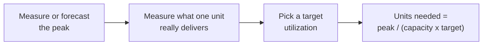

import Scenario from "../../../components/Scenario.astro";
import LevelIntro from "../../../components/LevelIntro.astro";
import PracticeCheck from "../../../components/PracticeCheck.astro";

export const unit = {
  track: "applied-math",
  unitSlug: "capacity-planning-math",
};

<Scenario label="A kitchen that handled every ordinary night, then drowned on a Saturday.">
  <Fragment slot="facts">
    

      
🍳 <strong>Capacity</strong> — 3 cooks × 20 plates per hour = 60 plates per hour

      

        
Ordinary night: 40 plates/hr67% of capacity

        

      

      

        
Capacity: 60 plates/hr100%

        

      

      

        
Saturday peak: 110 plates/hr183% of capacity

        

      

      
Bars are scaled to the 110 plates/hr peak.

    

  </Fragment>

A small restaurant has three cooks. Each cook finishes one plate every
3 minutes, which is 20 plates an hour, so the kitchen can plate 60 an hour.
On an ordinary night about 40 plates an hour are ordered, and nobody
complains. Then a Saturday brings 110 plates an hour. Tickets pile up, the
wait grows every minute, and by the end of the night the first tables are
still waiting while new ones sit down. **Nobody cooked more slowly than
usual. Which number should the owner have been counting before Saturday, and
what else was missing from the plan?**

</Scenario>

<LevelIntro
  items={[
    "Planning for the peak, not the average",
    "Headroom: why 100% busy is not usable",
    "A latency budget split across the steps",
  ]}
/>

## Which number is the kitchen actually planning for?

**The owner knew "about 40 plates an hour." Was that the number to build around?**
Three different numbers get called "the load", and only one of them is the
right input to a throughput budget:

| Number              | Kitchen value | What it tells you                                  |
| ------------------- | ------------- | -------------------------------------------------- |
| Average load        | 40 plates/hr  | What an ordinary night costs to run                |
| Peak load           | 110 plates/hr | What the kitchen must survive without falling over |
| Capacity (measured) | 60 plates/hr  | What the three cooks really deliver, per hour      |

A **throughput budget** is the rate a system must sustain, and it comes from
the **peak**. Here peak is $$110 / 60 \approx 1.83$$ times capacity, so the
kitchen is short by a whole extra cook and a half before anything else goes
wrong. The ratio of peak to average ($$110 / 40 = 2.75$$) is the
**peak-to-average ratio**: the number that turns "what I see on a normal day"
into "what I must plan for".

<PracticeCheck
  track={unit.track}
  unitSlug={unit.unitSlug}
  topicId="peak-vs-average"
/>

## If the peak fits, can the cooks run at 100% busy?

**Suppose the owner hires enough cooks that peak equals exactly 100% of
capacity. Is that safe?** No. Orders arrive in clumps, not evenly, and a
fully busy cook has no spare time to drain a clump. Under a simple one-cook
queue model, a plate that takes 3 minutes of actual cooking spends
$$3 / (1 - \rho)$$ minutes from ticket to plate, where $$\rho$$ is how busy
the cook is (see `applied-math/queueing-theory-basics`):

| Cook is busy | Minutes from ticket to plate |
| ------------ | ---------------------------- |
| 50%          | 6                            |
| 70%          | 10                           |
| 90%          | 30                           |
| 95%          | 60                           |

The cook's own work never changes. Only the waiting does, and it explodes
near the top. **Headroom** is the gap you keep below 100%; a **target
utilization** (often somewhere around 70% for a latency-sensitive system) is
the busy level you plan to stay under at peak.

<PracticeCheck
  track={unit.track}
  unitSlug={unit.unitSlug}
  topicId="headroom-queueing"
/>

## How long may the whole trip take, and who gets how much?

**The restaurant promises food in 25 minutes. Who owns which minutes?**
A **latency budget** divides a total time limit across every step a request
passes through, so each owner knows their share. The twist is that some steps
run at the same time:

| Step                                   | Minutes                 |
| -------------------------------------- | ----------------------- |
| Take the order                         | 4                       |
| Cook: grill (12) and sides (8) at once | 12 (the slower one)     |
| Plate                                  | 2                       |
| Carry to the table                     | 2                       |
| **Total**                              | **4 + 12 + 2 + 2 = 20** |

Steps in a chain add up. Steps that run side by side cost only the slowest
one. Against a 25-minute promise this plan has 5 minutes of margin, which is
exactly the kind of number that disappears when the kitchen is overloaded.

<PracticeCheck
  track={unit.track}
  unitSlug={unit.unitSlug}
  topicId="latency-budget-hops"
/>

## Key terms

- **Throughput budget** — the rate (plates, requests, messages per second)
  a system must sustain, set from the peak, not the average.
- **Peak-to-average ratio** — peak divided by average; it is measured, and
  it changes as a business grows.
- **Headroom / target utilization** — the spare capacity you keep on purpose,
  and the busy fraction you plan to run at during the peak.
- **Latency budget** — a total time limit split across the steps of a request;
  chained steps add, parallel steps cost the slowest.
- **Back-of-envelope estimate** — a quick calculation from measured unit costs,
  done before building, never a substitute for a real load test later.

## What the next levels do

L2 turns this into formulas for a real service: StreamCast, a live-chat
backend with 650 messages/sec on average. It sizes a fleet from a peak and a
target utilization, shows exactly how latency bends as utilization rises, and
adds Little's Law as a cross-check. L3 combines both budgets into one plan and
shows why the latency budget, not the throughput budget, can end up deciding
how many servers you buy.
