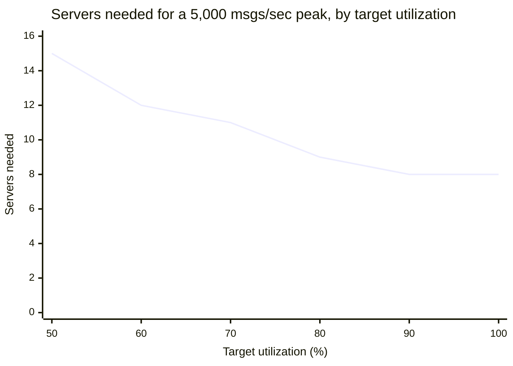
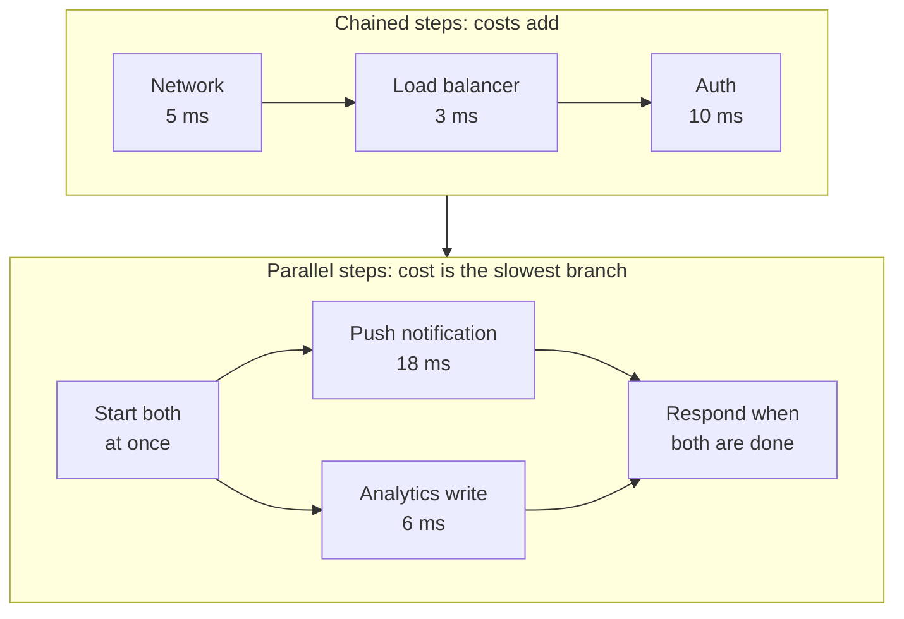

import LevelIntro from "../../../components/LevelIntro.astro";
import Checkpoint from "../../../components/Checkpoint.astro";
import PracticeCheck from "../../../components/PracticeCheck.astro";
import Plot from "../../../components/Plot.astro";

export const unit = {
  track: "applied-math",
  unitSlug: "capacity-planning-math",
};

L1 used a kitchen: plan for the peak, keep headroom, split a time promise
across steps. This level uses the same three ideas on a real service,
StreamCast's live-chat backend. The figures below are teaching numbers, not
measurements of any real product: 650 messages/sec average, a measured
peak-to-average ratio of 7.6 from one big event, and a load test showing one
server really sustains 700 messages/sec.

<LevelIntro
  items={[
    "From average traffic to a server count",
    "The delay curve and the latency bound on utilization",
    "Chained versus parallel steps, and Little's Law",
  ]}
/>

## How do you get from today's traffic to a number to size for?

**Today the dashboard says 650 messages/sec. Is that the number the fleet must
handle?** No. The number to size for is the forecast peak:

`peak = average × peak-to-average ratio`

For StreamCast: $$650 \times 7.6 = 4940$$ messages/sec, which the team
rounds up to 5,000 to plan with. Rounding up is deliberate: a measured ratio
from one event is a floor on what the next event may bring, not a ceiling.

<Checkpoint question="A team multiplies today's average by 7.6 and then plans for exactly that number, with every server allowed to run at 100% of its tested capacity. Which two assumptions in that plan are doing the most risky work?">

The first is that the ratio will not grow: 7.6 was measured from one event,
so a bigger event next quarter, or simply a larger audience, breaks it. The
second is that 100% busy is a usable operating point. At 100% there is no
spare time to drain a clump of arrivals, so latency climbs without bound
even though the peak "fits" on paper. Both assumptions turn a plan that
looks exact into one with no margin for the normal ways that forecasts miss.

</Checkpoint>

<PracticeCheck
  track={unit.track}
  unitSlug={unit.unitSlug}
  topicId="peak-vs-average"
/>

## Why does latency bend long before the limit?

**If one server really handles 700 messages/sec, why not run it at 700?**
Because requests wait behind each other, and the wait is what grows. For a
single queue with random arrivals, time in the system is the unloaded time
divided by the idle fraction left:

$$W = T_0 / (1 - \rho)$$

Here $$T_0$$ is the time at rest and $$\rho$$ is utilization. The multiplier
$$1 / (1 - \rho)$$ is mild until the high 70s and then takes off:

<Plot
  mark="line"
  x="utilization"
  y="multiplier"
  xLabel="Utilization (%)"
  yLabel="Latency as a multiple of the at-rest time"
  caption="Exact values of 1 / (1 - utilization). At 70% the multiplier is 3.33; at 92% it is 12.5; at 95% it is 20."
  data={[
    { utilization: 10, multiplier: 1.11 },
    { utilization: 20, multiplier: 1.25 },
    { utilization: 30, multiplier: 1.43 },
    { utilization: 40, multiplier: 1.67 },
    { utilization: 50, multiplier: 2 },
    { utilization: 60, multiplier: 2.5 },
    { utilization: 70, multiplier: 3.33 },
    { utilization: 80, multiplier: 5 },
    { utilization: 85, multiplier: 6.67 },
    { utilization: 90, multiplier: 10 },
    { utilization: 92, multiplier: 12.5 },
    { utilization: 95, multiplier: 20 },
  ]}
/>

This is a simplified single-queue model. It is right about the shape and
about where the trouble starts, but it overstates the cost of steps that do
not queue on your own machines (a network round trip, for instance). Use it
for planning conversations, then confirm with a load test.

The same curve gives a bound that a throughput number alone cannot. If the
at-rest time is $$T_0$$ and the whole request must finish within a budget
$$B$$, then you need $$T_0 / (1 - \rho) \le B$$, which rearranges to

$$\rho \le 1 - T_0 / B$$

So a request that already uses 80% of its budget at rest ($$T_0 = 40$$ ms,
$$B = 50$$ ms) may run its servers at no more than 20% busy. A request that
uses 40% of its budget at rest ($$T_0 = 20$$ ms) may run them at 60%.

## From a utilization target to a fleet size

**Given a peak and a busy ceiling, how many servers is that?** Each server
contributes its tested capacity times the ceiling, and you round up:

`servers = ceil(peak / (capacity × target))`

For a 5,000 messages/sec peak and 700 per server, exact results:

Going from 50% to 80% saves six servers. Going from 80% to 100% saves one
more, and removes every bit of headroom. That last step buys almost nothing
and costs everything the delay curve above warned about.

<Checkpoint question="At a 5,000 msgs/sec peak, the plan uses 11 servers at a 70% target (each safely handles 490). A launch overshoots the forecast by 10%. What happens, and what would 8 servers at a 100% target have done?">

The 10% overshoot is 5,500 messages/sec. Eleven servers have a raw capacity of
7,700, so they run at about 71% busy: a bit more waiting, still healthy. Eight
servers have a raw capacity of 5,600, so the same overshoot puts them at
about 98% busy, where the multiplier is above 50 and clients begin retrying
requests that look stuck. Those retries add load on top of load. The saving
from three fewer servers is real, but it is paid back the first time the
forecast misses by a normal amount.

</Checkpoint>

<PracticeCheck
  track={unit.track}
  unitSlug={unit.unitSlug}
  topicId="headroom-queueing"
/>

## When steps run side by side, what does the total become?

**A request has a 50 ms budget and five steps, each far below 50 ms. Is it
inside the budget?** It depends on the shape of the steps:

A chain costs the sum of its steps. A fan-out costs its slowest branch. For
the request here: network 5, load balancer 3, auth 10, then push (18) and
analytics (6) together, then 4 for serialization:

$$5 + 3 + 10 + \max(18, 6) + 4 = 40$$ ms

Adding every step as if it were chained gives 46 ms and hides the real
margin: 10 ms, not 4. The mistake in the other direction is worse. Treating a
genuinely chained dependency as parallel makes the plan look faster than the
system can ever be.

<Checkpoint question="If the analytics write grows from 6 ms to 25 ms, how much does the 40 ms total change, and which step now decides the budget?">

The total becomes $$5 + 3 + 10 + \max(18, 25) + 4 = 47$$ ms, a change of 7
ms, not 19 ms. The analytics write has become the slowest branch, so it now
decides the fan-out's cost and the push notification, which used to decide
it, is off the critical path. The step that sets the total can change as
costs change, which is why budgets get re-checked instead of assigned once.

</Checkpoint>

<PracticeCheck
  track={unit.track}
  unitSlug={unit.unitSlug}
  topicId="latency-budget-hops"
/>

## What does Little's Law add?

**Latency and throughput are linked. Is there a quick cross-check?** Little's
Law says the average number of requests in the system equals the arrival rate
times the average time each spends there:

$$L = \lambda W$$

It needs no model of the queue at all, only a rate and a time. Using the
numbers from this unit:

| Situation                            | Rate      | Time in system | Requests in flight |
| ------------------------------------ | --------- | -------------- | ------------------ |
| At rest, 40 ms per request           | 5,000/sec | 0.04 s         | 200                |
| Overloaded fleet, 500 ms per request | 3,860/sec | 0.5 s          | 1,930              |

When latency rises, the same traffic holds far more work in flight at once:
memory, connections and threads all have to carry the extra, which is one more
reason a slow fleet tends to get slower. The law also works as a sizing check
on connection pools and thread counts, not only on servers.

## Failure modes at this level

- **Sizing from the average, or from an untested guess at per-server capacity.**
  Both understate the number the system must survive.
- **Targeting close to 100% utilization to save a server or two.** The saving is
  small and the headroom lost is total.
- **Checking throughput and latency separately.** A fleet sized for throughput
  can still miss its time budget because latency depends on how busy it runs.
- **Adding branches of a fan-out as if they were chained** (overcounting) or
  chained steps as if they were parallel (undercounting).
- **Freezing a measured peak-to-average ratio.** It describes the past; revisit
  it as the audience grows.
