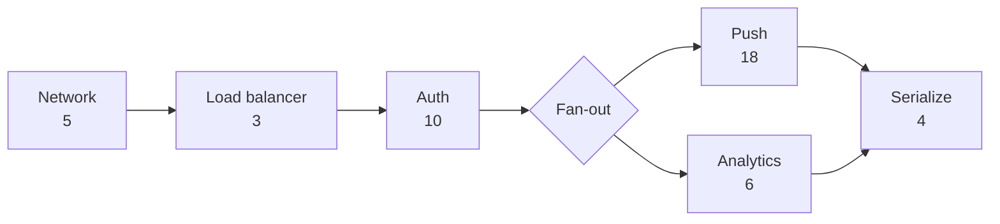

import Scenario from "../../../components/Scenario.astro";
import LevelIntro from "../../../components/LevelIntro.astro";
import Checkpoint from "../../../components/Checkpoint.astro";
import PracticeCheck from "../../../components/PracticeCheck.astro";
import Plot from "../../../components/Plot.astro";

export const unit = {
  track: "applied-math",
  unitSlug: "capacity-planning-math",
};

<Scenario label="The postmortem numbers: six servers, a big event, and a chat that took half a second per message.">
  <Fragment slot="facts">
    <div class="not-prose flex flex-col gap-2 text-sm text-slate-700 dark:text-slate-300">
      <div class="flex items-center gap-1.5"><span>📈</span> <strong>Average</strong> — 650 msgs/sec, peak-to-average ratio 7.6 (so a 5,000 msgs/sec plan)</div>
      <div class="flex items-center gap-1.5"><span>🧪</span> <strong>Load-tested capacity</strong> — 700 msgs/sec per server</div>
      <div class="flex items-center gap-1.5"><span>🖥️</span> <strong>Old fleet</strong> — 6 servers = 4,200 msgs/sec raw</div>
      <div class="flex items-center gap-1.5"><span>🔥</span> <strong>During the event</strong> — about 3,860 msgs/sec, so about 92% busy</div>
      <div class="flex items-center gap-1.5"><span>⏱️</span> <strong>Promise</strong> — 50 ms end to end; 40 ms at rest, about 500 ms that night</div>
    </div>
  </Fragment>

The team now has honest numbers for the first time: average 650 messages/sec,
a measured peak-to-average ratio of 7.6, a load-tested 700 messages/sec per
server and a latency promise of 50 ms that was never written down before.
(These are teaching figures, not data from any real product.) The old fleet
of six servers ran about 92% busy on the night, and a message that takes 40 ms
at rest took about 500 ms. **Working forward from those numbers, what should
the plan have said, and which of the two budgets would have decided the size
of the fleet?**

</Scenario>

<LevelIntro
  items={[
    "Sizing the fleet from the throughput budget",
    "The request plan as a nested chain and fan-out",
    "Why the latency budget can decide the fleet",
  ]}
/>

## What does the throughput budget alone say?

**Given a 5,000 messages/sec plan, 700 per server and a 70% ceiling, what is
the fleet?** Each server safely carries $$700 \times 0.7 = 490$$, so the
count is $$5000 / 490 \approx 10.2$$, rounded up to 11. The three views of
that fleet are worth keeping apart:

| View                            | Value                 |
| ------------------------------- | --------------------- |
| Raw capacity (11 × 700)         | 7,700 msgs/sec        |
| Safe capacity (11 × 490)        | 5,390 msgs/sec        |
| Unusable gap between the two    | 2,310 msgs/sec        |
| Utilization when the peak lands | 5,000 / 7,700 ≈ 64.9% |

The throughput budget is satisfied with room to spare. If the story ended
here, 11 servers would be the answer.

## How does the request plan become a number?

**Is the 40 ms at rest just the sum of the steps?** No: one fan-out sits in
the middle of the chain. The plan is a chain whose fourth element is itself
two parallel branches:



Evaluating it is naturally recursive: a number is its own cost, a chain is
the sum of its parts, a fan-out is the maximum of its parts. That is the one
place in this unit where reading code teaches more than a table, because the
nesting is the point:

```js
function estimateLatency(step) {
  if (typeof step === "number") return step;
  if (step.sequential)
    return step.sequential.reduce((t, s) => t + estimateLatency(s), 0);
  return Math.max(...step.parallel.map(estimateLatency));
}
```

Called on the plan below, it returns 40:

```js
estimateLatency({ sequential: [5, 3, 10, { parallel: [18, 6] }, 4] }); // 40
```

<PracticeCheck
  track={unit.track}
  unitSlug={unit.unitSlug}
  topicId="plan-in-code"
/>

<Checkpoint question="An engineer flattens the plan and adds every number: 5 + 3 + 10 + 18 + 6 + 4 = 46. Is that a safe, slightly pessimistic estimate?">

It is pessimistic about the wrong thing. The true at-rest total is 40 ms with
10 ms of margin; the flattened 46 ms suggests only 4 ms, which would send the
team hunting for speedups that the structure of the plan already provides.
Meanwhile it says nothing about what each step costs under load, which is the
risk that actually sank the night. A wrong structure produces a wrong number
in a predictable direction, and a number that is wrong in a predictable
direction is still wrong.

</Checkpoint>

## Why did 40 ms become 500 ms?

**The plan said 40 ms and the promise was 50. What changed on the night?**
The fleet was about 92% busy, and the delay curve from L2 applies:
$$W = T_0 / (1 - \rho)$$ gives $$40 / 0.08 = 500$$ ms. The same formula at
the 70% ceiling gives about 133 ms, and at the 64.9% that 11 servers
actually run at the peak it gives about 114 ms. Little's Law shows the
consequence in memory and connections: at 3,860 messages/sec, 40 ms holds
about 154 requests in flight and 500 ms holds 1,930, a 12.5-fold jump
that tightens the squeeze on a fleet already short of room.

Notice what the numbers say about the "right" fleet: 11 servers at 64.9% still
give about 114 ms, far over the 50 ms promise. The throughput budget was
satisfied and the latency budget was not.

<Checkpoint question="Adding servers lowers utilization. Why can't StreamCast simply keep adding servers until 114 ms drops under 50?">

It can, but the arithmetic says it takes a lot: to hold $$40 / (1 - \rho) \le 50$$
the fleet must run at 20% busy or less, which at a 5,000 messages/sec peak is
36 servers instead of 11. The queueing model also assumes every step feels the
load, which overstates a pure network hop. The better question is why the plan
spends 80% of its budget at rest. Cutting the at-rest time is a lever on the
same inequality, usually far cheaper than buying machines to stay nearly idle.

</Checkpoint>

<PracticeCheck
  track={unit.track}
  unitSlug={unit.unitSlug}
  topicId="headroom-queueing"
/>

## Which budget decides the fleet size?

**Rearranging the inequality gives the busy ceiling the latency promise allows.
How does that ceiling move with the at-rest time?** The ceiling is
$$\rho \le 1 - T_0 / B$$, and for a 50 ms budget its exact values are:

<Plot
  mark="line"
  x="nominal"
  y="maxUtil"
  xLabel="At-rest request time (ms)"
  yLabel="Highest allowed utilization (%)"
  caption="Exact values of 100 × (1 − T0 / 50). The less of the budget you spend at rest, the busier the servers may run."
  data={[
    { nominal: 10, maxUtil: 80 },
    { nominal: 15, maxUtil: 70 },
    { nominal: 20, maxUtil: 60 },
    { nominal: 25, maxUtil: 50 },
    { nominal: 30, maxUtil: 40 },
    { nominal: 35, maxUtil: 30 },
    { nominal: 40, maxUtil: 20 },
    { nominal: 45, maxUtil: 10 },
  ]}
/>

Putting the ceiling into the fleet formula for a 5,000 messages/sec peak and
700 per server (the 20 ms row assumes some change, such as moving the push
notification off the critical path, brings the at-rest total down to 20 ms; that
is an assumption for the example, not a measured result):

| Plan                        | Busy ceiling | Servers | Busy at peak | Latency at peak |
| --------------------------- | ------------ | ------- | ------------ | --------------- |
| Throughput only, 40 ms rest | 70%          | 11      | 64.9%        | about 114 ms    |
| Latency-driven, 40 ms rest  | 20%          | 36      | 19.8%        | about 49.9 ms   |
| Latency-driven, 20 ms rest  | 60%          | 12      | 59.5%        | about 49.4 ms   |

The first row meets the throughput budget and misses the promise. The second
meets both and costs more than three times the machines. The third meets
both with one more server than the first row, because the at-rest time was
attacked first. The throughput budget gave a lower bound on the fleet; the
latency budget raised it, and the biggest lever was not a server count.

<Checkpoint question="In the third row, 12 servers run at 59.5% and land at 49.4 ms against a 50 ms promise. Would you sign off on that plan?">

Not as a final answer. The margin is 0.6 ms, the at-rest 20 ms is an assumption
nobody has measured, the model is a simplification, and the 7.6 ratio came from
one event. The row shows which direction to push, not a number to ship. A
sensible next step is to measure the real at-rest time after the change, load
test at the planned peak, and keep a margin on the latency target itself,
which will probably mean a few more servers or a lower ceiling than the
arithmetic alone suggests.

</Checkpoint>

## What does this one worked example not cover?

This is a case, not the whole territory. Try changing one thing at a time and
predict which budget moves:

- **What if the service were a read-heavy API with a cache in front of the
  database?** A cache hit makes the at-rest time of that step tiny, but a miss
  does not. How would you combine hit and miss costs into one plan, and
  which one should the budget be checked against?
- **What if the news were worse and the ratio turned out to be 15 instead of
  7.6?** The sizing arithmetic simply returns a bigger number. At what size
  does a flat fleet of identical servers stop being the right shape, and
  what would you change instead of adding more?
- **What if only one step queues, such as a database, while the others do
  not?** Which steps should the delay curve be applied to?

## Failure modes at this level

- **Trusting an at-rest latency figure for a system that will run busy.**
  The 40 to 500 ms gap is the whole reason the check belongs at the planned
  utilization.
- **Adding servers without lowering the busy level they run at.** More servers
  at the same busy level change nothing about latency.
- **Applying the delay curve to every step, including ones that do not share
  the contended resource.** Treat it as an approximation for steps that do.
- **Treating one measured ratio as permanent.** Revisit it as the audience
  grows and after every event that surprised you.
- **Spending the whole latency budget at rest.** The less budget the steps use
  when idle, the busier the fleet may run, and the fewer machines you buy.
