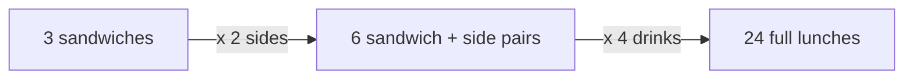

import Scenario from "../../../components/Scenario.astro";
import LevelIntro from "../../../components/LevelIntro.astro";
import PracticeCheck from "../../../components/PracticeCheck.astro";

export const unit = {
  track: "applied-math",
  unitSlug: "combinatorics",
};

<Scenario label="A lunch menu with 3 sandwiches, 2 sides and 4 drinks. How many different lunches can you order?">
  <Fragment slot="facts">
    

      
🥪 <strong>3 sandwiches</strong> — pick exactly one

      
🍟 <strong>2 sides</strong> — pick exactly one

      
🥤 <strong>4 drinks</strong> — pick exactly one

      
❓ <strong>Question</strong> — how many distinct lunches, without writing them all out?

    

    

      

        
Choices added up (3 + 2 + 4)9

        

      

      

        
Distinct lunches (3 × 2 × 4)24

        

      

    

  </Fragment>

You are staring at a lunch menu. Three sandwiches, two sides, four drinks,
and you pick one of each. A friend says "there are 9 options", adding
`3 + 2 + 4`. Another says "I would have to write them out to know." **Who is
right, and is there a way to get the exact count without listing a single
lunch?**

Take one sandwich. It can be paired with either side, and each of those
pairs can take any of the four drinks. So one sandwich alone already gives
`2 × 4 = 8` lunches. The count is not a sum of menu sizes. It is a product.

</Scenario>

<LevelIntro
  items={[
    "The product rule: choices that happen together multiply",
    "The sum rule: alternatives that exclude each other add",
    "Why this explodes when a system has many on/off switches",
  ]}
/>

## Why do choices multiply when you make them together?

**If each choice is made independently, why is the total not just a longer
menu?** Because every option in one choice appears alongside every option in
the next. Adding one more choice does not add a few lunches; it multiplies
every lunch you already had.

This is the **product rule**: if one thing can happen in `a` ways and a second
independent thing in `b` ways, doing both can happen in `a × b` ways.

<PracticeCheck
  track={unit.track}
  unitSlug={unit.unitSlug}
  topicId="product-and-sum"
/>

## And when the options are alternatives, not steps?

Suppose the cafe instead says "one main: any of 3 sandwiches **or** any of 2
soups". You eat one main, never both, so there are `3 + 2 = 5` mains. That is
the **sum rule**. The way to tell them apart is one question: am I doing
_both_ things, or choosing _between_ them?

| Wording in the problem            | Rule    | Operation | Lunch example                               |
| --------------------------------- | ------- | --------- | ------------------------------------------- |
| "and", "then", "each paired with" | Product | multiply  | sandwich and side and drink: 3 × 2 × 4 = 24 |
| "or", "either" (one path only)    | Sum     | add       | sandwich or soup: 3 + 2 = 5                 |

## Where does this matter in software?

A checkout feature has four independent on/off feature flags. Each flag is a
choice with 2 options (on or off), and all four are "made" at once, so the
product rule applies: `2 × 2 × 2 × 2 = 16` distinct system states. A team
that hand-picks 8 "important" test cases has covered half of them at best,
and, as L3 shows, it is the specific combinations missing from the list that
hide the bugs.

## Key terms

- **Product rule** — independent choices made together multiply their option
  counts.
- **Sum rule** — mutually exclusive alternatives add their option counts.
- **Factorial** (`n!`) — `n × (n-1) × ... × 1`, the number of ways to order `n`
  distinct items.
- **Permutation** — a selection where order matters.
- **Combination** — a selection where order does not matter.
- **Combinatorial explosion** — the count of possibilities growing so fast
  with each added choice that listing them stops being possible.

## What the next levels cover

L2 separates permutations from combinations, explains why `n` binary switches
make `2^n` states, and counts the pairs of switches that must be checked
together. L3 walks one concrete test suite and finds exactly which pairs of
flags it never exercised.
