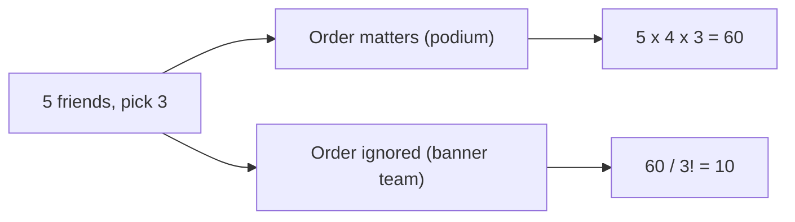

import LevelIntro from "../../../components/LevelIntro.astro";
import Checkpoint from "../../../components/Checkpoint.astro";
import Plot from "../../../components/Plot.astro";
import PracticeCheck from "../../../components/PracticeCheck.astro";

export const unit = {
  track: "applied-math",
  unitSlug: "combinatorics",
};

L1 gave the product rule and the sum rule. This level handles the two
questions that rule alone does not: when does the order of a selection change
the count, and how fast does the count of on/off states grow?

<LevelIntro
  items={[
    "Permutations versus combinations",
    "Why n on/off switches give 2^n states",
    "Counting pairs of switches with n choose 2",
  ]}
/>

## Does it matter who is picked first?

**Five friends enter a race, and you must name 1st, 2nd and 3rd place. Separately,
you must pick 3 of the 5 to carry a banner. Is it the same count?** No, and the
reason is whether swapping two people produces a different outcome.

- Podium: Ana-Ben-Cy and Ben-Ana-Cy are different results. Order matters.
- Banner team: `Ana, Ben, Cy` as a set is the same team in any order. Order does not matter.

The podium is built with the product rule: 5 choices for 1st, then 4 for 2nd,
then 3 for 3rd, so `5 × 4 × 3 = 60`. That count is a **permutation**, written
`nPr = n! / (n - r)!`.

For the banner team, those 60 ordered lists contain every team several times.
One team of 3 can be written in `3! = 6` orders, so divide: `60 / 6 = 10`.
That count is a **combination**, `nCr = n! / (r! × (n - r)!)`.

|                   | Permutation (`nPr`) | Combination (`nCr`)    |
| ----------------- | ------------------- | ---------------------- |
| Does order matter | Yes                 | No                     |
| Formula           | `n! / (n - r)!`     | `n! / (r! × (n - r)!)` |
| 5 friends, pick 3 | 60                  | 10                     |
| Relationship      | `nPr = nCr × r!`    | `nCr = nPr / r!`       |

<Checkpoint question="A team of 3 from 5 friends has 10 possibilities. Why is dividing the 60 ordered lists by 6 correct, and not by 3 or by 10?">

Each team appears once for every way its three members can be ordered, and
three distinct people can be ordered in `3 × 2 × 1 = 6` ways. So the 60 ordered
lists contain each of the 10 teams exactly 6 times, and dividing by 6 keeps one
copy of each. Dividing by 3 would leave some teams counted twice.

</Checkpoint>

<PracticeCheck
  track={unit.track}
  unitSlug={unit.unitSlug}
  topicId="order-matters"
/>

## How fast does a set of on/off switches grow?

**A product has 4 independent feature flags. Is that 4 situations to test, 8, or
something else?** Each flag has 2 settings, and all four are set at once, so the
product rule gives `2 × 2 × 2 × 2 = 16`. That is `2^4`. Every added flag doubles
the count, because each existing state can now occur with the new flag off and
with it on.

| Flags | States (`2^n`) |
| ----- | -------------- |
| 4     | 16             |
| 5     | 32             |
| 8     | 256            |
| 10    | 1,024          |
| 12    | 4,096          |

Going from 4 flags to 8 does not double the work, it multiplies it by 16
(`256 / 16`). The interactive demo on this page lets you drag the flag count and watch
both curves, states and pairs.

<Checkpoint question="A team adds a fifth flag to a feature that already has four. How many states does that create, and why is it not 16 + 1?">

32. Each of the 16 existing states can now appear with the fifth flag off and
    with it on, so the new flag doubles every situation that existed instead of
    adding one. Each further flag keeps doubling the count: 64, 128, 256.

</Checkpoint>

<PracticeCheck
  track={unit.track}
  unitSlug={unit.unitSlug}
  topicId="flag-growth"
/>

## If all states are too many, what can still be checked?

**Testing every state of 12 flags means 4,096 runs. What smaller thing can be
guaranteed instead?** Every _pair_ of flags set together in all four on/off
settings. A pair like `{A, B}` is the same pair as `{B, A}`, so pairs are a
combination: `nC2 = n(n - 1) / 2`.

For four flags A, B, C, D the pairs are `AB, AC, AD, BC, BD, CD`, which is
`4 × 3 / 2 = 6`. For 12 flags it is `12 × 11 / 2 = 66`, against 4,096 states.

<Plot
  mark="line"
  x="flags"
  y="count"
  series="kind"
  yScale="log"
  xLabel="Number of independent flags"
  yLabel="Count (log scale)"
  height={300}
  caption="Exact values: states double with every flag, pairs grow only quadratically. 12 flags: 4,096 states versus 66 pairs."
  data={[
    { flags: 2, count: 4, kind: "all on/off states (2^n)" },
    { flags: 2, count: 1, kind: "flag pairs (n choose 2)" },
    { flags: 3, count: 8, kind: "all on/off states (2^n)" },
    { flags: 3, count: 3, kind: "flag pairs (n choose 2)" },
    { flags: 4, count: 16, kind: "all on/off states (2^n)" },
    { flags: 4, count: 6, kind: "flag pairs (n choose 2)" },
    { flags: 5, count: 32, kind: "all on/off states (2^n)" },
    { flags: 5, count: 10, kind: "flag pairs (n choose 2)" },
    { flags: 6, count: 64, kind: "all on/off states (2^n)" },
    { flags: 6, count: 15, kind: "flag pairs (n choose 2)" },
    { flags: 7, count: 128, kind: "all on/off states (2^n)" },
    { flags: 7, count: 21, kind: "flag pairs (n choose 2)" },
    { flags: 8, count: 256, kind: "all on/off states (2^n)" },
    { flags: 8, count: 28, kind: "flag pairs (n choose 2)" },
    { flags: 9, count: 512, kind: "all on/off states (2^n)" },
    { flags: 9, count: 36, kind: "flag pairs (n choose 2)" },
    { flags: 10, count: 1024, kind: "all on/off states (2^n)" },
    { flags: 10, count: 45, kind: "flag pairs (n choose 2)" },
    { flags: 11, count: 2048, kind: "all on/off states (2^n)" },
    { flags: 11, count: 55, kind: "flag pairs (n choose 2)" },
    { flags: 12, count: 4096, kind: "all on/off states (2^n)" },
    { flags: 12, count: 66, kind: "flag pairs (n choose 2)" },
  ]}
/>

Pairs only protect against bugs that need two flags interacting. A bug that
needs three flags on together can still slip through, which is a trade-off, not
a free lunch.

<PracticeCheck
  track={unit.track}
  unitSlug={unit.unitSlug}
  topicId="counting-pairs"
/>

## Key idea

Counting is choosing the right rule for the shape of the question: multiply for
steps taken together, add for exclusive alternatives, divide out repeats when
order should not count.
