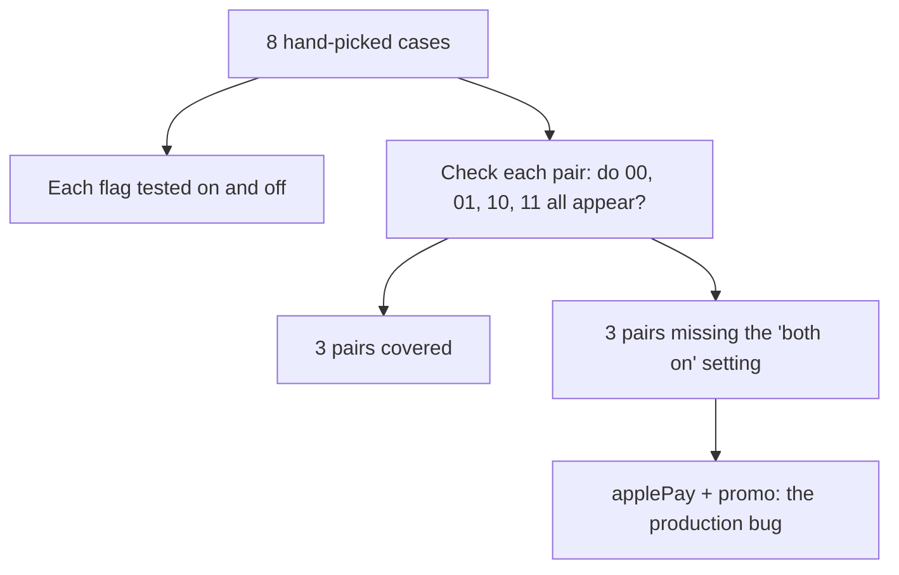

import Scenario from "../../../components/Scenario.astro";
import LevelIntro from "../../../components/LevelIntro.astro";
import Checkpoint from "../../../components/Checkpoint.astro";
import PracticeCheck from "../../../components/PracticeCheck.astro";

export const unit = {
  track: "applied-math",
  unitSlug: "combinatorics",
};

<Scenario label="Eight hand-picked test cases, four flags, and a bug in a combination nobody ran">
  <Fragment slot="facts">
    

      
🚩 <strong>4 flags</strong> — newUI, applePay, promo, express

      
📋 <strong>8 test cases</strong> — of 16 possible states (half)

      
🔗 <strong>6 flag pairs</strong> — each needs all 4 settings seen

      
💥 <strong>Bug</strong> — applePay and promo on together

    

    

      

        
Pairs fully covered by the 8 cases3 of 6

        

      

    

  </Fragment>

A team ships a checkout behind four flags and tests 8 cases chosen by feel.
Each flag appears on and off several times. Yet the combination `applePay` on
and `promo` on, together, never runs, and production finds it first. **Before
reading on: with 4 flags there are 6 pairs, each with 4 settings. Does having
tried every flag individually mean every pair was tried together?**

</Scenario>

<LevelIntro
  items={[
    "Building a pair-by-pair coverage table",
    "Spotting the exact missing setting",
    "Closing gaps and the true minimum suite",
  ]}
/>

## What did the 8 cases actually cover?

The 8 cases (1 = on, 0 = off), in the order newUI, applePay, promo, express:

| Case | newUI | applePay | promo | express |
| ---- | ----- | -------- | ----- | ------- |
| 1    | 0     | 0        | 0     | 0       |
| 2    | 1     | 0        | 0     | 0       |
| 3    | 0     | 1        | 0     | 0       |
| 4    | 0     | 0        | 1     | 0       |
| 5    | 0     | 0        | 0     | 1       |
| 6    | 1     | 1        | 0     | 0       |
| 7    | 1     | 0        | 0     | 1       |
| 8    | 0     | 0        | 1     | 1       |

**For each pair, which of the four settings 00, 01, 10, 11 appear somewhere in
the eight rows?** Reading two columns at a time gives:

| Pair               | Settings never seen | Covered? |
| ------------------ | ------------------- | -------- |
| newUI + applePay   | none                | yes      |
| newUI + promo      | 11                  | no       |
| newUI + express    | none                | yes      |
| applePay + promo   | 11                  | no       |
| applePay + express | 11                  | no       |
| promo + express    | none                | yes      |

Three of six pairs have a hole, and in every case the hole is "both on". The
cases are mostly "one thing switched on at a time", so interactions are
exactly what they skip. Flag `applePay` is on in case 3 and `promo` is on in
case 4, but never in the same row.

<Checkpoint question="Both applePay and promo were on in some test case. Why does that not show the pair was covered?">

Coverage is a property of two flags in the same row. `applePay` being on in
case 3 and `promo` being on in case 4 are two separate observations, and
neither run exercises the interaction. The pair was covered only if some single
case had both on, and none did.

</Checkpoint>

<PracticeCheck
  track={unit.track}
  unitSlug={unit.unitSlug}
  topicId="pair-coverage"
/>

## What does one more test case buy?

**Add a ninth case: newUI 1, applePay 1, promo 1, express 0. Which holes close?**
It sets `newUI+promo` to 11 and `applePay+promo` to 11, so those two close. It
sets `applePay+express` to 10, which was already seen, so that hole stays. One
pair remains uncovered, and a case only fixes the settings it actually sets.

The true minimum is smaller than the naive estimate of `6 pairs × 4 settings =
24` cases, because one row covers a setting for all six pairs at once. A
brute-force search over all 16 states shows that 4 flags need at least 5 cases
to cover every pair, for example `0000, 1100, 1010, 1001, 0111`, against 16 for
all states. This is a worked case, not the whole territory.

| Strategy                 | Cases for 4 flags | Guarantee                     |
| ------------------------ | ----------------- | ----------------------------- |
| Hand-picked "important"  | 8 (here)          | none, 3 pairs have holes      |
| Every pair, all settings | 5 (minimum)       | any 2-flag interaction is run |
| Every state              | 16                | any interaction at all        |

## Extend it yourself

- What changes with 12 flags: there are 66 pairs and 4,096 states. Does the
  minimum pair suite grow like 66, like 4,096, or far more slowly?
- A bug needs three flags on together. Which strategy in the table still
  catches it, and which does not?
- If one flag can never be on without another (a dependency), how many of
  the 16 states are even reachable?

This worked example is one case; the same pair-by-pair table applies to
browser/OS settings, user roles, or any set of independent options.

## Failure modes

| Mistake                                         | Why it fails                                     |
| ----------------------------------------------- | ------------------------------------------------ |
| Judging coverage by the number of cases         | Coverage depends on which settings the cases hit |
| Treating each flag tested alone as pair testing | Interactions need both flags in one row          |
| Assuming added cases always close gaps          | A case only closes the settings it sets          |
| Forgetting pairs miss 3-way interactions        | Pairwise is cheaper, not complete                |
