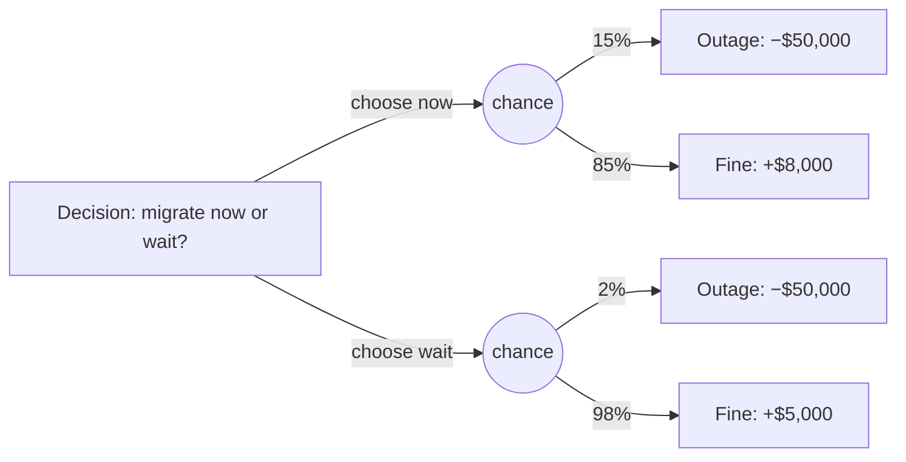
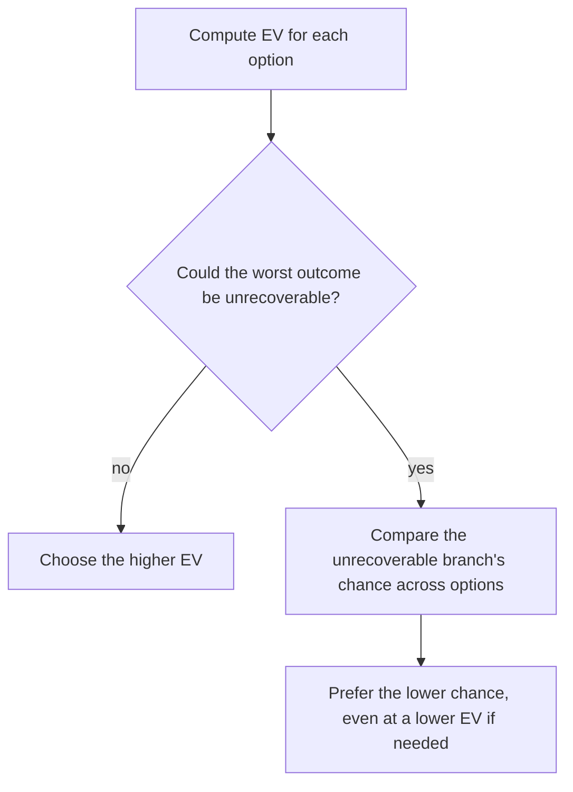

import LevelIntro from "../../../components/LevelIntro.astro";
import Checkpoint from "../../../components/Checkpoint.astro";
import PracticeCheck from "../../../components/PracticeCheck.astro";
import Plot from "../../../components/Plot.astro";

export const unit = { track: "applied-math", unitSlug: "expected-value" };

L1 priced the migration decision with two sums: −$700 for migrating now, +$3,900 for waiting. L2 shows the structure behind those sums, asks how wrong the 15% estimate may be before the answer flips, and names the case where the higher average is still the wrong call.

<LevelIntro
  items={[
    "Laying a decision out as a tree",
    "Break-even odds: where the answer flips",
    "When a good average hides a risk you cannot survive",
  ]}
/>

## How do you lay out a choice with branching outcomes so nothing is miscounted?

**Two choices, each with two outcomes: four numbers and four probabilities. Where does each one go?** A decision tree separates what you choose from what happens to you. Squares are choices you control, circles are chance you do not.

Two rules make the tree computable. The probabilities leaving any chance node must add to 1 (15 + 85, 2 + 98). And you evaluate from the right to the left: each chance node becomes one number (its EV), then the decision node picks the largest.

| Node         | Sum of probability × payoff   | EV        |
| ------------ | ----------------------------- | --------- |
| Chance: now  | `0.15 × −50000 + 0.85 × 8000` | **−700**  |
| Chance: wait | `0.02 × −50000 + 0.98 × 5000` | **+3900** |
| Decision     | best of the two               | **+3900** |

<Checkpoint question="A third option appears: migrate now, but at the lowest-traffic hour, with a 6% outage chance and a $7,000 payoff when fine. Where does it go on the tree, and does it change the decision?">

It hangs off the same decision node as a third branch, with its own chance node (6% and 94%). Its EV is 0.06 × −50,000 + 0.94 × 7,000 = **$3,580**. That is a real middle option, but still below waiting's $3,900, so the decision does not change. Adding a branch never changes how the others are evaluated; it only adds one more number for the decision node to compare.

</Checkpoint>

<PracticeCheck
  track={unit.track}
  unitSlug={unit.unitSlug}
  topicId="decision-trees"
/>

## How wrong can the estimate be before the answer changes?

**Nobody knows the outage chance is exactly 15%. Does the decision survive a different guess?** Hold waiting at its EV of $3,900 and let the "migrate now" outage chance $$p$$ vary. Migrating now is worth $$8000 - 58000p$$ (the $58,000 is the $50,000 loss plus the $8,000 not gained). It beats waiting when that exceeds $3,900, which happens at $$p = 4100 / 58000 \approx 7.07\%$$.

<Plot
  mark="line"
  x="p"
  y="advantage"
  xLabel="Outage chance if migrating now (%)"
  yLabel="EV(migrate now) minus EV(wait), in dollars"
  caption="Exact formula 4100 − 58000p, at the unit's assumed payoffs. Above zero migrating now wins; at 15% it is −4,600."
  data={[
    { p: 1, advantage: 3520 },
    { p: 3, advantage: 2360 },
    { p: 5, advantage: 1200 },
    { p: 7, advantage: 40 },
    { p: 8, advantage: -540 },
    { p: 10, advantage: -1700 },
    { p: 15, advantage: -4600 },
    { p: 20, advantage: -7500 },
    { p: 30, advantage: -13300 },
    { p: 40, advantage: -19100 },
  ]}
/>

Read it as a robustness check. The 15% guess would have to be wrong by more than half (down to about 7%) before migrating now wins. If the real chance could plausibly be 6%, the decision is close and worth more investigation; if nobody believes it is below 10%, the answer is stable. The slider demo below lets you move the outage chance, the outage cost and the payoff yourself.

<Checkpoint question="The team learns a failed migration would cost $70,000, not $50,000, for the migrate-now option only. Does the break-even point move toward 7.07% or away from it, and what is the new EV gap at 15%?">

It moves away from the 15% guess, further into the region where waiting wins. Migrating now becomes 0.15 × −70,000 + 0.85 × 8,000 = **−$3,700**, so the gap to waiting's $3,900 grows from $4,600 to **$7,600**. A bigger loss makes every chance of it more expensive, so the break-even outage chance drops below 7.07%.

</Checkpoint>

<PracticeCheck
  track={unit.track}
  unitSlug={unit.unitSlug}
  topicId="break-even-odds"
/>

## When is the better average still the wrong choice?

**EV says waiting is worth $4,600 more. Does that settle it for every team?** EV describes the long-run average over many repeats. It says nothing about whether this one attempt could end the company.

| Situation                                   | Why the average misleads                                                             |
| ------------------------------------------- | ------------------------------------------------------------------------------------ |
| A single loss you cannot recover from       | There is no "next attempt" to average over if this one removes you                   |
| A decision made once, not hundreds of times | One draw from the distribution, not its average                                      |
| Repeated exposure to the same risk          | Small chances add up: at 15%, three tries give a 38.6% chance of at least one outage |

The third row is exact: $$1 - 0.85^3 \approx 0.386$$. The correction is narrow. For a decision a team makes often, with survivable worst cases, follow the higher EV. When one branch is unrecoverable, look at that branch's size and probability on top of the average, not instead of it.

<Checkpoint question="A startup has $55,000 in the bank, and both options share the same $50,000 outage. Does the survival correction change the choice between migrating now (15%) and waiting (2%)?">

No. Waiting already has the higher EV _and_ the far smaller chance (2% against 15%) of the one outcome the company cannot absorb. The correction only overrides EV when the higher-EV option carries more of the unrecoverable risk, and here it carries less.

</Checkpoint>

<PracticeCheck
  track={unit.track}
  unitSlug={unit.unitSlug}
  topicId="when-ev-misleads"
/>

## Failure modes at this level

- **A chance node whose probabilities do not add to 1.** The "average" is then silently over- or under-weighting an outcome.
- **Reading EV as a promise for one attempt.** The single attempt lands on one branch, never on the average.
- **Defending one probability as exact.** The break-even check exists because inputs are guesses.
- **Applying "pick the higher EV" to a one-shot, unrecoverable loss** without looking at the size of the worst branch first.
