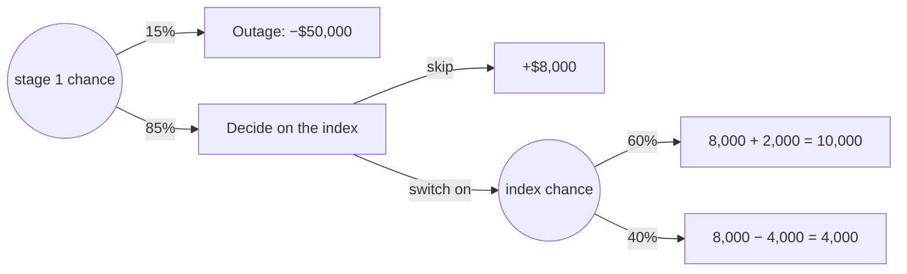

import Scenario from "../../../components/Scenario.astro";
import LevelIntro from "../../../components/LevelIntro.astro";
import Checkpoint from "../../../components/Checkpoint.astro";
import PracticeCheck from "../../../components/PracticeCheck.astro";
import Plot from "../../../components/Plot.astro";

export const unit = { track: "applied-math", unitSlug: "expected-value" };

<Scenario label="The migration works. Now a second, separate bet appears.">
  <Fragment slot="facts">
    <div class="not-prose flex flex-col gap-2 text-sm text-slate-700 dark:text-slate-300">
      <div class="flex items-center gap-1.5"><span>1️⃣</span> <strong>Stage 1</strong> — migrate now: 15% outage (−$50,000), 85% fine</div>
      <div class="flex items-center gap-1.5"><span>2️⃣</span> <strong>Stage 2 (only if fine)</strong> — optionally switch on a new index</div>
      <div class="flex items-center gap-1.5"><span>🎲</span> <strong>Index bet</strong> — 60% chance of +$2,000, 40% chance of −$4,000</div>
      <div class="flex items-center gap-1.5"><span>❓</span> <strong>Question</strong> — does the extra choice change stage 1's value?</div>
    </div>
    <div class="not-prose mt-3 rounded border border-slate-300 bg-slate-50 p-1.5 text-xs dark:border-slate-700 dark:bg-slate-900">
      <p class="font-semibold">Assumed figures, as in L1 and L2: nothing here is measured data.</p>
    </div>
  </Fragment>

After a successful migration you can take one more, optional gamble. It sits
_after_ a chance event, so you cannot decide it now: you have to decide what
you would do if you got there, and then let that decision feed back into the
value of stage 1. **How do you price a choice that only exists on one branch of
an earlier chance?** Work backwards from the end of the tree, not forwards from
the start.

</Scenario>

The earlier levels evaluated one decision at a time. This level handles trees
with a second stage, writes the calculation as a checked function, and asks how
much weight a computed EV can bear when its inputs are guesses.

<LevelIntro
  items={[
    "Folding a two-stage tree from the leaves back",
    "A calculator that rejects bad probabilities",
    "How far to trust an EV built on estimates",
  ]}
/>

## How do you evaluate a choice that comes after a chance event?

**What would you do at the second decision, if you got there?** Answer that
first. Fold the tree from the right: solve the last decision, replace it with
its value, and only then evaluate the chance node before it.



| Step | Node                 | Calculation                      | Value     |
| ---- | -------------------- | -------------------------------- | --------- |
| 1    | Index chance node    | `0.6 × 10000 + 0.4 × 4000`       | **7,600** |
| 2    | Decision: skip or on | max(8,000 skip, 7,600 switch on) | **8,000** |
| 3    | Stage 1 chance node  | `0.15 × −50000 + 0.85 × 8000`    | **−700**  |

The index bet alone has an EV of 0.6 × 2,000 + 0.4 × −4,000 = −$400, so the
right plan is to skip it, and stage 1 keeps its value of −$700. The extra
branch was worth examining and turned out to change nothing.

<Checkpoint question="Why must the skip-or-switch decision be solved before the stage-1 chance node, rather than after it?">

Because the 85% branch's value depends on what you would do there. Stage 1's EV is built from branch values, and the success branch is worth whichever is larger of skipping (8,000) or switching on (7,600). If you evaluated stage 1 first with a placeholder you would be guessing at that branch. Solving from the leaves back removes the guess: each solved sub-tree is just one number for the node above it.

</Checkpoint>

<PracticeCheck
  track={unit.track}
  unitSlug={unit.unitSlug}
  topicId="multi-stage-tree"
/>

## What does the calculation look like as code?

**Is a tree evaluator more than one multiply-and-add?** Not at the core. The one
non-obvious part is refusing to compute from a broken distribution. A typo such
as 0.15 and 0.80 returns a plausible-looking number if nothing checks it.

```js
function expectedValue(outcomes) {
  const total = outcomes.reduce((sum, o) => sum + o.p, 0);
  if (Math.abs(total - 1) > 1e-9)
    throw new Error("probabilities must sum to 1");
  const ev = outcomes.reduce((sum, o) => sum + o.p * o.v, 0);
  return Math.round(ev * 100) / 100;
}
```

The check is the point: a distribution that does not add to 1 has no
"average", so the honest response is an error. The rounding to cents hides
floating-point noise such as 0.1 + 0.2 not being exactly 0.3. A tree evaluator
is this function applied at each chance node, plus "take the max" at each
decision node.

<PracticeCheck
  track={unit.track}
  unitSlug={unit.unitSlug}
  topicId="ev-function"
/>

## How far should you trust an EV whose inputs are guesses?

**A simulation can replay the decision 100,000 times. Does matching the formula
mean 15% was right?** No. A simulation only checks that the arithmetic follows
from the inputs. It cannot test whether the inputs describe the world.

What it _can_ tell you is how noisy a sample average is. The migrate-now
outcomes are −50,000 (15%) and +8,000 (85%), which has a standard deviation of
`sqrt(0.15 × 0.85) × 58,000`, about 20,710, per attempt. The typical
gap between a simulated average and the true −700 is that value divided by the
square root of the number of trials.

<Plot
  mark="line"
  x="trials"
  y="gap"
  xScale="log"
  yScale="log"
  xLabel="Number of simulated trials"
  yLabel="Typical gap from the true EV ($)"
  caption="Exact formula: 20,710 / sqrt(trials). Ten times the trials only shrinks the typical gap by about 3.2 times."
  data={[
    { trials: 100, gap: 2071 },
    { trials: 1000, gap: 655 },
    { trials: 10000, gap: 207 },
    { trials: 100000, gap: 65 },
  ]}
/>

So a 1,000-trial run can easily land $655 away from −700 with nothing wrong, and
a lucky small run can look better than a large one. Two checks matter more than
more trials: run several seeds and see that they agree, and treat the
break-even odds from L2 as the real robustness test of the _inputs_.

| Check                   | What it verifies                          | What it cannot tell you             |
| ----------------------- | ----------------------------------------- | ----------------------------------- |
| Hand sum and tree fold  | The arithmetic follows from the inputs    | Whether the inputs are true         |
| Simulation, many trials | The code matches the formula              | Whether 15% is the real outage rate |
| Break-even odds         | How wrong an input can be before it flips | What the true input is              |

<Checkpoint question="Your simulation of the migrate-now option returns an average of −1,338 on 1,000 trials, against an exact −700. Is the formula broken?">

No. The typical gap at 1,000 trials is about $655, so −1,338 is roughly one such gap away, which is ordinary sampling noise and not evidence of a bug. The way to tell is to rerun with different seeds or more trials: a real bug stays wrong on every run, while noise scatters around −700 and tightens as trials grow.

</Checkpoint>

<PracticeCheck
  track={unit.track}
  unitSlug={unit.unitSlug}
  topicId="trusting-the-inputs"
/>

## This is one case, not the whole territory

The migration is a single worked example with assumed numbers. Try changing
what it holds fixed, and predict the result before computing it:

- If the index bet paid +$5,000 instead of +$2,000 on the good outcome, its EV
  becomes +$1,400, so you would switch it on and the success branch becomes
  8,000 + 1,400 = 9,400, making stage 1 worth **+$490**. Does that overturn
  the decision against waiting's $3,900? What would the success branch have to
  be worth for migrating now to win? (Solve 0.85 × s − 7,500 > 3,900; it is
  about $13,412.)
- What if the audience were a team that runs this migration twenty times a year
  instead of once? Which part of the L2 survival argument gets weaker?
- What if the news were worse: the outage chance is 25%, with a recovery that
  takes weeks and loses customers who never return? Which input is now hardest
  to put a number on?

## Failure modes

| Failure mode                                  | What it gets wrong                                                                  |
| --------------------------------------------- | ----------------------------------------------------------------------------------- |
| Evaluating stage 1 before the later decision  | Treats the branch as a fixed number when its value depends on the best later choice |
| Skipping the sum-to-1 check                   | A typo produces a confident wrong EV instead of an error                            |
| Reading one small simulation as a verdict     | Sampling noise is large at few trials; compare several seeds                        |
| Trusting a precise EV built on guessed inputs | The output looks exact while the inputs are not; check the break-even odds          |
| Letting the best-EV option settle everything  | The tree cannot see a branch that would end the business (see L2)                   |
