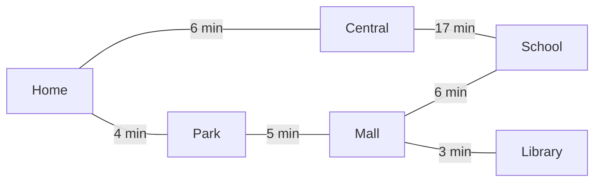

import Scenario from "../../../components/Scenario.astro";
import LevelIntro from "../../../components/LevelIntro.astro";
import PracticeCheck from "../../../components/PracticeCheck.astro";

export const unit = {
  track: "applied-math",
  unitSlug: "graph-theory-basics",
};

<Scenario label="Two routes on a subway map. Which one is the shortest?">
  <Fragment slot="facts">
    

      
🚉 <strong>The map</strong> — 6 stations, 6 tracks between them

      
🏠 <strong>Start</strong> — Home, <strong>goal</strong> — School

      
❓ <strong>The question</strong> — fewest rides, or fewest minutes?

    

    

      

        
Via Central (2 rides)23 min

        

      

      

        
Via Park and Mall (3 rides)15 min

        

      

    

  </Fragment>

You are at Home and want to get to School. The map shows two ways. One has
**two rides** (Home to Central, Central to School) and takes **23 minutes**.
The other has **three rides** (Home to Park, Park to Mall, Mall to School) and
takes **15 minutes**. The minutes are made up for this example.

**Which route is "the shortest"?** Both answers are defensible. Fewest rides
picks the first; fewest minutes picks the second. Until you say what you are
counting, the question has no single answer.

</Scenario>

<LevelIntro
  items={[
    "Nodes and edges: what a graph models",
    "Direction and weight on an edge",
    "Why 'shortest' needs a definition",
  ]}
/>

## What are you really drawing when you draw a map?

**If you strip the map of colours, curves and street names, what is left?**
Only two kinds of thing: places, and connections between places. That is a
graph.

- **Nodes** (vertices) are the things: stations, people, services, commits.
- **Edges** are the connections between two nodes: a track, a friendship, a call.

That is the whole subway map: 6 nodes and 6 edges. The numbers on the edges are
minutes, invented for this unit. Everything else in graph theory is a property
added to this two-part structure.

Two yes/no questions describe almost any graph you will meet:

| Question about the edges              | If yes                                        | If no                                         |
| ------------------------------------- | --------------------------------------------- | --------------------------------------------- |
| Does an edge only work one way?       | **Directed**: a one-way street, "A follows B" | **Undirected**: a friendship, a two-way track |
| Does an edge carry a number (a cost)? | **Weighted**: minutes, kilometres, a fare     | **Unweighted**: every edge counts as one step |

The subway map is undirected (a track runs both ways) and weighted (minutes). A
list of which service calls which is directed, and weighted only if you care
about something like latency.

<PracticeCheck
  track={unit.track}
  unitSlug={unit.unitSlug}
  topicId="graph-vocabulary"
/>

## So which route is the shortest?

**Why did the two answers disagree?** Because each one measures the path by a
different rule:

| What you count                | Route Home to School     | Result     |
| ----------------------------- | ------------------------ | ---------- |
| Edges used (rides)            | Home, Central, School    | 2 rides    |
| Sum of edge weights (minutes) | Home, Park, Mall, School | 15 minutes |

So "shortest path" is a family of questions, and each needs a different tool:

| If every edge counts as 1 step | If edges have non-negative weights |
| ------------------------------ | ---------------------------------- |
| **BFS** (breadth-first search) | **Dijkstra's algorithm**           |
| Finds the fewest edges         | Finds the lowest total weight      |

Using BFS when you care about minutes does not crash. It returns a route that
looks reasonable and is wrong for your question, which is the more dangerous
failure.

<PracticeCheck
  track={unit.track}
  unitSlug={unit.unitSlug}
  topicId="shortest-means-what"
/>

## One more thing worth knowing before L2

A program has to store this map somewhere. The two standard layouts differ in
how many numbers they hold. For the 6-station map above, a station-by-station
grid holds $$6 \times 6 = 36$$ cells, while a per-station list of neighbours
holds 18 entries (6 stations plus 12, because each of the 6 undirected tracks is
listed from both ends). The demo below lets you grow the network and watch the
gap open up. L2 explains why.

## Key terms

- **Graph** — a set of nodes and a set of edges between them.
- **Directed / undirected** — whether an edge has a direction.
- **Weighted** — whether an edge carries a number such as minutes or cost.
- **Path** — a sequence of edges leading from one node to another.
- **Cycle** — a path that leads back to where it started (L3 uses this).
- **BFS / Dijkstra** — the fewest-edges and lowest-total-weight search algorithms.

## What the next levels cover

L2 shows how a graph is stored and walks BFS and Dijkstra through the subway
map step by step. L3 uses a dependency graph to find a cycle before it causes an
outage, and writes the walk as short code.
