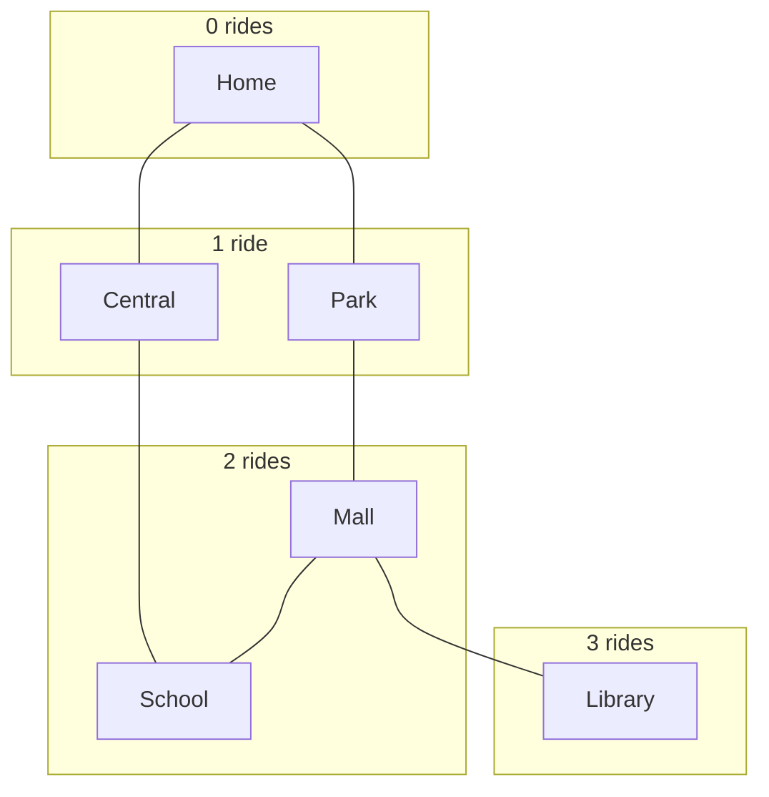

import LevelIntro from "../../../components/LevelIntro.astro";
import Checkpoint from "../../../components/Checkpoint.astro";
import PracticeCheck from "../../../components/PracticeCheck.astro";
import Plot from "../../../components/Plot.astro";

export const unit = {
  track: "applied-math",
  unitSlug: "graph-theory-basics",
};

L1 drew the subway map as nodes and edges and showed that "shortest" means
different things for fewest rides and fewest minutes. L2 opens the box: how a
program holds that map, and how BFS and Dijkstra actually walk it.

<LevelIntro
  items={[
    "Adjacency list versus adjacency matrix",
    "How BFS explores in layers",
    "How Dijkstra relaxes costs",
  ]}
/>

## How does a program hold the map so it can ask "who touches Mall?"

**A program cannot look at a picture. What does it store instead?** There are two
standard answers, and they trade space against lookup style.

**Adjacency list**: each station keeps a list of its neighbours and the minutes
to each.

| Station | Neighbours (minutes)              |
| ------- | --------------------------------- |
| Home    | Central (6), Park (4)             |
| Central | Home (6), School (17)             |
| Park    | Home (4), Mall (5)                |
| Mall    | Park (5), School (6), Library (3) |
| School  | Central (17), Mall (6)            |
| Library | Mall (3)                          |

**Adjacency matrix**: a grid with one row and one column per station. Cell
(row, column) holds the minutes of the track between them, or a dash if there is
none.

|             | Home | Central | Park | Mall | School | Library |
| ----------- | ---- | ------- | ---- | ---- | ------ | ------- |
| **Home**    | -    | 6       | 4    | -    | -      | -       |
| **Central** | 6    | -       | -    | -    | 17     | -       |
| **Park**    | 4    | -       | -    | 5    | -      | -       |
| **Mall**    | -    | -       | 5    | -    | 6      | 3       |
| **School**  | -    | 17      | -    | 6    | -      | -       |
| **Library** | -    | -       | -    | 3    | -      | -       |

Count what each holds. The matrix always has $$V^2$$ cells for $$V$$ stations:
36 here, of which only 12 are filled. The list holds $$V + 2E$$ entries for $$E$$
undirected tracks: $$6 + 12 = 18$$ here. A directed graph stores each edge once,
so it needs $$V + E$$.

Real networks are **sparse**: each station touches a handful of others, not
most of them. So the matrix wastes more space the bigger the network gets. In
the chart below every station has 4 tracks, so the list holds $$5V$$ entries
while the matrix holds $$V^2$$.

<Plot
  mark="line"
  x="stations"
  y="cells"
  series="layout"
  xScale="log"
  yScale="log"
  xLabel="Stations (V)"
  yLabel="Cells or entries"
  caption="Storage for a network where every station has 4 tracks: list = 5V, matrix = V squared (exact formulas, log-log axes)."
  data={[
    { stations: 10, cells: 50, layout: "list" },
    { stations: 10, cells: 100, layout: "matrix" },
    { stations: 50, cells: 250, layout: "list" },
    { stations: 50, cells: 2500, layout: "matrix" },
    { stations: 100, cells: 500, layout: "list" },
    { stations: 100, cells: 10000, layout: "matrix" },
    { stations: 200, cells: 1000, layout: "list" },
    { stations: 200, cells: 40000, layout: "matrix" },
    { stations: 400, cells: 2000, layout: "list" },
    { stations: 400, cells: 160000, layout: "matrix" },
  ]}
/>

The matrix earns its place in two cases: the graph is dense, or you need "is
there a track from A to B?" to be one instant cell lookup.

<Checkpoint question="A network has 200 stations and each station has about 4 tracks. Roughly how many cells does a matrix need, compared with a list?">

The matrix needs 200 × 200 = 40,000 cells no matter how few tracks
exist, because its size depends only on the station count. With 4 tracks per
station there are about 200 × 4 / 2 = 400 tracks, so the list holds
200 + 2 × 400 = 1,000 entries. That is 40 times smaller, and the ratio
keeps growing as the network does, since the matrix grows with the square of the
station count while the list grows only with stations plus tracks.

</Checkpoint>

<PracticeCheck
  track={unit.track}
  unitSlug={unit.unitSlug}
  topicId="representation"
/>

## How does BFS find the fewest rides?

**If you must visit stations in an order that guarantees you find the
fewest-rides route first, which order is it?** Closest first: everything one ride
away, then everything two rides away, then three. That is **breadth-first
search**.

BFS needs two things. A **queue** (first in, first out) forces the layer-by-layer
order. A **visited set** stops it from entering a station it already reached by
an equal or shorter route. Starting at Home:

| Step | Take from queue | New stations added | Queue afterwards |
| ---- | --------------- | ------------------ | ---------------- |
| 1    | Home            | Central, Park      | Central, Park    |
| 2    | Central         | School             | Park, School     |
| 3    | Park            | Mall               | School, Mall     |
| 4    | School          | (none new)         | Mall             |
| 5    | Mall            | Library            | Library          |
| 6    | Library         | (none new)         | (empty)          |

School was first reached at step 2, through Central, at 2 rides. Nothing in this
table looked at minutes, so BFS reports Home, Central, School: **2 rides, 23
minutes**, not the 15-minute route.

<PracticeCheck
  track={unit.track}
  unitSlug={unit.unitSlug}
  topicId="bfs-layers"
/>

## How does Dijkstra find the fewest minutes?

**What has to change when edges have different lengths?** Closest by rides is no
longer closest by minutes, so the queue must hand out the station with the
**lowest total minutes known so far**. That is a **priority queue**. Each time
Dijkstra takes a station, it checks every neighbour: does going through this
station beat the best total recorded for that neighbour? If yes, it overwrites
the record. That overwrite is called **relaxing** the edge.

Running it from Home:

| Take (total) | What it records                                      |
| ------------ | ---------------------------------------------------- |
| Home (0)     | Central = 6, Park = 4                                |
| Park (4)     | Mall = 9                                             |
| Central (6)  | School = 23                                          |
| Mall (9)     | School = 15 (**relaxed down from 23**), Library = 12 |
| Library (12) | nothing to improve                                   |
| School (15)  | done: Home, Park, Mall, School in 15 minutes         |

The School row is the lesson. Early on, Dijkstra believed School cost 23 (via
Central). Only after reaching Mall did it find 15, and it replaced the estimate.
BFS never needs this, because a later layer can never reach a station in fewer
rides.

Dijkstra rests on one assumption: **a station taken from the queue has its final
cost, because every other route would still have to add non-negative minutes.**
Negative weights break that. With tracks A to B costing 2, A to C costing 5 and C
to B costing -4, Dijkstra takes B at 2 and never revisits it, yet the route
through C costs $$5 - 4 = 1$$.

<Checkpoint question="Dijkstra relaxed School from 23 down to 15. Why could BFS never have to do that kind of correction?">

BFS orders stations by number of rides, and every ride counts exactly 1. By the
time it reaches a station in layer $$k$$, any route that would use fewer rides
would have been found in an earlier layer, so the first time a station is reached
is already its best. Minutes vary per track, so the first route Dijkstra finds to
School (23) can still lose to a route that needs more rides but less time. Relaxing
is how Dijkstra corrects an estimate it had no way to know was beatable yet.

</Checkpoint>

<PracticeCheck
  track={unit.track}
  unitSlug={unit.unitSlug}
  topicId="dijkstra-relax"
/>

## Picking the tool

| What you are asking                              | Edge weights            | Tool                           |
| ------------------------------------------------ | ----------------------- | ------------------------------ |
| Fewest rides, fewest hops, degrees of separation | All equal or irrelevant | BFS                            |
| Lowest total minutes, cost or distance           | Differ, none negative   | Dijkstra                       |
| Does any route exist at all                      | Either                  | BFS (ignore the weights)       |
| Lowest total, but some weights are negative      | Can be negative         | Neither: a different algorithm |

Running Dijkstra on an unweighted graph still gives the right answer, with extra
bookkeeping. Running BFS on a weighted graph and trusting the answer gives a
plausible wrong one. L3 uses a walk of a different kind, depth-first, to catch
cycles.
