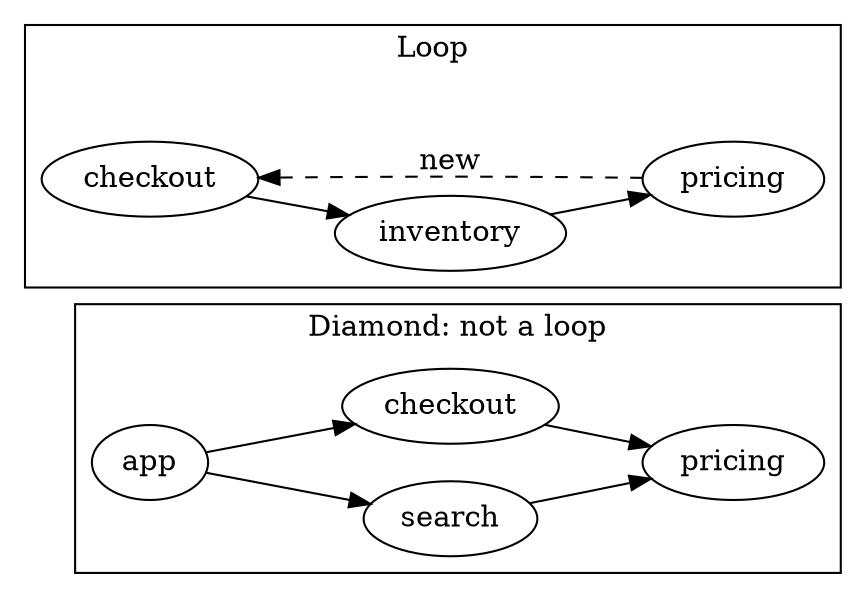
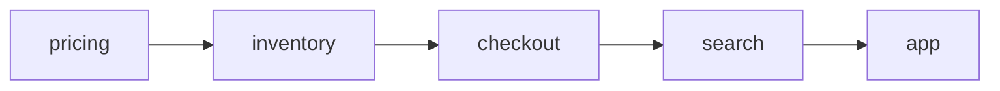

import Scenario from "../../../components/Scenario.astro";
import Checkpoint from "../../../components/Checkpoint.astro";
import LevelIntro from "../../../components/LevelIntro.astro";
import PracticeCheck from "../../../components/PracticeCheck.astro";

export const unit = {
  track: "applied-math",
  unitSlug: "graph-theory-basics",
};

<Scenario label="Three programs each wait for another one to start first. What is the start order?">
  <Fragment slot="facts">
    <div class="not-prose flex flex-col gap-2 text-sm text-slate-700 dark:text-slate-300">
      <div class="flex items-center gap-1.5"><span>🧩</span> <strong>checkout</strong> — needs <strong>inventory</strong> running first</div>
      <div class="flex items-center gap-1.5"><span>📦</span> <strong>inventory</strong> — needs <strong>pricing</strong> running first</div>
      <div class="flex items-center gap-1.5"><span>💲</span> <strong>pricing</strong> — needs <strong>checkout</strong> running first <span>⚠️</span></div>
      <div class="flex items-center gap-1.5"><span>🔁</span> <strong>Result</strong> — every one of them waits on another; none can start</div>
    </div>
  </Fragment>

Three small programs (names invented for this example) start up in some order.
`checkout` cannot start until `inventory` is running. `inventory` cannot start
until `pricing` is running. A teammate has just added a requirement that
`pricing` cannot start until `checkout` is running.

**Is there any order in which all three can start? And if the system had 50
programs instead of 3, how would you find out before the deploy hangs, rather
than after?**

Looking at a diagram works at 3 programs. It stops working long before 50. The
question needs a procedure.

</Scenario>

<LevelIntro
  items={[
    "Why 'already visited' is not enough to spot a loop",
    "Three colours: untouched, on the current path, finished",
    "A valid start order, and when none exists",
  ]}
/>

## Why can't the search from L2 just remember "visited"?

**BFS marked each station visited and moved on. Why isn't that enough to detect a
loop?** Because "visited" mixes up two different situations. Compare two graphs
(arrows mean "needs this running first"):



In the diamond, `pricing` is reached twice, once from each side. It is
visited both times, and there is no loop: two paths simply meet. In the loop,
`pricing` leads back to `checkout`, which is still waiting for it. A single
"visited" flag cannot tell these apart. A search that depends on that distinction
needs three states per node.

| Colour | Meaning                                          | Reaching it again means                    |
| ------ | ------------------------------------------------ | ------------------------------------------ |
| White  | Not looked at yet                                | Explore it                                 |
| Gray   | On the path being walked right now (an ancestor) | **A loop**: the path came back on itself   |
| Black  | Fully explored; nothing under it leads back      | Fine: two paths meeting, as in the diamond |

This walk is **depth-first search (DFS)**: follow one dependency as far as it
goes before trying the next. Here is the whole run on the full six-edge graph
(the three-program loop plus an `app` and a `search` program that were already
there). The rule is: explore dependencies in the order listed.

| Step | Action                                        | Gray path (current)                                    |
| ---- | --------------------------------------------- | ------------------------------------------------------ |
| 1    | Start at `app`, mark gray                     | app                                                    |
| 2    | Go to `checkout`, mark gray                   | app, checkout                                          |
| 3    | Go to `inventory`, mark gray                  | app, checkout, inventory                               |
| 4    | Go to `pricing`, mark gray                    | app, checkout, inventory, pricing                      |
| 5    | `pricing` needs `checkout`, which is **gray** | **loop found**: checkout, inventory, pricing, checkout |

The edges are: `app` needs `checkout` and `search`; `checkout` needs `inventory`;
`inventory` needs `pricing`; `search` needs `pricing`; and the new one, `pricing`
needs `checkout`. The loop is read straight from the gray path, from the first
appearance of `checkout` onward.

<Checkpoint question="In the diamond, pricing is reached a second time and DFS does not report a loop. Which colour is pricing when that happens, and why does that colour mean it is safe?">

Black. By the time the second branch reaches `pricing`, the first branch has
already finished exploring it and everything under it, so it has been fully
explored and nothing under it leads back to a path still being walked. Gray is
the only colour that means "still on the path I am currently on", which is the
only situation in which arriving there closes a loop. A single visited flag would
treat black and gray the same and report a loop that is not there.

</Checkpoint>

## What does the walk give you besides a yes or no?

**If the graph has no loop, is there a start order?** Yes, and the same walk
produces it. Every time DFS turns a node black, all of its dependencies are
already black. So the order in which nodes turn black, first to last, starts every
dependency before the thing that needs it.

Take the graph without the new `pricing` to `checkout` edge. Running the same walk
turns nodes black in this order:

| Order finished | Node        | Its dependencies, all earlier in the list |
| -------------- | ----------- | ----------------------------------------- |
| 1              | `pricing`   | none                                      |
| 2              | `inventory` | `pricing`                                 |
| 3              | `checkout`  | `inventory`                               |
| 4              | `search`    | `pricing`                                 |
| 5              | `app`       | `checkout`, `search`                      |

So `pricing, inventory, checkout, search, app` is a valid start order. Add the new
edge back and no order of the five works for the three looped programs, because
each must come before and after another. A loop in a dependency graph means no
valid start order exists, and the walk above finds it without trying orders.



<PracticeCheck
  track={unit.track}
  unitSlug={unit.unitSlug}
  topicId="cycle-detection"
/>

## Why is this affordable when the system is large?

**Why not simply test every pair of programs for a loop?** Counting shows the
difference. A walk touches each node and each edge about once, so its cost grows
like $$O(V + E)$$. Looking at every pair grows like $$V(V-1)/2$$. The demo below
uses these two counts as a scale illustration, with no claim that testing pairs
is how anyone detects loops:

| Programs (V) | Dependencies per program | Walk: V + E steps | Pairs: V(V-1)/2 |
| ------------ | ------------------------ | ----------------- | --------------- |
| 12           | 3                        | 48                | 66              |
| 300          | 3                        | 1,200             | 44,850          |

At 12 programs the two are close, so either is tolerable. At 300 the pair count
is about 37 times larger (44,850 / 1,200 is roughly 37), and the gap keeps
widening because one count grows with the number of programs and the other with
its square. The same $$O(V + E)$$ cost applies to BFS and to DFS on a list.

## The same walk as code

This is one of the few places where reading code teaches something the table does
not: how little there is to it. Dependencies are given as an object mapping each
program to the list it needs.

```js
function hasCycle(deps) {
  const state = {}; // missing = white, "open" = gray, "done" = black
  function visit(name) {
    state[name] = "open";
    for (const next of deps[name] ?? []) {
      if (state[next] === "open") return true; // reached a gray node: a loop
      if (state[next] === undefined && visit(next)) return true;
    }
    state[name] = "done";
    return false;
  }
  return Object.keys(deps).some((n) => state[n] === undefined && visit(n));
}
```

Three states, one recursive call per white node, and a check at the single point
where a gray node is reached. The exercises below ask you to write this kind of
walk yourself in a few shapes.

<Checkpoint question="If the loop is removed from this graph, what exactly makes the walk still visit every node exactly once?">

Only white nodes are explored. The moment a node is entered it turns gray, and
when its dependencies are done it turns black, so it can never be white again. The
outer loop restarts from any node that is still white, which covers parts of the
graph the first start could not reach. Each node is therefore entered once and
each edge is looked at once, which is where the $$O(V + E)$$ cost comes from.

</Checkpoint>

<PracticeCheck
  track={unit.track}
  unitSlug={unit.unitSlug}
  topicId="graph-code"
/>

## This is one case, not the whole territory

Everything above used one directed dependency graph. Try changing the scene and
see which parts survive.

- **Undirected edges.** Suppose the edges are mutual awareness rather than "needs".
  Every edge you just walked along now points back at a gray node, your own
  parent. What extra piece of information must the walk carry to tell "I came
  back along the edge I arrived on" from "I found a genuine loop"?
- **Weights that can be negative.** What would break in Dijkstra from L2, and would
  a loop then matter in a new way?
- **A million nodes.** Which of the layouts from L2 stays usable, and which part of
  the walk becomes the cost you worry about first?

There is no single correct answer to these. They are prompts for checking whether
you hold the idea or only the example.
