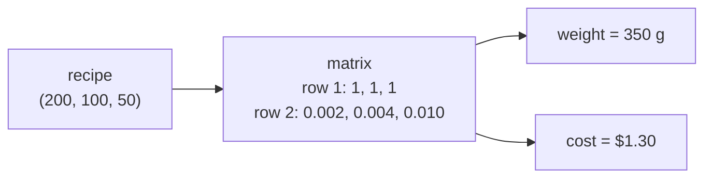

import Scenario from "../../../components/Scenario.astro";
import LevelIntro from "../../../components/LevelIntro.astro";
import PracticeCheck from "../../../components/PracticeCheck.astro";

export const unit = {
  track: "applied-math",
  unitSlug: "linear-algebra-basics-vectors-matrices-where",
};

<Scenario label="A cookie recipe, tripled">
  <Fragment slot="facts">
    

      
🍪 <strong>One batch</strong> — 200 g flour, 100 g sugar, 50 g butter

      
👥 <strong>Guests</strong> — enough for 3 batches

      
🧮 <strong>Also needed</strong> — total weight and total cost of the shopping list

    

  </Fragment>

One batch of cookies needs 200 g of flour, 100 g of sugar and 50 g of butter.
Three batches are coming to dinner. You could redo the sum for flour, then
again for sugar, then again for butter, and again for the cost of each. **But
the three amounts are really one thing, "the recipe". Is there a way to
scale and combine the whole recipe at once instead of one number at a
time?**

</Scenario>

<LevelIntro
  items={[
    "A vector as one bundle of numbers",
    "A matrix as a reusable rule",
    "Where the pattern shows up in engineering",
  ]}
/>

## What do you get if the recipe is one object?

Write the recipe as an ordered list: `(flour, sugar, butter) = (200, 100, 50)`.
That list is a **vector**. Three small operations cover most of what you do
with it:

| Operation             | Recipe example                                         | Result            |
| --------------------- | ------------------------------------------------------ | ----------------- |
| Scalar multiplication | 3 batches: `3 × (200, 100, 50)`                        | `(600, 300, 150)` |
| Vector addition       | cookies `(200, 100, 50)` + shortbread `(150, 50, 100)` | `(350, 150, 150)` |
| Dot product           | recipe dotted with a price list (next section)         | one number        |

Order matters inside a vector: `(100, 0)` and `(0, 100)` hold the same numbers
and are different vectors, just as 100 g of flour is not 100 g of butter.

<PracticeCheck
  track={unit.track}
  unitSlug={unit.unitSlug}
  topicId="vectors-bundle"
/>

## What if the rule itself were one object?

Suppose the shopping list needs two numbers per recipe: total weight, and total
cost. The assumed prices in this example are 0.002, 0.004 and 0.010 dollars per
gram for flour, sugar and butter (made-up round numbers, not real prices).
Each output is a dot product of the recipe with one row of numbers:

That grid of rows is a **matrix**: a rule that turns one vector into another.
The same matrix works on shortbread `(150, 50, 100)` (weight 300 g, cost
$1.50) or on three batches (weight 1050 g, cost $3.90). That is the point of
writing the rule once.

## Where does this show up in engineering?

| Field                   | The vector                                    | The matrix or dot product                             |
| ----------------------- | --------------------------------------------- | ----------------------------------------------------- |
| 2D and 3D graphics, UI  | A point `(x, y)` or `(x, y, z)`               | Rotate, scale or move it with one matrix              |
| Machine learning        | A row of features, or a word's embedding      | A layer's weights turn one vector into the next       |
| Recommendations, search | A user's ratings, or a document's word counts | Dot product and cosine similarity compare two vectors |
| Games, simulation       | A position or velocity                        | Apply the same update rule to every entity            |

The common thread: state that is **several numbers that belong together**, plus
an operation that must be **applied consistently** and sometimes **combined
with other operations in a particular order**.

## What this unit covers

L2 shows exactly how a matrix acts on a vector, and why combining two rules in
a different order can give a different answer. L3 builds the same ideas as
small tested functions and uses the dot product to compare two people's
tastes.
