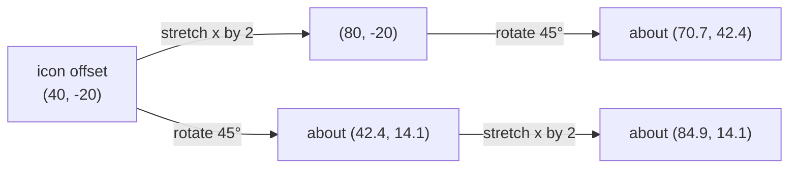

import LevelIntro from "../../../components/LevelIntro.astro";
import Checkpoint from "../../../components/Checkpoint.astro";
import PracticeCheck from "../../../components/PracticeCheck.astro";

export const unit = {
  track: "applied-math",
  unitSlug: "linear-algebra-basics-vectors-matrices-where",
};

L1 turned a recipe into a vector and a shopping-list rule into a matrix. L2
moves the same machinery onto a screen: an icon sits 40 px right and 20 px up
from its pivot, and a hover effect rotates it 45 degrees and scales it 1.4
times. The interactive demo further down uses exactly these numbers.

<LevelIntro
  items={[
    "Matrix times vector, row by row",
    "Rotation and scale as small matrices",
    "Why order of transformations matters",
  ]}
/>

## What does "multiply a matrix by a vector" compute?

**L1 said each output was a dot product with one row. Is that all there is to
it?** Yes. For a 2×2 matrix and a vector `(x, y)`:

```text
[ a  b ] [ x ]   [ a·x + b·y ]
[ c  d ] [ y ] = [ c·x + d·y ]
```

Row one gives the first output, row two gives the second. The recipe matrix
works the same way with three entries per row: `(1, 1, 1) · (200, 100, 50) =
350` and `(0.002, 0.004, 0.010) · (200, 100, 50) = 1.3`. A matrix with 2 rows
and 3 columns takes 3 numbers in and gives 2 numbers out.

<Checkpoint question="What does the matrix with rows (1, 0) and (0, 1) do to the vector (7, 3)?">

It returns `(1·7 + 0·3, 0·7 + 1·3) = (7, 3)`, unchanged. That is the identity
matrix, the matrix equivalent of multiplying by 1.

</Checkpoint>

<PracticeCheck
  track={unit.track}
  unitSlug={unit.unitSlug}
  topicId="matrix-vector-product"
/>

## What do rotate and scale look like as matrices?

| Transform             | Matrix                              | Effect                                 |
| --------------------- | ----------------------------------- | -------------------------------------- |
| Uniform scale by `s`  | `[[s, 0], [0, s]]`                  | Multiplies both coordinates by `s`     |
| Stretch x only by `k` | `[[k, 0], [0, 1]]`                  | Widens or narrows, leaves y alone      |
| Rotate by angle `θ`   | `[[cos θ, −sin θ], [sin θ, cos θ]]` | Turns the vector `θ` around the origin |
| Identity              | `[[1, 0], [0, 1]]`                  | Changes nothing                        |

For the icon offset `(40, −20)` (y measured downward on screen, so −20 means
up), rotating 45° gives about `(42.43, 14.14)` and then scaling by 1.4 gives
about `(59.4, 19.8)`. Drag the sliders below to see where it lands for other
angles and scales.

## Does the order of two transformations matter?

**The hover effect rotates, then scales. If a teammate swaps the two lines, does
the icon land somewhere else?** For this pair, no: scaling every coordinate by
the same factor commutes with rotating around the same pivot, so the swap is
harmless. Now change the scale to a stretch of the x-axis only, `S = [[2, 0],
[0, 1]]`, and the answer changes:



Same two operations, same start, different destinations. In matrix terms
`A·B` is not always equal to `B·A`. For the product `A·B·v` the matrix next to
`v` acts first.

<Checkpoint question="Two uniform scales (2× then 3×) versus 3× then 2×: does the order matter, and why?">

No. A uniform scale only multiplies every entry by a plain number, and plain
numbers commute: 2 × 3 equals 3 × 2. The order only starts to matter when the
two operations treat the coordinates differently, such as a rotation mixing x
and y, or a stretch that touches only x.

</Checkpoint>

<PracticeCheck
  track={unit.track}
  unitSlug={unit.unitSlug}
  topicId="transform-order"
/>

## The habit to keep

Write a chain of operations as one product of matrices, remember which end acts
first, and ask "do these two actually commute, or am I relying on luck?" before
reordering them.
