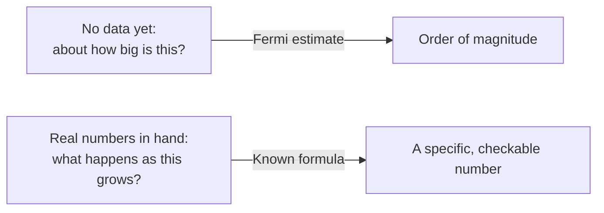

import Scenario from "../../../components/Scenario.astro";
import LevelIntro from "../../../components/LevelIntro.astro";
import PracticeCheck from "../../../components/PracticeCheck.astro";
import Plot from "../../../components/Plot.astro";
import { Icon } from "astro-icon/components";

export const unit = { track: "applied-math", unitSlug: "math-tool-prediction" };

<Scenario label="The toothpick bridge">
  <Fragment slot="facts">
    

      
<Icon name="lucide:ruler" class="h-4 w-4" /> <strong>Tested</strong> — a 10 cm span, one coin sags it 1 mm (made-up teaching number)

      
<Icon name="lucide:arrow-right-left" class="h-4 w-4" /> <strong>Asked</strong> — the same bridge, 15 cm long, same coin

    

    

      

        
Tested (1.0 mm)

        

      

      

        
Gut guess for 15 cm (1.5 mm)

        

      

      

        
Beam formula for 15 cm (about 3.4 mm)

        

      

    

  </Fragment>

You build a bridge out of toothpicks. You put one coin in the middle of a 10 cm
span and it sags a little. Passed: the bridge holds. Your friend wants the
same bridge 15 cm long and says, "Half again as long, so it should sag about
half again as much."

Your single test cannot say whether they are right, because you only tested
the 10 cm bridge. **What tool tells you what the 15 cm bridge will do before
you build it?**

</Scenario>

<LevelIntro
  items={[
    "Tested cases vs. predicted cases",
    "Estimating vs. using a known formula",
    "Why linear guesses fail",
  ]}
/>

## What does a passing test actually tell you?

A passing test, type check or compiler run answers one question: **does this
thing do what it claims in the case I tried?** The bridge you tested is fine.
The longer bridge was never tested, so the test is silent about it.

| Question                                   | Tool that answers it            |
| ------------------------------------------ | ------------------------------- |
| Does this code do what it claims?          | Tests, type checker, compiler   |
| What happens in a case I have not run yet? | A model: a formula plus numbers |

For software, the untried case is usually bigger: more traffic, more users,
more data, more time. Math used as **prediction** takes a relationship you
trust, plugs in the numbers you have, and tells you what to expect at the
scale you have not reached.

<PracticeCheck
  track={unit.track}
  unitSlug={unit.unitSlug}
  topicId="tested-vs-predicted"
/>

## Is this the same as estimating on the back of an envelope?

Close, but different. **Fermi estimation** (see `applied-math/orders-magnitude`)
gets you a rough order of magnitude with almost no data. This unit is for the
moment after that, when you do have real numbers and a known relationship.

## Why does "50% bigger, so 50% worse" keep failing?

The friend's guess is a **linear guess**: change the input by some
percentage and assume the result changes by the same percentage. Many real
relationships are not linear. For a simple beam held at both ends with a
weight in the middle, the standard result is that sag grows with the cube of
the length:

$$sag \propto length^3$$

Only the ratio matters here. A bridge 1.5 times as long sags $$1.5^3 = 3.375$$
times as much, not 1.5 times. That is the 3.4 mm in the callout above.

<Plot
  mark="line"
  x="length"
  y="sag"
  series="model"
  xLabel="Span length (multiple of the tested bridge)"
  yLabel="Sag (multiple of the tested sag)"
  caption="Sag relative to the tested bridge. The straight line is the gut guess; the curve is the cube relationship (exact ratios)."
  data={[
    { length: 1, sag: 1, model: "Gut guess (linear)" },
    { length: 1.25, sag: 1.25, model: "Gut guess (linear)" },
    { length: 1.5, sag: 1.5, model: "Gut guess (linear)" },
    { length: 1.75, sag: 1.75, model: "Gut guess (linear)" },
    { length: 2, sag: 2, model: "Gut guess (linear)" },
    { length: 1, sag: 1, model: "Cube relationship" },
    { length: 1.25, sag: 1.953125, model: "Cube relationship" },
    { length: 1.5, sag: 3.375, model: "Cube relationship" },
    { length: 1.75, sag: 5.359375, model: "Cube relationship" },
    { length: 2, sag: 8, model: "Cube relationship" },
  ]}
/>

Software has the same trap. If 10 users can each message each of the other 9,
that is `10 x 9 = 90` possible conversations. At 100 users it is
`100 x 99 = 9,900`. Users grew 10 times; conversations grew 110 times.

<PracticeCheck
  track={unit.track}
  unitSlug={unit.unitSlug}
  topicId="linear-trap"
/>

## What this unit covers

- **Correctness math vs. predictive math**: tests cover the cases you tried;
  a formula covers the ones you did not.
- **Known formula vs. Fermi estimate**: estimate when you have no data, use a
  formula when you do.
- **The linear trap**: ask what is being counted before assuming that twice
  the input means twice the result.
- **Two worked tools in L2/L3**: Little's Law (how many things are inside a
  system at once) and the wait-time curve near full capacity.
