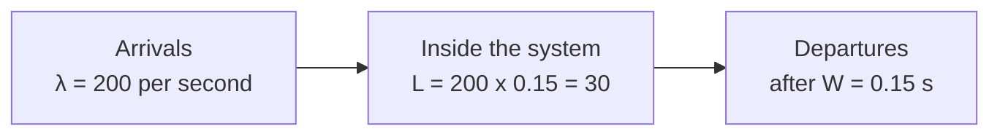

import LevelIntro from "../../../components/LevelIntro.astro";
import Checkpoint from "../../../components/Checkpoint.astro";
import PracticeCheck from "../../../components/PracticeCheck.astro";
import Plot from "../../../components/Plot.astro";

export const unit = { track: "applied-math", unitSlug: "math-tool-prediction" };

L1 showed that a test covers the case you tried and a formula covers the case
you did not, and that guessing "50% more input, 50% more result" is often
wrong. L2 makes that concrete with two durable relationships for anything
that waits in line: Little's Law, and the way waiting explodes near full
capacity.

<LevelIntro
  items={[
    "Little's Law: things inside = arrivals x stay",
    "Why waiting explodes near full capacity",
    "One habit, many formulas",
  ]}
/>

## A store has 200 customers an hour and each stays 15 minutes. How many are inside?

Gut feeling says "a lot, 200 sounds like a crowd". But 200 is how many arrive
over a whole hour, not how many are inside at once. Each person leaves after
a quarter of an hour, so the shop is never holding all 200.

Little's Law gives the exact answer for any stable system, with no
assumptions about the shape of the traffic:

$$L = \lambda W$$

| Symbol | Plain meaning                       | Store             | Web service             |
| ------ | ----------------------------------- | ----------------- | ----------------------- |
| `L`    | how many are inside, on average     | customers in shop | requests in flight      |
| `λ`    | how many arrive per unit of time    | 200 per hour      | 200 requests per second |
| `W`    | how long each one stays, on average | 0.25 hours        | 0.15 seconds (150 ms)   |

Store: `200 x 0.25 = 50` customers inside. Web service: `200 x 0.15 = 30`
requests in flight, not 200. The units check you: `per second x seconds =
a count`.

<Checkpoint question="A support queue gets 40 new tickets per hour and each ticket takes 45 minutes (0.75 hours) to resolve on average. How many tickets are open at any moment?">

About 30, because `40 x 0.75 = 30`. The tickets are not requests and the
queue is not a server, but the law only cares about the arrival rate and the
average stay. The 45 minutes had to become 0.75 hours first, since the rate is
per hour: the units must match before you multiply.

</Checkpoint>

<PracticeCheck
  track={unit.track}
  unitSlug={unit.unitSlug}
  topicId="littles-law"
/>

## Going from 60% busy to 90% busy: does waiting grow by about 1.5 times?

Little's Law takes `W` as given. But `W` is not fixed: the busier a server is,
the longer new arrivals wait behind the ones already queued. The standard
approximation for a single-server queue says the average wait scales with:

$$\rho / (1 - \rho)$$

where `ρ` (rho) is utilization, the fraction of time the server is busy, from
0 to 1. Read it as "how busy" divided by "how much room is left". At 50% busy
the room left is `0.50`; at 90% it is only `0.10`. Dividing by a shrinking
number makes the result grow faster than the percentage did.

| Utilization `ρ` | Room left `1 - ρ` | `ρ / (1 - ρ)` | vs. the 50% baseline |
| --------------- | ----------------- | ------------- | -------------------- |
| 0.50            | 0.50              | 1.0           | 1x                   |
| 0.60            | 0.40              | 1.5           | 1.5x                 |
| 0.80            | 0.20              | 4.0           | 4x                   |
| 0.90            | 0.10              | 9.0           | 9x                   |
| 0.95            | 0.05              | 19.0          | 19x                  |

<Plot
  mark="line"
  x="utilization"
  y="wait"
  xLabel="Utilization (%)"
  yLabel="Relative wait (50% busy = 1)"
  caption="The wait curve rho / (1 - rho) divided by its value at 50%. Exact values."
  data={[
    { utilization: 50, wait: 1 },
    { utilization: 60, wait: 1.5 },
    { utilization: 70, wait: 2.3333 },
    { utilization: 80, wait: 4 },
    { utilization: 85, wait: 5.6667 },
    { utilization: 90, wait: 9 },
    { utilization: 95, wait: 19 },
  ]}
/>

So "we are at 60% today, 90% is tight but survivable" is a linear read of a
curve. The same 30-point move that costs 1.5x at the bottom costs 6x between
60% and 90% (`9 / 1.5 = 6`).

<Checkpoint question="Using only the table, is the jump from 70% to 90% utilization about as painful as the jump from 50% to 70%, or worse?">

Worse, by a lot. From 50% to 70% the relative wait goes from 1 to about 2.3,
roughly 2.3 times. From 70% to 90% it goes from about 2.3 to 9, nearly 4
times. Same 20-point move, but each extra point costs more because the room
left keeps shrinking.

</Checkpoint>

<PracticeCheck
  track={unit.track}
  unitSlug={unit.unitSlug}
  topicId="utilization-curve"
/>

## Is the lesson "memorize Little's Law", or something wider?

Wider. Both tools follow one habit: **name the relationship between a few
quantities you can measure, write it down, and use it to predict one you
cannot measure yet.** The formula changes with the problem; reaching for it
instead of eyeballing a percentage is the transferable skill.

| Problem shape                           | Formula family             | What it predicts                         |
| --------------------------------------- | -------------------------- | ---------------------------------------- |
| Things waiting in line                  | Little's Law, wait curve   | How many inside, how long they wait      |
| Repeated independent chances of failure | Probability multiplication | Odds over many tries, not one            |
| Everyone interacting with everyone      | Pair counting              | Interactions grow much faster than users |

The utilization demo below lets you drag the numbers yourself. The point is
not the 9x figure but how quickly an average-case formula stops looking
average as it nears its limit.
