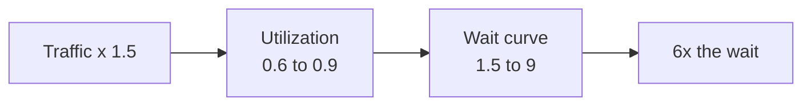
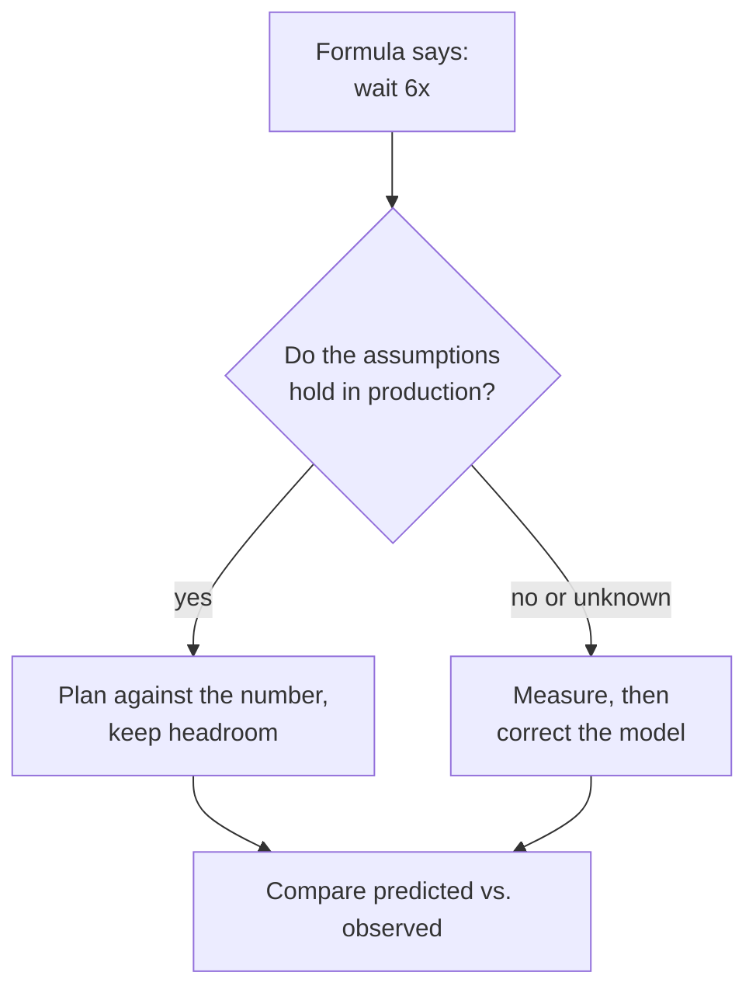

import Scenario from "../../../components/Scenario.astro";
import LevelIntro from "../../../components/LevelIntro.astro";
import Checkpoint from "../../../components/Checkpoint.astro";
import PracticeCheck from "../../../components/PracticeCheck.astro";
import Plot from "../../../components/Plot.astro";
import { Icon } from "astro-icon/components";

export const unit = { track: "applied-math", unitSlug: "math-tool-prediction" };

<Scenario label="The near-miss">
  <Fragment slot="facts">
    

      
<Icon name="lucide:gauge" class="h-4 w-4" /> <strong>Today</strong> — 60% utilization, nobody complains

      
<Icon name="lucide:trending-up" class="h-4 w-4" /> <strong>Forecast</strong> — 1.5x traffic (assumed forecast figure)

      
<Icon name="lucide:calculator" class="h-4 w-4" /> <strong>Utilization after</strong> — 0.6 x 1.5 = 0.9

    

    

      

        
Traffic change (1.5x)

        

      

      

        
Wait-time change (6x)

        

      

    

  </Fragment>

A team's service is 60% busy on a normal day. Product expects 50% more
traffic over two quarters. The plan on the table: "That puts us near 90%.
Tight, but survivable. We will add capacity next year."

The plan is simple arithmetic, and the first step of it is right: `0.6 x 1.5 =
0.9`. **Is the plan still reasonable once you ask what 90% busy does to the
wait?**

</Scenario>

<LevelIntro
  items={[
    "The near-miss worked with real numbers",
    "Which assumptions the answer depends on",
    "What changes when the case changes",
  ]}
/>

## What does the formula say about the 60% to 90% move?

Apply the wait curve from L2, `ρ / (1 - ρ)`, to both ends. Everything is
relative, so no real milliseconds are needed.

| Step              | Today (`ρ` = 0.6) | After growth (`ρ` = 0.9) |
| ----------------- | ----------------- | ------------------------ |
| Room left `1 - ρ` | 0.4               | 0.1                      |
| `ρ / (1 - ρ)`     | 0.6 / 0.4 = 1.5   | 0.9 / 0.1 = 9            |
| Change in wait    | baseline          | 9 / 1.5 = **6x**         |

Traffic grew 1.5 times. Utilization grew 1.5 times. The wait grew 6 times.
"Tight but survivable" was a linear read of a non-linear curve; in practice
the latency target would very likely be missed well before the full growth
arrived.

Partway through the growth the picture is already bad. With traffic at 7/6,
4/3 and 3/2 of today's (utilization 0.7, 0.8 and 0.9):

<Plot
  mark="line"
  x="growth"
  y="multiplier"
  xLabel="Traffic growth (multiple of today)"
  yLabel="Wait multiplier vs. today"
  caption="Wait time relative to today's wait, as traffic grows from 1x to 1.5x. Exact values from rho / (1 - rho) with rho = 0.6 x growth."
  data={[
    { growth: 1, multiplier: 1 },
    { growth: 1.1667, multiplier: 1.5556 },
    { growth: 1.3333, multiplier: 2.6667 },
    { growth: 1.5, multiplier: 6 },
  ]}
/>

Caught at planning time, this moves the capacity work from "next year" to
"before traffic gets anywhere near the full 1.5x". That is a decision the
linear guess could never have produced.

<Checkpoint question="The projection multiplies today's utilization (0.6) by the traffic growth (1.5) to get 0.9. What real-world change would make the true utilization higher than 0.9 even if the 1.5x traffic forecast is exactly right?">

Anything that makes each request take longer to serve under load: lock
contention, memory pressure, a slower downstream service. The projection
quietly assumed the time to serve one request stays the same. If each request
gets slower as load rises, the same traffic keeps the server busy for more of
each second, so utilization lands above 0.9 and the wait lands on a steeper
part of the curve.

</Checkpoint>

<PracticeCheck
  track={unit.track}
  unitSlug={unit.unitSlug}
  topicId="near-miss"
/>

## When is a correct formula still the wrong answer?

**The formula was applied correctly. Where can a correct calculation still
mislead?** Every formula comes with conditions, and the answer is only as true
as they are.

| Hidden assumption                        | What happens when it is false                                    |
| ---------------------------------------- | ---------------------------------------------------------------- |
| The numbers are averages that hold       | Real traffic has bursts; some minutes are far worse than average |
| Time to serve one request stays constant | Contention raises it under load, so the real curve is steeper    |
| The system is in steady state            | A flash spike is a different problem: plan burst headroom        |
| The formula is the truth                 | It is a prediction; measure and compare it to reality            |

A formula's job is to produce a specific, falsifiable expectation (for
example "do not run this above 80%"). Then you check it against measurements.
Predictive math narrows uncertainty; it does not remove the need for headroom.

<Checkpoint question="A team plans exactly to the average utilization its formula says is safe. Why can it still miss its latency target some minutes of the day?">

Because the formula describes the average and real traffic varies around it.
During a burst the instantaneous utilization sits higher on the curve, where
a small extra load costs a lot of wait. Planning to the average with no
headroom is planning to be wrong during every busy minute.

</Checkpoint>

<PracticeCheck
  track={unit.track}
  unitSlug={unit.unitSlug}
  topicId="assumptions"
/>

## A case, not the whole territory

The near-miss is one case: one service, a smooth forecast, one wait curve. It
is not the whole territory. Try changing it yourself:

- **What changes if the growth arrives as one spike in a single day** instead
  of smoothly over two quarters? Which row of the assumptions table is
  broken, and does `ρ / (1 - ρ)` still describe that day?
- **What if a database behind the service saturates at 70% while the service
  has room to 90%?** Which curve do you plan against, and what number do you
  alert on?
- **What if the team could cut the service time per request by a third?**
  What utilization would 1.5x traffic reach then, and what is the wait
  multiplier?

For the neighbouring tools, continue with `applied-math/queueing-theory-basics`
for queues, `applied-math/statistics` for averages and variance, and
`applied-math/orders-magnitude` for rough checks before exact prediction.
