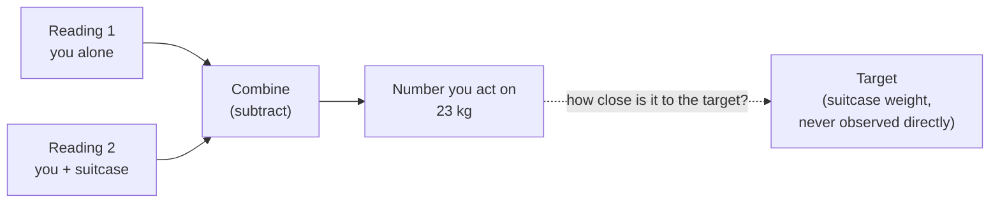

import Scenario from "../../../components/Scenario.astro";
import LevelIntro from "../../../components/LevelIntro.astro";
import PracticeCheck from "../../../components/PracticeCheck.astro";

export const unit = {
  track: "applied-math",
  unitSlug: "measurement-theory",
};

<Scenario label="The suitcase and the bathroom scale">
  <Fragment slot="facts">
    
What the scale showed

    

      
🧍 You alone: <strong>70 kg</strong>

      
🧳 You + suitcase: <strong>93 kg</strong>

      
➖ Difference: <strong>23 kg</strong> (airline limit: 23 kg)

    

    
Where the true weight can be (21 to 25 kg shown)

    

      

      

    

    
212223 (limit)2425

  </Fragment>

You want to know how much your suitcase weighs, but the only scale at home is
a bathroom scale you cannot fit it on. So you stand on the scale alone and read
70 kg, then stand on it holding the suitcase and read 93 kg. The suitcase
"weighs" 93 - 70 = 23 kg. The airline limit is exactly 23 kg. The scale only
shows whole kilograms.

**You never weighed the suitcase itself, and the scale rounds every reading.
Can you honestly say the suitcase is within the limit?**

</Scenario>

<LevelIntro
  items={[
    "Measuring a target through a stand-in",
    "Resolution and how errors add up",
    "Random versus systematic error",
  ]}
/>

## How do you measure something you cannot weigh directly?

**What did the subtraction just do?** It measured the suitcase _indirectly_:
you could not observe the target, so you measured two things you could observe
and combined them. Most interesting quantities work this way. Nobody can read
"code quality" or "learning" off an instrument; people read a **proxy**, an
observable stand-in believed to move with the target.

| Everyday piece | Simple example                   | Software example                    |
| -------------- | -------------------------------- | ----------------------------------- |
| Instrument     | ruler, bathroom scale, stopwatch | dashboard, logs, tracing, test tool |
| Unit           | cm, kg, seconds                  | %, ms, requests per second          |
| Proxy          | a grade for "learning"           | test coverage for "code quality"    |
| A claim        | "23 kg" (a number plus a unit)   | "p99 fell from 800 ms to 480 ms"    |

A number with no unit or no baseline ("it got 40% faster") is a direction, not
a measurement: nobody can check it.

<PracticeCheck
  track={unit.track}
  unitSlug={unit.unitSlug}
  topicId="measuring-indirectly"
/>

## How sure can you be of a rounded reading?

**The scale shows 70. Is the true value exactly 70?** No. The display only has
whole-kilogram steps, so 70 stands for anything from 69.5 up to 70.5. The step
size is the **resolution**, and one reading is uncertain by up to half a step.

Subtracting two readings stacks their uncertainties. Each reading can be off by
0.5 kg in either direction, so the difference can be off by up to 1 kg:

| Quantity                         | Displayed | True value lies in |
| -------------------------------- | --------- | ------------------ |
| You alone                        | 70 kg     | 69.5 to 70.5 kg    |
| You + suitcase                   | 93 kg     | 92.5 to 93.5 kg    |
| Suitcase (difference of the two) | 23 kg     | 22 to 24 kg        |

So the honest answer to the opening question is "I cannot tell": the suitcase
could be 22 kg or 24 kg, and the limit sits in the middle of that range.

Errors come in two kinds, and they behave differently under subtraction:

- **Random error** changes from reading to reading (you wobble on the scale).
  It does not cancel; it adds up.
- **Systematic error** is the same every time (the scale reads 2 kg too heavy).
  It **cancels** in a difference, because both readings carry the same offset.

<PracticeCheck
  track={unit.track}
  unitSlug={unit.unitSlug}
  topicId="resolution-error"
/>

## What this unit covers

- **Proxies**: observable stand-ins for things you cannot observe (L1, L2).
- **Resolution and error bounds**: a reading is a range, and combining readings
  widens it (L1, L3).
- **Validity versus reliability**: consistent is not the same as correct (L2).
- **When a proxy breaks**: pushing hard on the stand-in can detach it from the
  target (L2).
- **Sampling**: measuring a part to learn about the whole, and what it costs in
  accuracy (L3).
