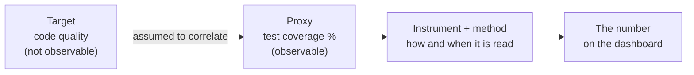
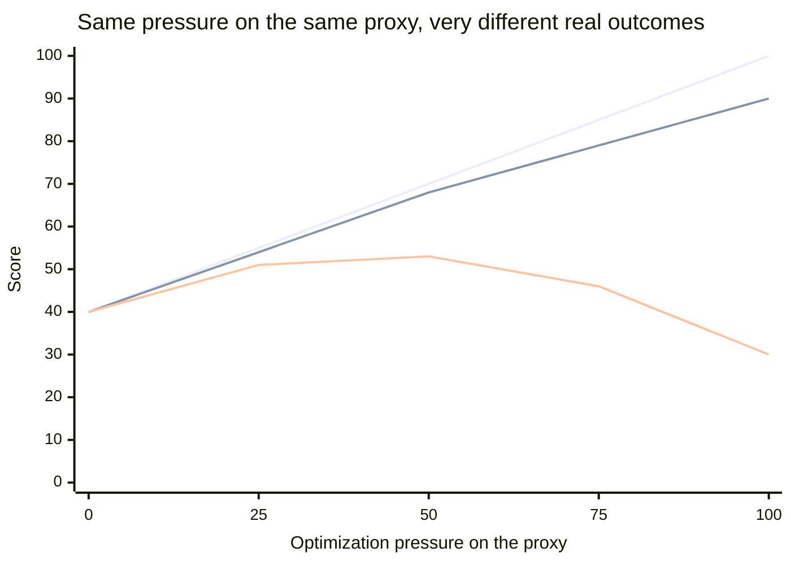

import LevelIntro from "../../../components/LevelIntro.astro";
import Checkpoint from "../../../components/Checkpoint.astro";
import PracticeCheck from "../../../components/PracticeCheck.astro";

export const unit = {
  track: "applied-math",
  unitSlug: "measurement-theory",
};

L1 showed that even a simple indirect measurement, the suitcase on a bathroom
scale, is a range rather than a point. This level asks what happens when the
stand-in itself is the weak link, using the engineering version of the same
idea: two teams, one metric.

<LevelIntro
  items={[
    "The target, proxy, instrument chain",
    "Reliable but not valid readings",
    "Why pushing on a proxy can break it",
  ]}
/>

## What actually connects a target you care about to a number on a screen?

**Two teams both raise test coverage from 40% to 100%. What has to be true for
that to mean their code got better?** The chain below has four links, and only
the first one is a judgment call.

The dotted link is the fragile one. Everything after it (instrument accuracy,
sampling) is an engineering problem you can fix; whether the proxy actually
tracks the target is an assumption the rest of the chain silently inherits. The
suitcase version: the scale can be perfect and still answer a different
question than "will the airline accept this bag".

"Instrumentation" is the instrument plus the method: "measure the desk from this
edge, three times, in centimeters" or "trace 1% of requests, store milliseconds,
compute p99 every minute".

<Checkpoint question="In the chain target, proxy, instrument, number: a bug in the metrics pipeline is fixed so coverage is computed correctly. Which link did that repair, and did it prove coverage tracks quality?">

It repaired the instrument link (how the number is produced), and it proved
nothing about the dotted link. A more accurate reading of the wrong stand-in is
still a reading of the wrong stand-in. Fixing instruments makes the number
trustworthy as a measurement of coverage; whether coverage tells you about
quality is a separate question that needs separate evidence.

</Checkpoint>

## Can a measurement be perfectly consistent and still be wrong?

**A scale reads 2 kg heavy every single time. Never a contradiction. Is that
good?** Two properties are hiding in that question:

|                   | Low reliability (readings scatter) | High reliability (readings repeat)     |
| ----------------- | ---------------------------------- | -------------------------------------- |
| **Low validity**  | Scattered and off target           | Tight cluster, wrong place (the scale) |
| **High validity** | Centered on target but noisy       | Tight cluster on the target (the goal) |

- **Reliability** (precision): do repeated readings of the same thing agree?
- **Validity** (accuracy): are the readings close to the thing you actually care
  about?

The dangerous cell is high reliability with low validity, because consistency
feels like trustworthiness. A dashboard that shows the same tidy number every
day may be reading a stale cache, a biased subset of traffic, or the wrong
proxy, and it will never visibly contradict itself.

<Checkpoint question="A dashboard shows exactly the same p99 latency every day this week. Does that stability show the number is accurate?">

No. Stability shows the reading is reliable, not valid. The same value every day
is also what a stuck cache, a miscalibrated instrument, or a sample that only
covers quiet hours would produce. You find out by checking against an
independent source, the way you would put a known 10 kg weight on a suspect
scale.

</Checkpoint>

<PracticeCheck
  track={unit.track}
  unitSlug={unit.unitSlug}
  topicId="validity-reliability"
/>

## Why does a proxy that used to track the target stop tracking it?

**If coverage was a fine quality signal last year, why can it be a bad one this
year?** Because once people are rewarded for the number itself, effort moves
from the target to the stand-in: tests get added that execute lines without
checking anything. That pattern is called **Goodhart's law**: when a measure
becomes a target, it stops being a good measure.

The chart is a simple model, not field data. The proxy score is
`40 + 0.6 x pressure`, capped at 100. The real target equals that minus a penalty
that grows with the square of the pressure and shrinks as the proxy's
correlation with the target gets stronger. A weak proxy (correlation 0.3) is
Team B; a strong one (0.9) is Team A.

Early on, both targets rise with the proxy, which is exactly why the proxy
looked like a good idea. Team B's real target peaks near 53 and then falls to 30
while its coverage keeps climbing. Drag the correlation and pressure sliders in
the interactive demo on this level to see where the curve bends.

A school has the same shape: reward only test scores and some students learn the
subject while others learn the test. The score rises either way.

<PracticeCheck
  track={unit.track}
  unitSlug={unit.unitSlug}
  topicId="goodhart-proxy"
/>

## Does measuring something change the thing being measured?

**Is more instrumentation always better?** Taking a measurement costs
something, and sometimes enough to disturb what you are measuring (timing a
fast function by logging every call can make the function slow).

| Choice                           | Value of the data              | Ongoing cost                                    |
| -------------------------------- | ------------------------------ | ----------------------------------------------- |
| No instrumentation               | None, you are guessing         | None                                            |
| Sampled tracing (for example 1%) | Trends and most large outliers | Small, roughly proportional to the sample rate  |
| Full tracing of every request    | Complete picture               | Real CPU and storage; can become the bottleneck |

The right amount is where the next bit of data stops being worth what it costs
to collect. A small internal tool and a high-traffic service land in different
places.

<PracticeCheck
  track={unit.track}
  unitSlug={unit.unitSlug}
  topicId="instrumentation-cost"
/>
