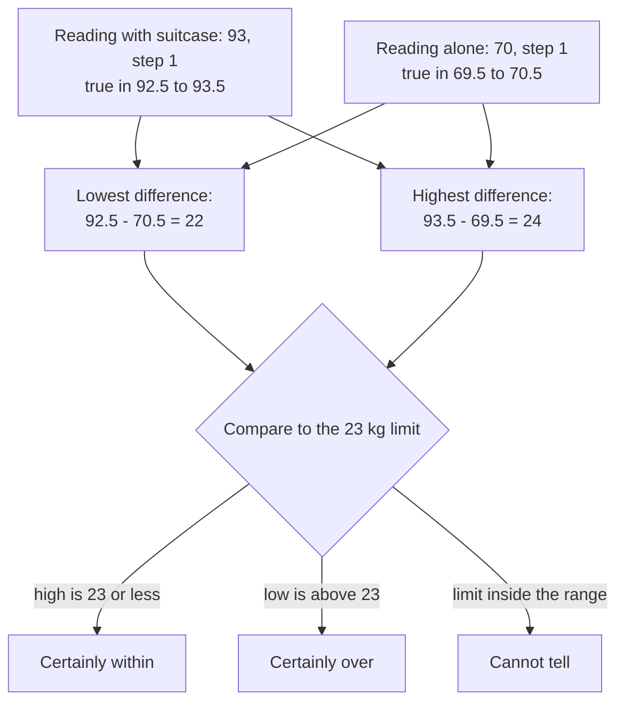
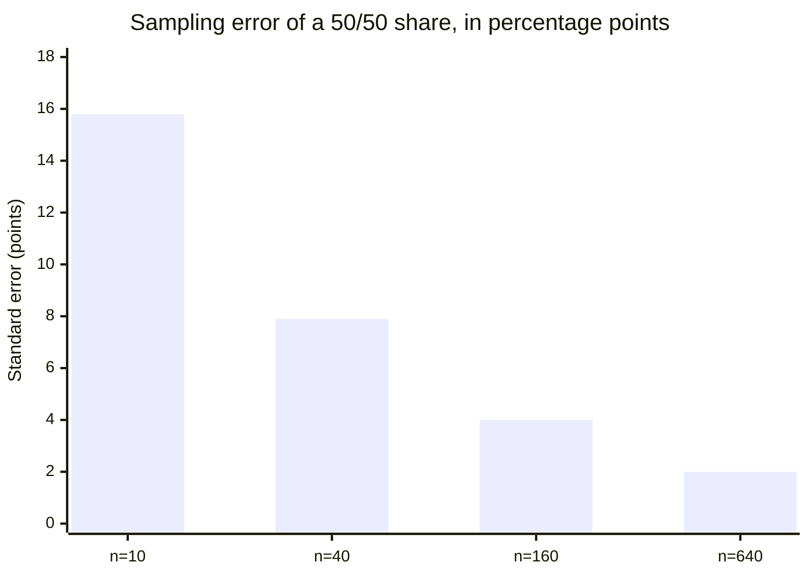

import Scenario from "../../../components/Scenario.astro";
import LevelIntro from "../../../components/LevelIntro.astro";
import Checkpoint from "../../../components/Checkpoint.astro";
import PracticeCheck from "../../../components/PracticeCheck.astro";

export const unit = {
  track: "applied-math",
  unitSlug: "measurement-theory",
};

<Scenario label="The lunch-menu survey">
  <Fragment slot="facts">
    
Typical error of a "share who like it" estimate (assumes a fair 50/50 split)

    

      

        10 asked
        

        ±15.8 pts
      

      

        40 asked
        

        ±7.9 pts
      

      

        160 asked
        

        ±4.0 pts
      

    

  </Fragment>

A school wants to know what share of its students like the new lunch menu.
Asking every student is a lot of work, so a volunteer asks 10 students and
finds 6 of 10 like it. The principal says "that is too few, ask 40." After 40
answers the number moves a little, and the principal says "ask 160 to be sure."
Each time the volunteer has to ask four times as many people.

**Quadrupling the effort helps. But does it help four times as much, or less?
And what if the 160 people asked are all standing in the lunch queue for the
new menu?**

</Scenario>

<LevelIntro
  items={[
    "Carrying error through a calculation",
    "How sampling error shrinks with sample size",
    "Failure modes: bias and stale proxies",
  ]}
/>

## How wide is the range after you combine readings?

**L1 said the suitcase is 22 to 24 kg. Where did that range come from, and can
you compute it for any combination?** Work from the rule: a reading with
resolution `step` is uncertain by half a step either way. Combining readings
turns those into bounds on the result.

The worst case for a difference pairs the highest first reading with the lowest
second one, so the range is the displayed difference minus and plus one full
step. For a sum of `n` readings every reading adds half a step each way, so the
range grows to `n` half-steps on each side. A constant systematic offset is the
exception: it shifts both readings equally and cancels in the difference, which
is why subtracting is a good trick for a scale that reads 2 kg heavy.

The three verdicts in the diagram are the point. A rounded number can prove
"within the limit" or "over the limit", but when the limit falls inside the
range the only honest verdict is "cannot tell". Getting a better answer means
buying a finer scale (smaller step), not computing harder.

<Checkpoint question="You switch to a scale that shows 0.5 kg steps and read 70.0 alone and 93.0 with the suitcase. What is the new range for the suitcase, and does it settle the 23 kg question?">

The displayed difference is still 23.0 kg, but the range is now the difference
minus and plus one step of 0.5, so 22.5 to 23.5 kg. The limit of 23 is still
inside the range, so it still does not settle it, only narrows it. Halving the
step halves the width of the doubt; it never removes it. With 0.1 kg steps the
same 23.0 difference would give 22.9 to 23.1, still undecided. A difference of
22.0 on that scale (range 21.9 to 22.1) would finally clear the limit.

</Checkpoint>

<PracticeCheck
  track={unit.track}
  unitSlug={unit.unitSlug}
  topicId="error-bounds"
/>

## How fast does sampling error shrink as you ask more people?

**Before reading on: if 10 answers leave you about 15.8 percentage points
unsure, what do you guess 40 answers do, and 160?** Sampling error is separate
from instrument error: even a perfect instrument reading a random subset gives
an estimate that differs from the whole population by chance. The usual measure
for a random sample is the standard error, which shrinks with the square root
of the sample size:

| Sample size n | Error for a 50/50 yes-no share (0.5 / sqrt(n)) | Error for a measure with spread 20 (20 / sqrt(n)) |
| ------------- | ---------------------------------------------- | ------------------------------------------------- |
| 10            | 15.8 points                                    | 6.32                                              |
| 40            | 7.9 points                                     | 3.16                                              |
| 160           | 4.0 points                                     | 1.58                                              |
| 640           | 2.0 points                                     | 0.79                                              |

Each 4x increase in n halves the error. So quadrupling the effort helps, but
with sharply diminishing returns: the first 30 extra answers buy 7.9 points, the
next 120 buy 3.9, the next 480 buy 2.0. The assumptions behind the numbers are
a random sample, independent answers, and (for the second column) an assumed
spread of 20, not a measured one.

For production traffic the same rule applies. Going from a 1% sample to a 4%
sample halves the error. Going from 4% to 100% is 25 times more data for a
further 5 times less error, at the instrumentation cost of full tracing from
L2.

<Checkpoint question="You sample 1% of requests and want half the sampling error. Does doubling the rate to 2% do it?">

No. Error scales with 1 / sqrt(n), so doubling n only divides the error by
sqrt(2), about 1.41, which is a 29% reduction rather than 50%. Halving needs 4x
the sample, so 1% would have to become 4%.

</Checkpoint>

<PracticeCheck
  track={unit.track}
  unitSlug={unit.unitSlug}
  topicId="sampling-error"
/>

## What can go wrong that more data does not fix?

**Back to the lunch queue: 160 answers from the queue for the new menu. Is the
error now 4.0 points?** The 4.0 assumes a random sample. A large biased sample
does not converge on the school's opinion; it converges, with a very small
error bar, on the opinion of the queue.

- **Biased sampling.** Sampling only business hours, only the fastest
  servers, or only people who chose to answer measures a different population
  precisely. Standard error says nothing about this kind of error, because it
  only describes chance variation.
- **A proxy that quietly decoupled.** A proxy validated once can stop tracking
  its target after people are rewarded for it (L2). Re-check it periodically,
  especially after it becomes something people are evaluated on.
- **Instrumentation cost found late.** Overhead that is invisible at
  development load can become the bottleneck at production load; evaluate the
  trade-off from L2 at production scale.
- **A claim without a unit or a baseline.** "Latency improved 40%" does not say
  which percentile, which endpoint, or compared with what.

## A case, not the whole territory

The suitcase, the lunch survey and the two coverage teams are three cases of
one model, not the whole territory. Try to extend them:

- **What changes if the scale shows 2 kg steps instead of 1?** What range does a
  93 and 70 reading give now, and could any displayed difference still prove
  "within 23 kg"?
- **What changes if the survey population is heavily lopsided**, say 95% of
  students like the menu instead of 50%? Does the error still shrink as
  1 / sqrt(n), and is the error in points the same size as in the 50/50 case?
- **What if a proxy is so poorly chosen that pushing it makes the target worse
  from the first unit of effort?** What would the real-target line in the L2
  chart look like?
- **Pick a proxy from your own team** (for example "tickets closed" for
  "support quality"). What is the first check you would do before trusting it,
  and what would hammering on it do to the target?
