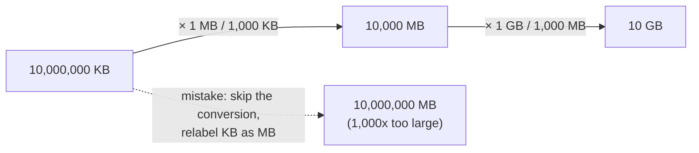
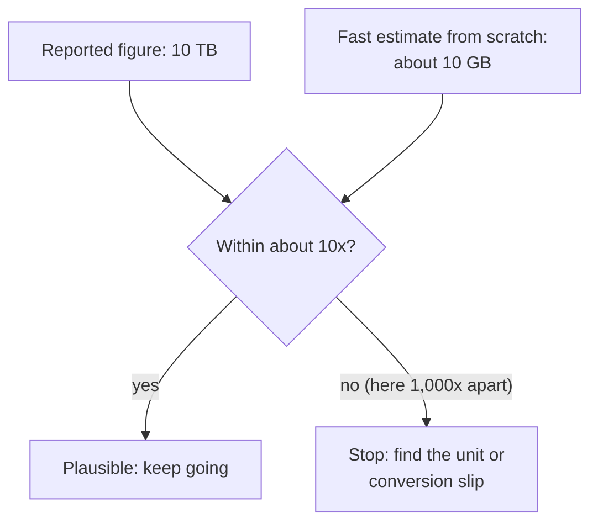

import LevelIntro from "../../../components/LevelIntro.astro";
import Checkpoint from "../../../components/Checkpoint.astro";
import PracticeCheck from "../../../components/PracticeCheck.astro";

export const unit = {
  track: "applied-math",
  unitSlug: "orders-magnitude",
};

L1 showed that the same digits, `10,000,000`, can mean 10 GB or 10 TB depending
on the unit, and that a rough rebuild of the answer exposes the gap. L2 makes
both moves mechanical enough to run by hand on any calculation.

<LevelIntro
  items={[
    "Canceling units like algebra terms",
    "Conversion as multiplying by 1",
    "Fermi estimates built from front numbers",
  ]}
/>

## Why does `records × KB/record` come out in KB?

**Where does the unit of an answer come from, if not from habit?** Units behave
like variables: they multiply, divide, and cancel.

```text
2,000,000 records × 5 (KB / record)
= (2,000,000 × 5) × (records × KB / record)
= 10,000,000 × KB          <- "records" cancels against "per record"
```

Read the labels as objects. "records" appears once as the thing counted and once
as "per record", so the two cancel. "KB" has no opposite, so it remains. The
unit `KB` was derived, not chosen. Writing "MB" at this point would be inventing
a unit the algebra never produced.

<Checkpoint question="A calculation multiplies 3 servers by 4 requests per second per server. Cancel the units by hand. What unit is the result in, and why?">

Requests per second. "server" appears once as the thing counted and once as "per
server" inside the rate, so those labels cancel and leave "requests per second".
The numbers 3 and 4 play no part in deciding the unit; only which labels have an
opposite to cancel against does.

</Checkpoint>

<PracticeCheck
  track={unit.track}
  unitSlug={unit.unitSlug}
  topicId="unit-cancellation"
/>

## How does a conversion change the number but not the amount?

**How does `10,000,000 KB` correctly become GB?** A conversion factor is a
fraction equal to exactly 1, because both sides name the same amount of data.
`1 MB / 1,000 KB` is such a fraction. Multiplying by it changes the written
number and the unit, never the quantity.



The slip is almost never wrong arithmetic. It is a missing multiplication by 1:
the number stays `10,000,000` while the unit quietly changes meaning.

The demo below uses this unit's own numbers. The true figure is a fixed 10 GB
per day; each skipped conversion step multiplies the reported number by another
1,000.

<Checkpoint question="Why does multiplying by `1 MB / 1,000 KB` leave the quantity of data unchanged?">

Because the fraction equals 1: 1 MB and 1,000 KB are two names for the same
amount of data, so the multiplication is the same as multiplying by `5/5`. Only
the unit used to express the amount changes. That is also why skipping the
conversion is dangerous. The digits stay the same, so nothing looks different,
but they are now attached to a unit 1,000 times larger.

</Checkpoint>

## How do you rebuild an answer in seconds?

**If exact arithmetic can still be wrong by 1,000x, what catches it?** A
**Fermi estimate**, named for the physicist Enrico Fermi, who was known for fast,
rough estimates. Write each factor as a front number times a power of ten, then
multiply the front numbers and add the exponents.

Start with something familiar. How long is a queue of 300 people? Assume each
person takes about 0.6 m of space: $$300 \times 0.6 = 180$$ m, so "a couple of
hundred metres, not 20 m and not 2 km." Now the pipeline:

| Factor             | Written as      | Front number | Power of ten |
| ------------------ | --------------- | ------------ | ------------ |
| 2,000,000 records  | 2 × 10⁶         | 2            | 6            |
| 5 KB = 5,000 bytes | 5 × 10³         | 5            | 3            |
| Product            | 10 × 10⁹ = 10¹⁰ | 2 × 5 = 10   | 6 + 3 = 9    |

Ten billion bytes is 10 GB. The estimate took a few seconds, used no long
multiplication, and lands on the right order of magnitude.



The value of a Fermi estimate is **speed and independence**, not precision. It
does not reuse the original calculation, so it cannot repeat the original
mistake. Its own error from rounding is typically small next to a skipped
conversion. Rounding 2 and 5 to the nearest front number costs at most a
factor of a few, while a missed KB-to-MB step costs 1,000.

<Checkpoint question="Why can't you check a calculation by simply running the same steps again?">

Because the same steps contain the same mistake. If the unit was mislabelled in
step one, a second pass makes the same mislabel and the two answers agree on
a wrong number. A check is only useful when it is computed a different way, so
the two results can disagree when one is wrong.

</Checkpoint>

<PracticeCheck
  track={unit.track}
  unitSlug={unit.unitSlug}
  topicId="fermi-split"
/>

## The two-part discipline

| Habit                         | What it protects against                     |
| ----------------------------- | -------------------------------------------- |
| Carry units through each step | A unit chosen from memory at the end         |
| Rebuild a rough answer        | A mistake that repeats when you recompute it |
