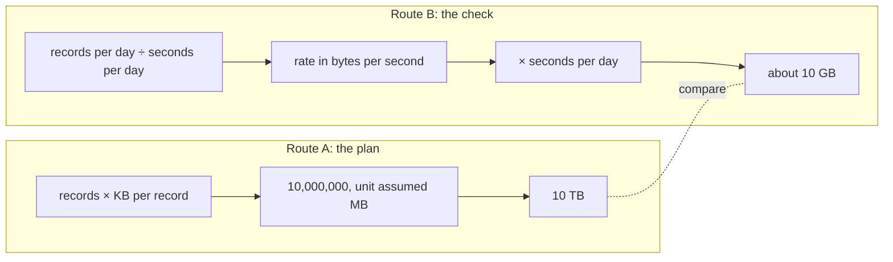

import Scenario from "../../../components/Scenario.astro";
import LevelIntro from "../../../components/LevelIntro.astro";
import Checkpoint from "../../../components/Checkpoint.astro";
import Plot from "../../../components/Plot.astro";
import PracticeCheck from "../../../components/PracticeCheck.astro";

export const unit = {
  track: "applied-math",
  unitSlug: "orders-magnitude",
};

<Scenario label="Your quick estimate says 10 GB a day. The plan on the table says 10 TB. Which one do you trust?">
  <Fragment slot="facts">
    

      
📥 <strong>Input</strong> — 2,000,000 records a day, about 5 KB each (made-up pipeline)

      
📋 <strong>The plan</strong> — provision for 10 TB a day

      
🧠 <strong>Your estimate</strong> — about 10 GB a day, built from scratch

    

    

      

        
Estimate

        about 10 GB/day (10¹⁰ bytes)
      

      

        
The plan

        10 TB/day (10¹³ bytes)
      

    

  </Fragment>

Two numbers disagree by 1,000x, and both came from someone who can do
arithmetic. **Re-reading the plan's multiplication will not settle it, because
the multiplication is probably fine. What would?**

</Scenario>

<LevelIntro
  items={[
    "A second route to the same quantity",
    "How far apart counts as disagreement",
    "Where the check itself goes wrong",
  ]}
/>

## How do you build a second route that cannot share the first one's mistake?

**If your estimate used the same steps as the plan, what would it prove?**
Nothing. A useful check goes at the quantity from another side. The plan computed
"records times size". The check below computes a data rate first, then scales it
to a day. Every number is rounded, and every rounding is an assumption written
down.

| Step | Quantity           | Rounded value             | Why                                    |
| ---- | ------------------ | ------------------------- | -------------------------------------- |
| 1    | Records per day    | 2 × 10⁶                   | Given                                  |
| 2    | Seconds in a day   | about 10⁵ (really 86,400) | Assumption: round up to a power of ten |
| 3    | Records per second | 2 × 10⁶ / 10⁵ = 20        | Step 1 divided by step 2               |
| 4    | Bytes per record   | 5 × 10³                   | 5 KB                                   |
| 5    | Bytes per second   | 20 × 5 × 10³ = 10⁵        | Step 3 times step 4                    |
| 6    | Bytes per day      | 10⁵ × 10⁵ = 10¹⁰          | Step 5 times step 2                    |

Ten billion bytes is 10 GB. The exact value, from L2, is also 10 GB, so the
rounding cost essentially nothing here. The plan's 10 TB is 10¹³ bytes.

Notice that route B follows its own unit chain too: records per second times
bytes per record is bytes per second. The check uses the same discipline, in a
different order.

<Checkpoint question="Route B multiplies by the seconds per day once, after dividing by it once. Why does it still count as an independent check instead of just cancelling out?">

The rounded value is not the same number each time it appears, and the order of
operations is different. The route turns the quantity into a rate, which is
something you can sanity check on its own: about 20 records every second, about
100 KB per second. That intermediate figure is a thing a person can feel and
challenge. The plan's route has no such waypoint, and its unit was never
checked along the way.

</Checkpoint>

<PracticeCheck
  track={unit.track}
  unitSlug={unit.unitSlug}
  topicId="second-route"
/>

## How far apart do two numbers have to be before something is wrong?

**Rounding costs a small factor, so when does a gap stop being rounding?** Think
in orders of magnitude of the ratio. This is a working rule of thumb for this
unit, not a law:

| Ratio between plan and estimate | Likely meaning                                     | Action                          |
| ------------------------------- | -------------------------------------------------- | ------------------------------- |
| Under about 3x                  | Rounding and assumptions                           | Accept                          |
| About 10x                       | One assumption may be off, or a real effect        | Look at the biggest assumption  |
| 100x or more                    | A unit, a conversion, or a misread quantity        | Stop and hunt for the slip      |
| About 1,000x                    | Almost always a skipped or doubled factor of 1,000 | Check KB / MB / GB labels first |

A gap of exactly a power of ten is a strong signature: mistakes in
assumptions tend to give messy ratios like 2.7x, while a missing unit conversion tends to give
1,000x on the nose.

The chart plots four figures in GB on a log scale. The two good figures sit on
the same grid line, the plan sits three lines above it, and an error in the other
direction sits three lines below.

<Plot
  mark="dot"
  x="case"
  y="gb"
  yScale="log"
  xLabel="1 = estimate, 2 = exact, 3 = plan (relabelled MB), 4 = divided by 1,000 once too often"
  yLabel="Gigabytes per day"
  caption="The mistake is not a small drift: it is three grid lines away in either direction."
  data={[
    { case: 1, gb: 10 },
    { case: 2, gb: 10 },
    { case: 3, gb: 10000 },
    { case: 4, gb: 0.01 },
  ]}
/>

## What does the check not protect you from?

| Failure mode                                        | Why the check misses it                                                                                                                                                  |
| --------------------------------------------------- | ------------------------------------------------------------------------------------------------------------------------------------------------------------------------ |
| Both routes share an input that is wrong            | If 2,000,000 records a day is itself a misread, both routes inherit it                                                                                                   |
| The ratio is small but the cost of being off is big | 3x on a bill or a safety limit can still matter; a rough check does not replace exact work                                                                               |
| The check reuses the plan's unit table              | A wrong KB-to-MB factor copied into both routes makes them agree on a wrong answer                                                                                       |
| Decimal versus binary units                         | 1,024³ / 1,000³ is about 1.07, so GB versus GiB is roughly a 7% drift, well inside rounding, not a 1,000x slip                                                           |
| Believing it only happens to careless teams         | A 1999 spacecraft loss is attributed to one team's software output in pound-force seconds and another's expecting newton-seconds; one unit is about 4.45 times the other |

The spacecraft case is the same structure as the logging plan. A number was
correct in the unit it was produced in and wrong the moment a downstream system
assumed a different one, with nothing forcing an explicit unit check between them.

<Checkpoint question="Your estimate and the plan agree to within 2x, but both came from the same spreadsheet cell for 'records per day'. What has the check actually shown?">

Only that the arithmetic and units downstream of that cell are consistent. The
cell itself was never checked, because both routes depend on it. An independent
check has to be independent of the input too, for example by asking how many
users there are and how many records each makes. Agreement between two routes
that share a source tells you nothing about that source.

</Checkpoint>

<PracticeCheck
  track={unit.track}
  unitSlug={unit.unitSlug}
  topicId="gap-signature"
/>

## Extend the case: this is one worked example, not the whole territory

The plan overestimated by 1,000x and cost money. **What changes if the same
slip had gone the other way, planning for 10 MB a day instead of 10 GB?** The
check flags it just the same, three grid lines low, but the consequence is
different: storage fills and data is dropped or a service fails under real load,
usually found later and in production instead of in a budget review. Now try
changing other things yourself. What if the 5 KB were 5 MB per record? What if
the estimate had no unit written down for one factor? What if the two routes
disagreed by exactly 24, a number that looks like hours in a day? Each variant
asks you to decide where in the chain the slip lives, which is the real skill;
this scenario is only one place to practise it.
