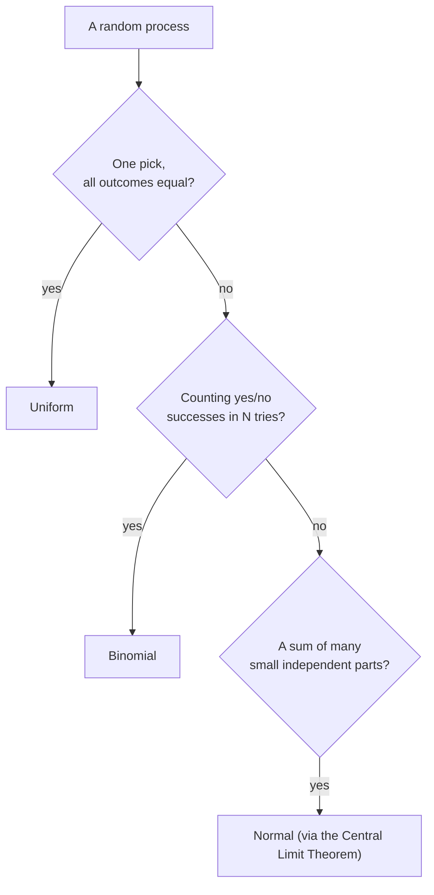

import Scenario from "../../../components/Scenario.astro";
import LevelIntro from "../../../components/LevelIntro.astro";
import PracticeCheck from "../../../components/PracticeCheck.astro";

export const unit = {
  track: "applied-math",
  unitSlug: "probability-distributions-uniform",
};

<Scenario label="You rolled a fair die 60 times and got 15 sixes. Is the die loaded?">
  <Fragment slot="facts">
    

      
🎲 <strong>The setup</strong> — one die, 60 rolls, each face has probability 1/6

      
📊 <strong>Expected sixes</strong> — 60 × 1/6 = 10

      
🚨 <strong>Observed</strong> — 15 sixes, which is 5 more than expected

    

    

      

        
Expected10 sixes

        

      

      

        
Observed15 sixes

        

      

    

  </Fragment>

You roll a fair die 60 times. A fair die gives each face a one-in-six
chance, so you expect about 10 sixes. You count 15. **Is the die loaded, or
is this what fair dice look like over 60 rolls?** Your gut can't answer that.
You need to know how much wobble around 10 is normal, and that is what a
probability distribution describes.

</Scenario>

<LevelIntro
  items={[
    "Uniform outcomes, discrete and continuous",
    "Counting successes: the binomial",
    "Sums of small effects: the normal",
  ]}
/>

## Three shapes of chance

Chance questions come in three common shapes. Which shape you have decides
which tool you use.

| Question about a random process                       | Distribution | Dice or coin example                           |
| ----------------------------------------------------- | ------------ | ---------------------------------------------- |
| Which one of several equally likely outcomes happens? | Uniform      | One roll of a fair die: each face is `1/6`     |
| How many times does a yes/no event happen in N tries? | Binomial     | Number of sixes in 60 rolls                    |
| What does the total of many small random parts do?    | Normal       | Sum of six dice: it clusters around the middle |

## Uniform: every outcome equally likely

A fair die is **discrete** uniform: you can list the outcomes (1 to 6) and
each has probability `1/6`. A decimal picked anywhere between 1 and 5 is
**continuous** uniform: there are infinitely many values, so you ask about
intervals. The interval 2 to 4 is half of 1 to 5, so it has probability
`2/4 = 50%`.

<PracticeCheck
  track={unit.track}
  unitSlug={unit.unitSlug}
  topicId="uniform-shapes"
/>

## Binomial: counting successes

If you roll 60 times and count sixes, each roll is an independent yes/no
trial with `p = 1/6`. The count of sixes follows a binomial distribution.

| Quantity           | Formula            | 60 rolls, p = 1/6 |
| ------------------ | ------------------ | ----------------- |
| Mean               | `n × p`            | 10 sixes          |
| Standard deviation | `√(n × p × (1-p))` | about 2.89 sixes  |

The standard deviation is the typical wobble around the mean. 15 sixes is
`(15 − 10) / 2.89`, about 1.73 standard deviations above the mean. A fair die
gives 15 or more sixes in roughly 6.5% of 60-roll sessions, so the honest answer
to the scenario is "unusual, not proof."

<PracticeCheck
  track={unit.track}
  unitSlug={unit.unitSlug}
  topicId="binomial-spread"
/>

## Normal: sums of small effects

One die is flat. The sum of six dice is not: it bunches around 21, because
there are many more ways to land in the middle than at the extremes. Summing many
independent pieces tends toward a bell curve whatever the shape of each piece.
This is the **Central Limit Theorem**. Means add, and variances add.

<PracticeCheck
  track={unit.track}
  unitSlug={unit.unitSlug}
  topicId="sums-look-normal"
/>

## Key terms

- **Distribution** — how likely each outcome is.
- **Mean** — the expected center.
- **Standard deviation** — the typical distance from the mean.
- **Z-score** — how many standard deviations a result sits from the mean.
- **Independent** — one trial's result doesn't change another's chance.

## What the next levels cover

L2 draws each shape and shows the formulas. L3 applies them to a 4-server load
balancer (64 of 200 requests on one server), a 2%-failure alert threshold, and a
simulated latency sum, and ends with a code exercise that computes the z-score.
