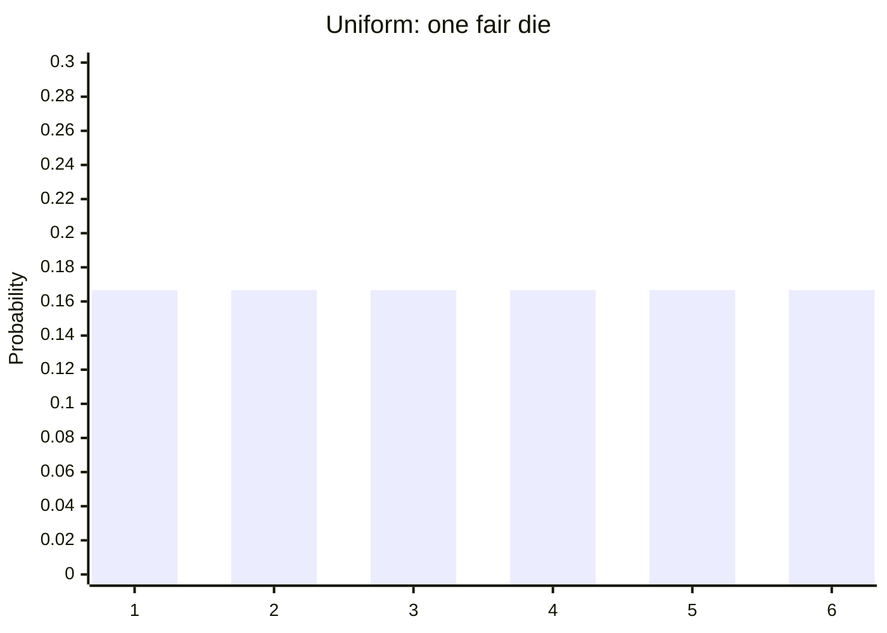
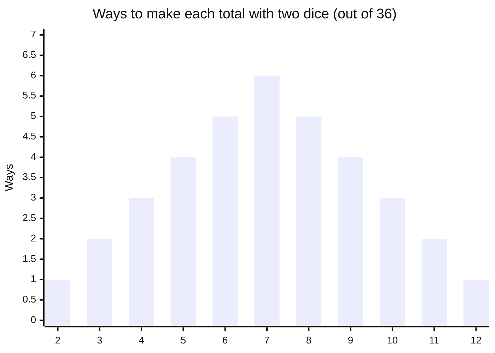

import LevelIntro from "../../../components/LevelIntro.astro";
import Checkpoint from "../../../components/Checkpoint.astro";
import PracticeCheck from "../../../components/PracticeCheck.astro";
import Plot from "../../../components/Plot.astro";

export const unit = {
  track: "applied-math",
  unitSlug: "probability-distributions-uniform",
};

L1 left the dice question open: 15 sixes in 60 rolls against 10 expected. This level
draws each of the three shapes and shows the arithmetic that turns "unusual-looking" into a number.

<LevelIntro
  items={[
    "Flat shapes: discrete and continuous uniform",
    "Binomial mean, spread, and shape",
    "Why sums of independent parts look bell-shaped",
  ]}
/>

## What does "equally likely" look like?

**If every outcome is equally likely, what does the picture look like?** A flat
set of bars (discrete) or a flat rectangle (continuous).

| Uniform type | Example                       | How probability is read                      |
| ------------ | ----------------------------- | -------------------------------------------- |
| Discrete     | a die face, 1 of 4 servers    | each listed outcome has probability `1/N`    |
| Continuous   | a delay anywhere in 1 to 5 ms | probability = interval length / total length |

For the continuous case the chance of landing on one exact value is 0, which is
why you ask about intervals. 1 ms to 2 ms inside 1 ms to 5 ms is `1/4 = 25%`.
A continuous uniform on `[a, b]` has mean `(a+b)/2` and variance `(b−a)²/12`; for 1 to 5 that is mean 3
and variance `16/12 ≈ 1.333`.

<Checkpoint question="A delay is continuous uniform between 1 ms and 5 ms. What is the probability it falls between 3 ms and 5 ms?">

50%. The interval is 2 ms long inside a 4 ms range, so `2/4`. Only the length of the piece
relative to the whole matters, not where it sits.

</Checkpoint>

<PracticeCheck
  track={unit.track}
  unitSlug={unit.unitSlug}
  topicId="uniform-shapes"
/>

## How many sixes is normal in 60 rolls?

**Each roll is a yes/no trial. What shape does the count of yeses take?** Not flat.
The count piles up near `n × p` and thins out on both sides.

<Plot
  mark="bar"
  x="k"
  y="p"
  data={[
    { k: 0, p: 0.0 },
    { k: 1, p: 0.0002 },
    { k: 2, p: 0.0013 },
    { k: 3, p: 0.0049 },
    { k: 4, p: 0.0138 },
    { k: 5, p: 0.031 },
    { k: 6, p: 0.0569 },
    { k: 7, p: 0.0877 },
    { k: 8, p: 0.1162 },
    { k: 9, p: 0.1343 },
    { k: 10, p: 0.137 },
    { k: 11, p: 0.1246 },
    { k: 12, p: 0.1017 },
    { k: 13, p: 0.0751 },
    { k: 14, p: 0.0504 },
    { k: 15, p: 0.0309 },
    { k: 16, p: 0.0174 },
    { k: 17, p: 0.009 },
    { k: 18, p: 0.0043 },
    { k: 19, p: 0.0019 },
    { k: 20, p: 0.0008 },
  ]}
  xLabel="Sixes in 60 rolls"
  yLabel="Probability"
  caption="Exact binomial probabilities for 60 rolls, p = 1/6. The peak is at 10."
/>

| Quantity           | Formula             | 60 rolls, p = 1/6 | 500 requests, p = 0.02 |
| ------------------ | ------------------- | ----------------- | ---------------------- |
| Mean               | `n × p`             | 10                | 10                     |
| Variance           | `n × p × (1 − p)`   | about 8.33        | 9.8                    |
| Standard deviation | square root of that | about 2.89        | about 3.13             |

Same mean, different spread: the standard deviation, not the mean, tells you how far counts wander.
A **z-score** is `(observed − mean) / standard deviation`. For 15 sixes: `(15 − 10) / 2.89 ≈ 1.73`.
The exact chance of 15 or more sixes is about 6.5%.

The binomial rests on two assumptions: each trial has the same `p`, and trials are **independent**.

<Checkpoint question="Two processes both average 10 events in a window. One has standard deviation 2.89 and the other 3.13. Does 15 events look equally surprising for both?">

Slightly more surprising for the first one. 15 is 1.73 standard deviations out for the
first and about 1.60 for the second. The same raw gap of 5 means more when the typical wobble is smaller.

</Checkpoint>

<PracticeCheck
  track={unit.track}
  unitSlug={unit.unitSlug}
  topicId="binomial-spread"
/>

## Why does a sum of flat things look like a bell?

**One die is flat. What about two?** Count the ways to make each total:

A total of 7 can happen 6 ways, a total of 2 only 1 way. Middle totals have more
combinations. Add more dice and the shape smooths further toward a bell: this is the Central Limit Theorem.
For independent pieces, **means add and variances add** (not standard deviations).

| Sum of | Mean | Variance (one die = 35/12 ≈ 2.917) | Standard deviation |
| ------ | ---- | ---------------------------------- | ------------------ |
| 1 die  | 3.5  | 2.917                              | 1.71               |
| 6 dice | 21   | 17.5                               | 4.18               |

Six dice have a standard deviation of 4.18, not `6 × 1.71 = 10.2`.

<Checkpoint question="Why is the standard deviation of six dice (4.18) so much smaller than six times one die's (10.2)?">

Because independent pieces partly cancel: when one die rolls high another often rolls low.
Variances add (`6 × 2.917 = 17.5`), and the square root of that is 4.18. Adding standard deviations would assume every piece wobbles the same way at once.

</Checkpoint>

<PracticeCheck
  track={unit.track}
  unitSlug={unit.unitSlug}
  topicId="sums-look-normal"
/>

## Choosing the tool

| Question                                        | Use      |
| ----------------------------------------------- | -------- |
| Which of N equal outcomes occurs?               | Uniform  |
| How many yeses in N independent trials?         | Binomial |
| What does a total of many independent parts do? | Normal   |

Using the wrong one gives a confident answer to a question nobody asked.
