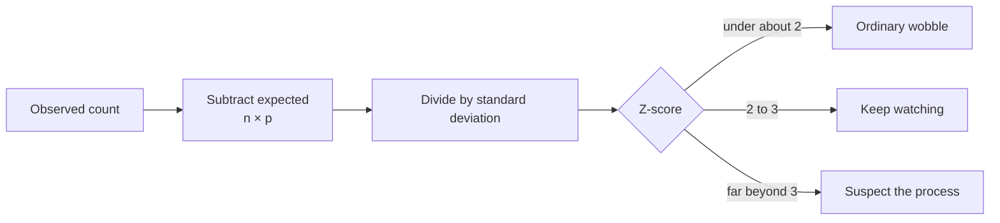

import Scenario from "../../../components/Scenario.astro";
import LevelIntro from "../../../components/LevelIntro.astro";
import Checkpoint from "../../../components/Checkpoint.astro";
import PracticeCheck from "../../../components/PracticeCheck.astro";

export const unit = {
  track: "applied-math",
  unitSlug: "probability-distributions-uniform",
};

<Scenario label="Server 3 got 64 of 200 requests. Is the load balancer broken?">
  <Fragment slot="facts">
    

      
⚖️ <strong>The setup</strong> — 4 servers, each request picked uniformly at random

      
📊 <strong>Expected</strong> — 200 × 1/4 = 50 per server

      
🚨 <strong>Observed</strong> — 64 on server 3 (32%)

    

    

      

        
Expected50

        

      

      

        
Observed64

        

      

    

  </Fragment>

The dice question again, now with stakes: a load balancer should send each of 4
servers about a quarter of the traffic. After 200 requests, server 3 has 64.
**Is a 14-request gap big or small compared with what a fair 4-way split produces?**

</Scenario>

<LevelIntro
  items={[
    "The z-score of 64 out of 200",
    "Choosing an alert threshold from the tail",
    "Latency as a sum of delays",
  ]}
/>

## How far out is 64?

Treat "went to server 3" as a yes/no trial with `p = 1/4`.

| Step                       | Arithmetic             | Result     |
| -------------------------- | ---------------------- | ---------- |
| Expected count             | `200 × 1/4`            | 50         |
| Gap                        | `64 − 50`              | 14         |
| Standard deviation         | `√(200 × 0.25 × 0.75)` | about 6.12 |
| Z-score                    | `14 / 6.12`            | about 2.29 |
| Exact chance of 64 or more | binomial tail          | about 1.5% |

Verdict: unusual but not damning. There is a subtlety. You looked at server 3 _after_ seeing
it was high. Four servers each get a chance to look odd, so the chance that _some_ server reaches
64 or more is at most `4 × 1.5% ≈ 6.2%`. Picking the target after seeing the data inflates how
surprising it looks.

<Checkpoint question="Server 3 later reads 5.5 standard deviations above expected. Is 'keep watching' still the right verdict?">

No. Beyond about 3 standard deviations, chance alone becomes a poor explanation, and 5.5 is far
past it. Look for biased selection, sticky routing, or a bug. The verdict follows the z-score, not
whether the count is merely above average.

</Checkpoint>

<PracticeCheck
  track={unit.track}
  unitSlug={unit.unitSlug}
  topicId="gap-in-stddevs"
/>

## Setting an alert threshold

**A dependency fails independently 2% of the time. How many failures in 500 requests should page someone?**
Mean 10, standard deviation about 3.13. Exact binomial tails (verified):

| Threshold (failures) | z-score | Chance of reaching it by luck |
| -------------------- | ------- | ----------------------------- |
| 12                   | 0.64    | about 30%                     |
| 15                   | 1.60    | about 8.1%                    |
| 20                   | 3.19    | about 0.31% (1 in 320)        |

A threshold at 12 would fire on ordinary noise roughly 3 batches in 10. Pages stop meaning anything.
At 20, a crossing almost always means something changed. The demo below uses these exact numbers: drag the threshold and watch the luck probability collapse.

The math assumes independence. If failures cluster because they share a database that is down, one outage produces
a burst of failures together and the 0.31% figure no longer applies.

<Checkpoint question="Failures actually come in bursts because a shared dependency stalls. Does the 0.31% still describe how often 20 failures happens?">

No. The 0.31% assumes independent failures. Correlated failures make large counts far more common than the
independent model predicts, so this threshold would page more often than 1 in 320 windows, and the calculation gives false comfort.

</Checkpoint>

<PracticeCheck
  track={unit.track}
  unitSlug={unit.unitSlug}
  topicId="gap-in-stddevs"
/>

## Latency as a sum

**Six independent hops, each a flat uniform delay between 1 and 5 ms. What does the total look like?**
Each hop has mean 3 ms and variance `16/12 ≈ 1.333`. The total has mean `6 × 3 = 18` ms and variance 8 (standard deviation about 2.83 ms).
A simulation of 20,000 requests (seeded, verified) gave:

| Quantity | Theory     | Simulation |
| -------- | ---------- | ---------- |
| Mean     | 18         | 18.03      |
| Variance | 8          | 7.98       |
| Median   | 18         | 18.00      |
| p99      | not needed | 24.48      |

No single hop is bell-shaped, but the total clusters around 18 ms. Because variances add, you can reason
about a total latency budget from its parts.

<PracticeCheck
  track={unit.track}
  unitSlug={unit.unitSlug}
  topicId="sums-look-normal"
/>

## Compute it yourself

The last exercise set asks you to write the z-score function. Writing the three-line formula is the
understanding: observed minus expected, over the binomial standard deviation.

<PracticeCheck
  track={unit.track}
  unitSlug={unit.unitSlug}
  topicId="zscore-code"
/>

## Extend it

This is a case, not the whole territory. Try changing it:

- If the same 14-request gap appeared out of 2,000 requests across 4 servers, would the z-score grow or shrink, and why?
  (Hint: expected count and standard deviation both change.)
- With 20 hops instead of 6, each uniform from 1 to 5 ms, mean and standard deviation of the total scale differently. Does relative
  spread (`stddev / mean`) get wider or narrower? Theory says it falls as `1/√n`: about 0.157 for 6 hops and about 0.086 for 20.
- What would change if the 4 servers were not equally weighted?

## Failure modes

| Failure mode                                        | What goes wrong                                                           |
| --------------------------------------------------- | ------------------------------------------------------------------------- |
| Treating any gap from expected as a bug             | Small samples are lumpy by nature; use z-scores                           |
| Choosing which server to test after seeing the data | The chance that some server looks odd is larger than for one named server |
| Picking an alert threshold by intuition             | It may fire on noise or sleep through real problems                       |
| Assuming independence when failures are correlated  | Tail probabilities are badly underestimated                               |
| Adding standard deviations instead of variances     | Overestimates the spread of a sum of independent parts                    |
