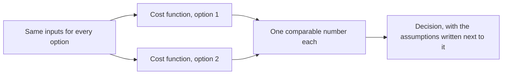
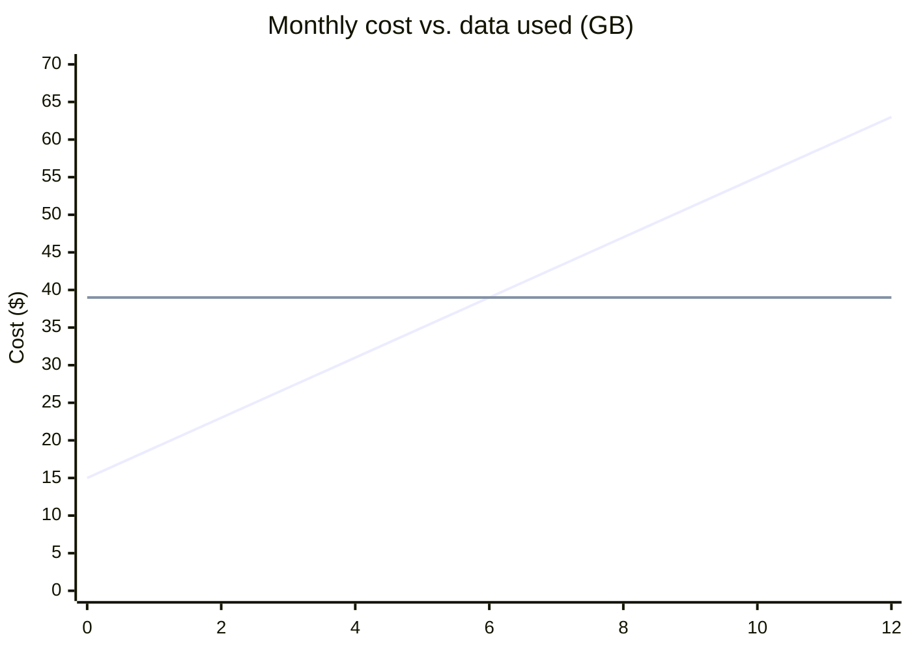

import Scenario from "../../../components/Scenario.astro";
import LevelIntro from "../../../components/LevelIntro.astro";
import PracticeCheck from "../../../components/PracticeCheck.astro";

export const unit = {
  track: "applied-math",
  unitSlug: "quantitative-modeling-design-decisions",
};

<Scenario label="Two phone plans, two confident friends, no arithmetic">
  <Fragment slot="facts">
    

      
📱 <strong>Plan P (pay per GB)</strong> — $15 a month plus $4 for every GB used

      
♾️ <strong>Plan F (flat)</strong> — $39 a month, any amount of data

      
📈 <strong>Your usage</strong> — 3 GB this month, and it has been rising about 1 GB a month

    

    

      

        
Plan P at 3 GB$27

        

      

      

        
Plan F at 3 GB$39

        

      

      
Bars are scaled to $63, what Plan P costs at 12 GB.

    

  </Fragment>

One friend says, "Take the flat plan, it is simpler and you never get
a surprise bill." Another says, "Take pay-per-GB, it is cheaper."
Both statements are true of something. **Which plan should you
actually buy, and what would you need to know to answer without
trusting whichever friend sounds more sure?**

At 3 GB, Plan P costs $15 + 3 × $4 = $27 against $39 for Plan F, so
the second friend is right today. But your usage is climbing, and
nobody has checked what happens at 6 GB, or 10.

</Scenario>

<LevelIntro
  items={[
    "Why adjectives cannot settle a choice",
    "One comparable number per option",
    "The break-even point and why growth matters",
  ]}
/>

## What can a number do that "simpler" and "cheaper" cannot?

**Are your friends wrong?** No. "Simpler" and "cheaper" are both true.
They just are not _comparable_: nothing says how much simpler, or
cheaper at what usage. A **quantitative model** fixes that by taking
every option, feeding it the same inputs, and computing one number per
option that can be put side by side.

| What the debate sounds like | What the model asks instead                          |
| --------------------------- | ---------------------------------------------------- |
| "Flat is simpler"           | What does flat cost at my usage, in dollars?         |
| "Pay-per-GB is cheaper"     | Cheaper at which usage, and for how long?            |
| "It is probably fine"       | What numbers would have to be true for that to hold? |

The model does not remove judgment. It moves it somewhere visible: the
judgment becomes the **assumptions** (how much data will I use?), and
those can be argued with, which a mood cannot.

<PracticeCheck
  track={unit.track}
  unitSlug={unit.unitSlug}
  topicId="one-number-per-option"
/>

## At what usage does the winner change?

**Plan P wins at 3 GB. Does it win at 10?** Each plan is a line: a fixed
part plus a per-GB part. The usage where the two lines meet is the
**break-even point**. With the numbers in the callout:

$15 + $4 × usage = $39, so usage = ($39 − $15) ÷ $4 = **6 GB**.

The rising line is Plan P and the flat line is Plan F. Below 6 GB, Plan P
is cheaper; at 6 GB they tie at $39; above it, Plan F is cheaper and the
gap widens every GB.

| Month of your plan | Usage | Plan P | Plan F | Cheaper |
| ------------------ | ----- | ------ | ------ | ------- |
| 1                  | 3 GB  | $27    | $39    | P       |
| 4                  | 6 GB  | $39    | $39    | tie     |
| 8                  | 10 GB | $55    | $39    | F       |

Checking only month 1 would send you to Plan P. Over twelve months
(usage 3, 4, ... 14 GB), Plan P totals 12 × $15 + $4 × 102 = $588 and
Plan F totals 12 × $39 = $468, so **Plan F saves $120 even though it lost
month 1**. The lesson: a comparison at one point in time can be right
today and wrong by next quarter.

<PracticeCheck
  track={unit.track}
  unitSlug={unit.unitSlug}
  topicId="break-even-point"
/>

## Where does this show up in engineering?

Swap phone plans for architectures and the shape is identical: each
option has a **fixed** cost, a **per-unit** cost, sometimes a one-time
build cost, and a chance of something going wrong. The pieces, which
L2 builds for a real-looking case:

| Phone plan idea       | Design decision idea                            |
| --------------------- | ----------------------------------------------- |
| Monthly fee           | Fixed monthly infrastructure overhead           |
| Price per GB          | Cost per request, message or job                |
| Your growing usage    | Traffic projected to grow                       |
| Break-even usage      | Crossover volume where the cheaper design flips |
| "What if I use more?" | Sensitivity analysis on the assumptions         |

**Key terms.** Option, cost function, assumption, break-even
(crossover) point, sensitivity analysis. L2 combines cost,
amortized build cost and expected outage cost into one monthly number
per architecture. L3 stress-tests the assumptions and shows how to
write the whole model into a design doc.
