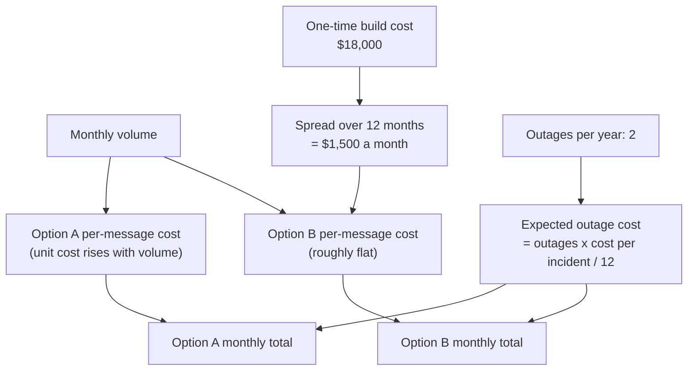
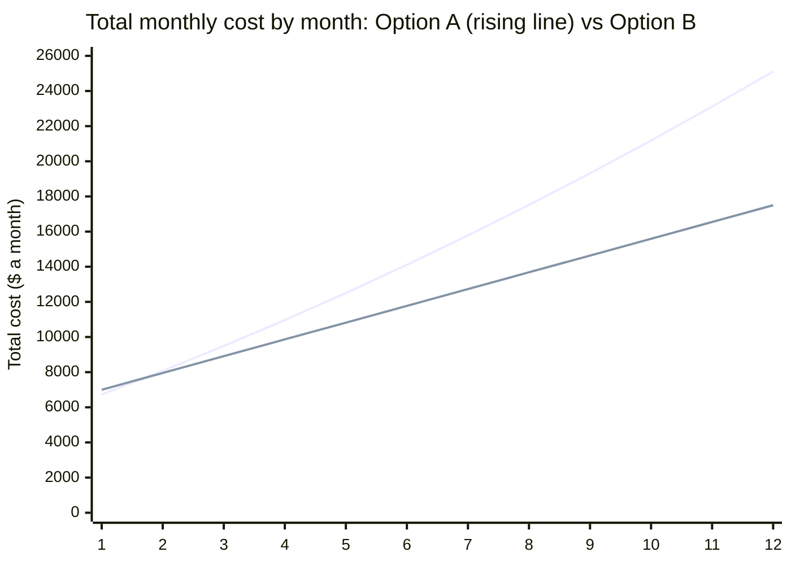

import LevelIntro from "../../../components/LevelIntro.astro";
import Checkpoint from "../../../components/Checkpoint.astro";
import PracticeCheck from "../../../components/PracticeCheck.astro";

export const unit = {
  track: "applied-math",
  unitSlug: "quantitative-modeling-design-decisions",
};

L1 compared two phone plans with a fixed part, a per-unit part and a
break-even point. Real architecture choices add two more pieces: a
one-time build cost and the chance of an outage. This level builds that
fuller model for a made-up case. All figures below are **illustrative
assumptions** chosen for the example, not measurements.

**The case.** A notification service called NotifyCo sends 15 million
messages a month, projected to reach 45 million by year end. Option A
keeps the current synchronous design and adds servers. Option B puts a
queue between ingestion and delivery, with an assumed one-time build cost
of $18,000. One engineer argues for A because it is simpler; the other
for B because it is more resilient.

<LevelIntro
  items={[
    "Fixed, per-unit, amortized and risk costs",
    "Why Option A's unit cost climbs with volume",
    "Running the model forward to find the crossover",
  ]}
/>

## What goes into one monthly number?

**Which costs does each option actually carry?** Four kinds, all
converted to dollars per month so they can be added:

| Piece                         | Option A                                  | Option B                      |
| ----------------------------- | ----------------------------------------- | ----------------------------- |
| Per-message cost              | $0.00035 per message, times a growth term | $0.00035 per message          |
| Fixed monthly overhead        | none                                      | $200 for the queue            |
| Build cost, spread over 12 mo | $0                                        | $18,000 / 12 = $1,500         |
| Cost per outage (assumed)     | $3,000 (dropped requests to reconcile)    | $300 (delay, nothing dropped) |
| Expected outage cost a month  | 2 × $3,000 / 12 = $500                    | 2 × $300 / 12 = $50           |

The **expected outage cost** is frequency times cost per incident,
turned into a monthly figure. A rare event still gets a real number
instead of an unweighted "but what if". The **amortized** build cost
makes sure the engineering effort is not pretended to be free.

Option A's growth term is the multiplier `1 + volume / 80,000,000`.
It encodes one idea: a synchronous design must be sized for its busiest
moments, and busy moments get busier as the service grows. The 80M
reference is an assumption, and L3 tests how much the answer depends on it.

<Checkpoint question="A teammate says to model Option A as a flat $0.00035 per message, same as Option B, to keep things simple. What does that quietly assume?">

It assumes Option A never needs extra capacity for its busiest moments,
so its cost per message never rises as the service grows. That is the
exact claim under debate. Using a flat rate for A would decide the
argument in A's favor before any arithmetic ran. At 45M messages a month
it would make A look $1,250 cheaper than B, where the fuller model has A
$7,609.37 more expensive.

</Checkpoint>

## What does month 1 look like?

**At today's 15M messages, which option is cheaper?** Plug the inputs
into each column:

| Component (15M messages, month 1) | Option A      | Option B      |
| --------------------------------- | ------------- | ------------- |
| Per-message cost                  | $6,234.38     | $5,250.00     |
| Fixed overhead                    | $0            | $200.00       |
| Amortized build cost              | $0            | $1,500.00     |
| Expected outage cost              | $500.00       | $50.00        |
| **Total**                         | **$6,734.38** | **$7,000.00** |

Option A is **$265.62 cheaper today**. The first engineer is right about
today. Whether that stays true is a separate question.

<PracticeCheck
  track={unit.track}
  unitSlug={unit.unitSlug}
  topicId="cost-pieces"
/>

## When does the answer flip?

**Volume is heading from 15M to 45M. Does A stay ahead?** Solving
"A total = B total" with month-1 prices gives a **crossover** at about
**16.9M messages a month**. Volume reaches 17.7M in month 2, so the flip is
about one month away. Running the whole year (volume rising evenly from
15M to 45M):

| Month | Volume     | Option A   | Option B   | Cheaper |
| ----- | ---------- | ---------- | ---------- | ------- |
| 1     | 15,000,000 | $6,734.38  | $7,000.00  | A       |
| 2     | 17,727,273 | $8,079.42  | $7,954.55  | B       |
| 7     | 31,363,636 | $15,780.86 | $12,727.27 | B       |
| 12    | 45,000,000 | $25,109.37 | $17,500.00 | B       |

Added up over the year, A costs $183,903.42 and B costs $147,000.00, so
**B is $36,903.42 cheaper over year one, even after paying for its own
build**. A wins exactly one month of twelve. The interactive demo on this
unit's page lets you drag volume, months since launch and outages per year
to watch the crossover move. At month 13 the build cost is fully
amortized and B at 45M drops to $16,000.

<Checkpoint question="A is cheaper today by $265.62. Does that settle the debate in A's favor?">

No. "Cheaper today" is true and nearly irrelevant, because 15M is close to
the 16.9M crossover and the projection carries volume past it within a
month or two. A model that only checks today's volume hands back a
correct number that goes stale almost immediately. The model has to run
forward over the growth trajectory, and the trajectory itself is an
assumption the doc must state. If volume stayed flat at 15M all year,
A would win the year by $3,187.44.

</Checkpoint>

<PracticeCheck
  track={unit.track}
  unitSlug={unit.unitSlug}
  topicId="growth-crossover"
/>

## Failure modes at this level

| Mistake                                         | What it does to the answer                           |
| ----------------------------------------------- | ---------------------------------------------------- |
| Charging all $18,000 to month 1, or to no month | Distorts every monthly comparison in one direction   |
| Dropping the expected outage line               | Hides $450 a month of difference between the options |
| Comparing only at today's volume                | Gives a correct number that is wrong within weeks    |
| Mixing yearly and monthly figures               | Makes a cost 12 times too large or too small         |
