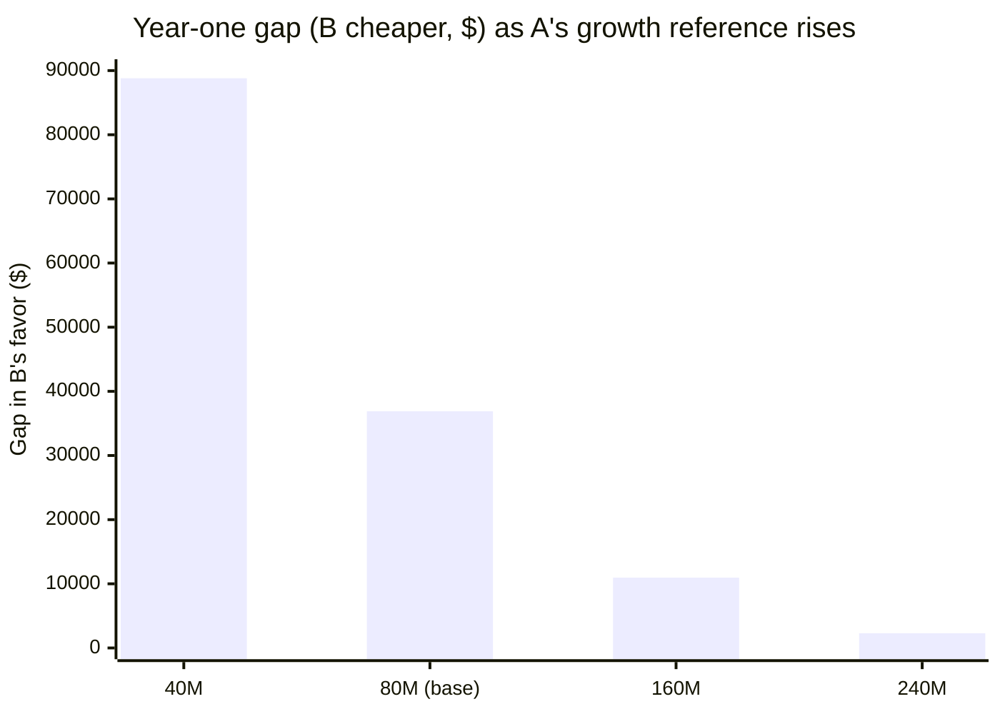
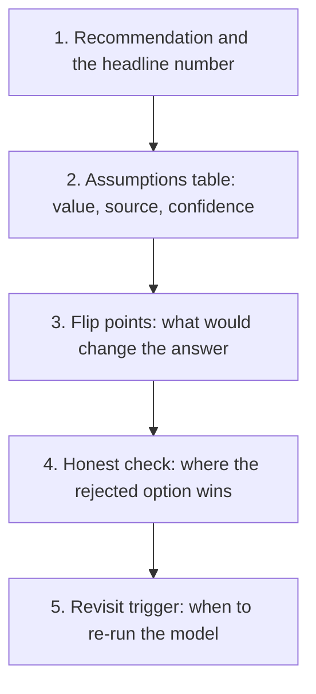

import Scenario from "../../../components/Scenario.astro";
import LevelIntro from "../../../components/LevelIntro.astro";
import Checkpoint from "../../../components/Checkpoint.astro";
import PracticeCheck from "../../../components/PracticeCheck.astro";

export const unit = {
  track: "applied-math",
  unitSlug: "quantitative-modeling-design-decisions",
};

<Scenario label="The model says B wins by $36,903.42. A reviewer asks, 'what if you are wrong?'">
  <Fragment slot="facts">
    <div class="not-prose flex flex-col gap-2 text-sm text-slate-700 dark:text-slate-300">
      <div class="flex items-center gap-1.5"><span>🧮</span> <strong>Year-one result</strong> — A $183,903.42 vs B $147,000.00, so B is $36,903.42 cheaper</div>
      <div class="flex items-center gap-1.5"><span>🎚️</span> <strong>Assumptions</strong> — 2 outages a year, $3,000 / $300 per incident, 80M growth reference, $18,000 build, 15M to 45M volume</div>
      <div class="flex items-center gap-1.5"><span>❓</span> <strong>Reviewer</strong> — which of these, if wrong, would change your recommendation?</div>
    </div>
  </Fragment>

The model is done and the answer looks decisive. A reviewer reads the
design doc and asks a fair question: every input above was an assumption
someone chose. **Which of them could be off by a lot without changing the
answer, and which one is holding the whole recommendation up?** "I am
fairly confident" is the opinion you were trying to leave behind.

</Scenario>

<LevelIntro
  items={[
    "Sensitivity analysis and flip points",
    "Which assumptions carry the result",
    "Putting the model into a design doc",
  ]}
/>

## Which assumptions actually move the answer?

**How do you find out?** Change one assumption at a time, re-run the
year, and watch the gap between A and B. This is **sensitivity analysis**.
The assumption value at which the recommendation flips is its **flip
point**. All rows below come from the same model as L2, one input changed
per row:

| Assumption changed (others held at base)      | Year-one gap, B cheaper by | Recommendation |
| --------------------------------------------- | -------------------------- | -------------- |
| Base case                                     | $36,903.42                 | B              |
| Outages a year: 0 (instead of 2)              | $31,503.42                 | B              |
| Outages a year: 6                             | $47,703.42                 | B              |
| Growth reference 160M (A's penalty is milder) | $10,951.72                 | B              |
| Growth reference 240M                         | $2,301.14                  | B              |
| Growth reference 320M                         | A cheaper by $2,024.16     | A              |
| Build cost $54,000                            | $903.42                    | B              |
| Build cost $60,000                            | A cheaper by $5,096.58     | A              |
| Volume stays flat at 15M all year             | A cheaper by $3,187.44     | A              |



Reading the table: each extra outage a year adds exactly $2,700 to B's
lead ($3,000 − $300), and even **zero outages leave B ahead by
$31,503.42**. The outage numbers are the most arguable inputs and
the least important. The recommendation flips only if the build cost
passes about **$54,900** (3.05 times the estimate), if A's growth penalty
is about **3.5 times weaker** than assumed (flip near 277M instead of
80M), or if volume does not grow.

<Checkpoint question="The outage cost per incident ($3,000 versus $300) is the number the team argued about most. Based on the table, should it be the number you spend the most time verifying?">

No. Even with zero outages B stays $31,503.42 ahead, and each outage only
moves the gap by $2,700. The arguments that deserve verification effort
are the ones near a flip point: the volume projection, A's growth
reference and the build estimate. Sensitivity analysis tells you where
checking pays off, which is separate from where the debate has been loudest.

</Checkpoint>

<PracticeCheck
  track={unit.track}
  unitSlug={unit.unitSlug}
  topicId="sensitivity-analysis"
/>

## How do you write this into a design doc?

**What does a reader need so they can disagree with you productively?**
The recommendation, the number, and the assumptions it stands on, in that
order.



| Doc section     | Example for this case                                                          |
| --------------- | ------------------------------------------------------------------------------ |
| Headline        | Over year one, B costs $36,903.42 less than A, after its own $18,000 build     |
| Assumptions     | 2 outages a year (estimate), $3,000 / $300 per incident (estimate), 15M to 45M |
| Flip points     | B stops winning if build passes about $54,900, or if volume stays flat at 15M  |
| Honest check    | A is cheaper in month 1 by $265.62, then loses every month after               |
| Revisit trigger | Re-run if real monthly volume departs from the 15M to 45M projection           |

A model that hides its assumptions is an opinion in a spreadsheet; one
that states them can be corrected. Each estimate in the table should say
where it came from, even if the honest answer is "a guess to replace with
incident data".

<PracticeCheck
  track={unit.track}
  unitSlug={unit.unitSlug}
  topicId="design-doc-writing"
/>

## When is code the right way to explore this?

**The break-even point is a one-line formula. Why write it as code at
all?** Because once you have several options and several cases, the edge
cases (parallel lines, a crossing at negative volume) are easy to get
wrong by hand. The whole mechanism fits in a few lines:

```js
function breakEven(fixedA, perUnitA, fixedB, perUnitB) {
  if (perUnitA === perUnitB) return null; // parallel: never cross
  const units = (fixedB - fixedA) / (perUnitA - perUnitB);
  return units > 0 ? units : null; // crossing below zero is meaningless
}
```

`breakEven(15, 4, 39, 0)` returns 6, the phone-plan answer. `breakEven(10, 3, 14, 3)`
returns `null`, because the lines never meet and one option is always $4
cheaper. Writing it makes you decide what "no crossover" means instead of
returning a nonsense number.

<PracticeCheck
  track={unit.track}
  unitSlug={unit.unitSlug}
  topicId="break-even-code"
/>

<Checkpoint question="Two options have the same per-unit price but different fixed fees. Where do they cross, and what does that say about the decision?">

They never cross. The cheaper fixed fee wins at every volume, so there is
no break-even to compute and no reason to model growth for this pair. The
decision then rests on non-cost factors, such as which is easier to
operate, which is exactly the kind of judgment the model leaves visible.

</Checkpoint>

## This is a case, not the whole territory

The worked example is one shape: two options, a cost that grows
unevenly, a small outage risk. **Extend it.** What changes if the cost of an
outage grows with the traffic being dropped, rather than being a flat
$3,000? What if a third option (a managed service with a high per-message
price and no build) enters? What if the growth projection is a range
(30M to 60M) instead of a single 45M? Re-run the sensitivity table for
each and notice which assumption becomes the one that carries the answer.
It will not always be the same one.

## Failure modes

| Failure mode                                     | What it gets wrong                                                         |
| ------------------------------------------------ | -------------------------------------------------------------------------- |
| Reporting a result with no assumptions beside it | Reviewers argue with the conclusion instead of the inputs that produced it |
| Varying every input at once                      | You cannot tell which input moved the result                               |
| Varying inputs only one at a time                | Two inputs shifting together can flip a result neither flips alone         |
| Spending effort on the loudest debate            | The assumptions near a flip point get less checking than they need         |
| Treating the model as a one-time answer          | Real volume drifts from the projection and the recommendation goes stale   |
