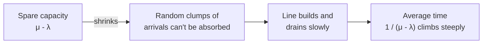

import Scenario from "../../../components/Scenario.astro";
import LevelIntro from "../../../components/LevelIntro.astro";
import PracticeCheck from "../../../components/PracticeCheck.astro";

export const unit = {
  track: "applied-math",
  unitSlug: "queueing-theory-basics",
};

<Scenario label="One checkout lane: 50% more shoppers, four times the time in line">
  <Fragment slot="facts">
    

      
🧑‍💼 <strong>One cashier</strong> — serves 10 shoppers per minute when never idle

      
🚶 <strong>Quiet hour</strong> — 6 shoppers arrive per minute; average time in the lane system: 15 seconds

      
🚶‍♀️ <strong>Busy hour</strong> — 9 shoppers arrive per minute; average time: 60 seconds

    

    

      

        
Quiet hour: cashier busy60%

        

      

      

        
Busy hour: cashier busy90%

        

      

    

  </Fragment>

A shop has one checkout lane and one cashier who can serve 10 shoppers a
minute. In a quiet hour, 6 shoppers arrive per minute and the average shopper
spends 15 seconds from joining the line to leaving. In a busy hour, 9 arrive
per minute, which is only 50% more traffic. **Why does the average time jump
to 60 seconds, four times longer, instead of rising by about half?**

The cashier is not twice as slow. What changed is how much spare capacity is
left to absorb the random clumps of shoppers that always happen.

</Scenario>

<LevelIntro
  items={[
    "Arrival rate, service rate, utilization",
    "Little's Law (people in the system = rate x time)",
    "Why the delay curve has a knee",
  ]}
/>

## What are the pieces of a line?

**If you wanted to predict the lane's behaviour before the shop is even built,
what would you need to know?** Only two rates.

| Everyday piece                  | Systems word     | Quiet hour         |
| ------------------------------- | ---------------- | ------------------ |
| shoppers joining the line       | arrival rate `λ` | 6 per minute       |
| how fast the cashier works      | service rate `μ` | 10 per minute      |
| fraction of time cashier busy   | utilization `ρ`  | `6 / 10 = 0.60`    |
| shoppers in line or at the till | in system `L`    | 1.5 on average     |
| time from joining to leaving    | latency `W`      | 0.25 minute (15 s) |

- **Queueing theory** studies what happens when work arrives at a system that
  can only handle so much per unit time.
- **Utilization** is `ρ = λ / μ`: the share of capacity in use. It must stay
  below 1 or the line grows forever.
- **Little's Law** says `L = λW`: the average number in the system equals the
  arrival rate times the average time each spends there. In the quiet hour,
  `6 × 0.25 = 1.5`. In the busy hour, `9 × 1 = 9`.

<PracticeCheck
  track={unit.track}
  unitSlug={unit.unitSlug}
  topicId="queue-pieces"
/>

## What does the delay look like as the cashier gets busier?

For the simplest random model (one server, random arrivals, random service
times, called M/M/1), the average time in the system is exactly
`1 / (μ - λ)`. With `μ = 10` per minute:

| Utilization `ρ` | Arrivals `λ` per minute | Average time in system |
| --------------- | ----------------------- | ---------------------- |
| 50%             | 5                       | 0.2 minute (12 s)      |
| 60%             | 6                       | 0.25 minute (15 s)     |
| 80%             | 8                       | 0.5 minute (30 s)      |
| 90%             | 9                       | 1 minute (60 s)        |
| 95%             | 9.5                     | 2 minutes              |

The same arithmetic holds for any system with a rate in and a rate out: web
requests per second, packets, jobs on a worker. The unit of time cancels.

## Key terms

- **Arrival rate (`λ`)** — how often work arrives, on average.
- **Service rate (`μ`)** — how much work the server finishes per unit time
  when it never idles.
- **Utilization (`ρ = λ / μ`)** — share of capacity in use. A stable queue needs `ρ < 1`.
- **Little's Law (`L = λW`)** — average number in the system equals arrival
  rate times average time in the system.
- **Latency vs. throughput** — latency is how long one request takes;
  throughput is how many finish per unit time. In the busy hour throughput
  rose 1.5x while latency rose 4x.
- **The knee** — the utilization range where delay stops creeping and starts climbing.

When the real system does not exist yet, `μ` is an estimate from a prototype,
a vendor limit, or an explicit assumption. `applied-math/orders-magnitude` and
`applied-math/math-tool-prediction` cover getting that first rough number.

## What the next levels cover

L2 explains why the curve bends, what Little's Law does and does not promise,
and why latency and throughput can diverge. L3 plays the line out customer by
customer, checks the formula against a 50,000-customer simulation, and asks
how far the model can be trusted.
