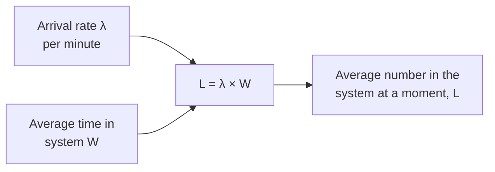

import LevelIntro from "../../../components/LevelIntro.astro";
import Checkpoint from "../../../components/Checkpoint.astro";
import PracticeCheck from "../../../components/PracticeCheck.astro";
import Plot from "../../../components/Plot.astro";

export const unit = {
  track: "applied-math",
  unitSlug: "queueing-theory-basics",
};

L1 gave the pieces (`λ`, `μ`, `ρ`) and the lane's puzzle: 50% more shoppers,
four times the time. L2 explains the shape behind that, then a second,
simpler law that needs no shape at all.

<LevelIntro
  items={[
    "The wait-time knee near full utilization",
    "Little's Law and what it holds regardless",
    "Latency and throughput moving apart",
  ]}
/>

## Why does the lane hardly notice 10% to 60%, then fall apart by 90%?

**If the cashier is idle 40% of the time at 60% load, why is a line there at all?**
Because arrivals are random. Shoppers do not walk up on an even beat; two show
up together, then nobody for a while. A clump forms a short line, and the
spare capacity is what drains it. The more spare capacity, the faster the line
clears; the less, the longer it lingers while the next clump lands on top.

With `μ = 10` per minute the exact average time in the system is `1 / (μ - λ)`.
Plotting it against utilization shows the whole story:

<Plot
  mark="line"
  x="utilization"
  y="minutes"
  xLabel="Utilization (%)"
  yLabel="Average time in system (minutes)"
  caption="M/M/1 with service rate 10 per minute: W = 1 / (10 - λ), exact values."
  data={[
    { utilization: 10, minutes: 0.111 },
    { utilization: 20, minutes: 0.125 },
    { utilization: 30, minutes: 0.143 },
    { utilization: 40, minutes: 0.167 },
    { utilization: 50, minutes: 0.2 },
    { utilization: 60, minutes: 0.25 },
    { utilization: 70, minutes: 0.333 },
    { utilization: 80, minutes: 0.5 },
    { utilization: 85, minutes: 0.667 },
    { utilization: 90, minutes: 1 },
    { utilization: 95, minutes: 2 },
  ]}
/>

From 10% to 60% the time moves from about 0.11 to 0.25 minute. From 60% to 95%
it moves from 0.25 to 2. A test run only at 60% load sits entirely on the flat
part and cannot see the steep part. The interactive demo on this level lets
you drag the arrival rate and watch the same curve.

Two equivalent ways to read the formula:

| Form              | Plain meaning                                                   |
| ----------------- | --------------------------------------------------------------- |
| `1 / (μ - λ)`     | actual average time, given real rates                           |
| `(1/μ) / (1 - ρ)` | one service time, stretched by the inverse of the free fraction |

<Checkpoint question="With μ = 10 per minute, arrivals rise from λ = 8 to λ = 9. Does the average time rise by roughly the same small amount, or by something much bigger in proportion?">

Much bigger. Spare capacity `μ - λ` falls from 2 to 1, so it halves, and the
time `1 / (μ - λ)` doubles from 0.5 to 1 minute. The same extra shopper per
minute at `λ = 2` would change the time from 0.125 to 0.143. Near the top
there is almost no slack left to absorb it.

</Checkpoint>

<PracticeCheck
  track={unit.track}
  unitSlug={unit.unitSlug}
  topicId="wait-knee"
/>

## Where does the delay come from if the average rates fit?

**If arrivals average 9 per minute and the cashier averages 10, why isn't the
wait zero?** Because only the averages fit; the individual gaps vary.

| Arrival pattern at `λ = 9`, `μ = 10`                           | Lane behaviour             |
| -------------------------------------------------------------- | -------------------------- |
| every shopper exactly 6.67 s apart, each served in exactly 6 s | no waiting at all, ever    |
| random gaps and random service times (M/M/1)                   | average 60 s in the system |

The knee is a product of variability meeting thin spare capacity, not of
capacity alone. That is why a clean, even-paced load test understates real
traffic.

## Little's Law: what holds regardless of the details

**Is there a relationship that survives any arrival pattern and any service
pattern?** Yes, and it needs only averages.

Written as math, $$L = \lambda W$$. It holds for almost any stable system, which
makes it a cross-check: from two measured numbers you get the third. In the
lane, `λ = 9` and `W = 1` minute give `L = 9` shoppers on average.

It says nothing about the shape of the curve, the worst case, or the slowest
1% of requests. It describes averages of a stable system.

<Checkpoint question="A dashboard shows an average of 5 requests per second arriving and an average response time of 400 ms. Roughly how many requests are in flight at any moment?">

About 2: `L = λW = 5 × 0.4 = 2`. This is the intended use. You combined two
numbers you can observe to learn how much concurrent work the system carries,
without knowing anything about the distribution of arrivals or service times.

</Checkpoint>

<PracticeCheck
  track={unit.track}
  unitSlug={unit.unitSlug}
  topicId="littles-law"
/>

## If the shop completes more shoppers per minute, is it doing better?

**Can throughput rise while the experience gets worse?** Yes, and the lane
shows it. Throughput is arrivals served; latency is the time each takes.

| Arrivals `λ` per minute | Throughput (long run)   | Average time in system |
| ----------------------- | ----------------------- | ---------------------- |
| 6                       | 6 per minute            | 0.25 minute            |
| 9                       | 9 per minute            | 1 minute               |
| 12 (above `μ = 10`)     | capped at 10 per minute | grows without bound    |

Going from 6 to 9, throughput rose 1.5x and latency 4x. At 12, throughput
cannot follow arrivals any more, and the surplus piles up in the line.
A dashboard that only shows requests per second would call all three rows healthy.

<PracticeCheck
  track={unit.track}
  unitSlug={unit.unitSlug}
  topicId="latency-throughput"
/>

## Failure modes at this level

- **Load-testing only at a comfortable utilization.** The flat region gives false confidence about the steep one.
- **Treating headroom as linear.** Going from 60% to 90% is 1.5x the traffic but 4x the time.
- **Watching throughput alone.** It can stay healthy while latency has already become unacceptable.
- **Assuming an even-paced test equals real traffic.** Real arrivals clump.
