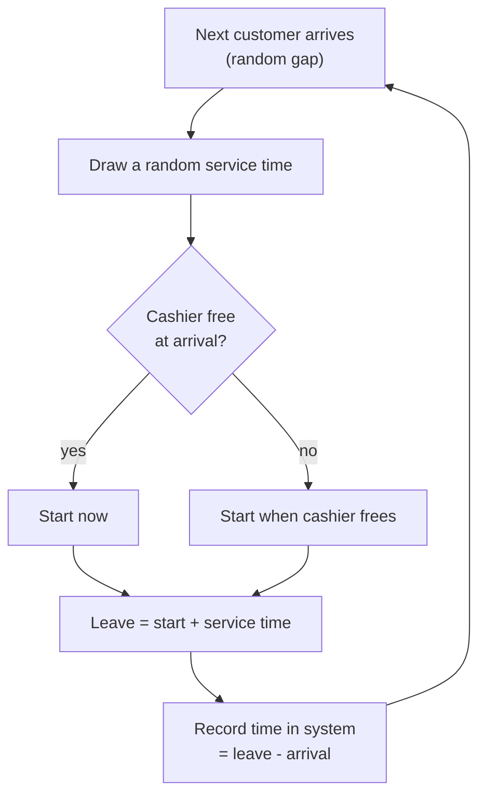

import Scenario from "../../../components/Scenario.astro";
import LevelIntro from "../../../components/LevelIntro.astro";
import Checkpoint from "../../../components/Checkpoint.astro";
import PracticeCheck from "../../../components/PracticeCheck.astro";
import Plot from "../../../components/Plot.astro";

export const unit = {
  track: "applied-math",
  unitSlug: "queueing-theory-basics",
};

<Scenario label="The formula says 60 seconds at 90% busy. Why believe a formula you cannot see?">
  <Fragment slot="facts">
    

      
📐 <strong>Formula</strong> — average time in system = 1 / (μ - λ)

      
🎲 <strong>Check</strong> — play out 50,000 random customers and average their times

      
🎯 <strong>Target</strong> — 0.25 minute at 6 per minute, 1 minute at 9 per minute (service rate 10)

    

  </Fragment>

L1 and L2 gave a tidy formula. Formulas rest on assumptions, and the
assumptions are where predictions go wrong. **Can you reproduce the lane's
numbers by brute force, with no formula in sight, and then ask what changes
when the lane stops matching the formula's assumptions?**

</Scenario>

<LevelIntro
  items={[
    "A hand-played lane, one customer at a time",
    "Simulation checked against the formula",
    "What the model assumes and where it breaks",
  ]}
/>

## How do you play a line out by hand?

**What is the whole rule?** One sentence: a customer starts when they arrive or
when the cashier frees up, whichever is later, and leaves one service time after
starting. Here are five customers, times in seconds from opening:

| Customer | Arrives | Cashier free at | Starts | Leaves | Time in system |
| -------- | ------- | --------------- | ------ | ------ | -------------- |
| 1        | 0.10    | 0.00            | 0.10   | 0.22   | 0.12           |
| 2        | 0.18    | 0.22            | 0.22   | 0.35   | 0.17           |
| 3        | 0.50    | 0.35            | 0.50   | 0.62   | 0.12           |
| 4        | 0.55    | 0.62            | 0.62   | 0.80   | 0.25           |
| 5        | 0.57    | 0.80            | 0.80   | 0.90   | 0.33           |

Customers 3, 4 and 5 arrive within 0.07 of each other, and the last two pay
for the clump: their times are 0.25 and 0.33 versus 0.12 for customer 3. The
average of the five is `0.99 / 5 = 0.198`. A simulation is this table with
random gaps and random service times, repeated 50,000 times.

## Does the brute-force average match the formula?

One run of this loop in Node, with exponential random gaps (the standard way to
say "random arrivals at a known average rate"), a fixed seed (42) so it
replays identically, and 50,000 customers per row, service rate 10:

| Arrivals `λ` | Utilization | Simulated W | Formula W | Simulated L | Formula L |
| ------------ | ----------- | ----------- | --------- | ----------- | --------- |
| 2            | 0.20        | 0.125       | 0.125     | 0.25        | 0.25      |
| 4            | 0.40        | 0.167       | 0.167     | 0.67        | 0.67      |
| 6            | 0.60        | 0.250       | 0.250     | 1.50        | 1.50      |
| 8            | 0.80        | 0.491       | 0.500     | 3.93        | 4.00      |
| 9            | 0.90        | 1.046       | 1.000     | 9.41        | 9.00      |

The formulas are `W = 1/(μ-λ)` and `L = ρ/(1-ρ)`. The simulated `L` is the
simulation's measured throughput times its measured average time, which is
Little's Law applied to the run itself. Gaps at 0.8 and 0.9 come from finite
samples: near the knee, averages converge slowly, because rare long lines
dominate.

<Plot
  mark="line"
  x="lambda"
  y="minutes"
  series="source"
  xLabel="Arrival rate λ (per minute, service rate 10)"
  yLabel="Average time in system (minutes)"
  caption="Formula versus 50,000-customer simulation. They overlap until the steep part, where the simulation wobbles around the formula."
  data={[
    { lambda: 2, minutes: 0.125, source: "formula" },
    { lambda: 4, minutes: 0.167, source: "formula" },
    { lambda: 6, minutes: 0.25, source: "formula" },
    { lambda: 8, minutes: 0.5, source: "formula" },
    { lambda: 9, minutes: 1, source: "formula" },
    { lambda: 2, minutes: 0.125, source: "simulation" },
    { lambda: 4, minutes: 0.167, source: "simulation" },
    { lambda: 6, minutes: 0.25, source: "simulation" },
    { lambda: 8, minutes: 0.491, source: "simulation" },
    { lambda: 9, minutes: 1.046, source: "simulation" },
  ]}
/>

<Checkpoint question="The lane scenario reported 15 seconds at 60% busy and 60 seconds at 90% busy. Do those two figures need a new simulation, or are they already in the table?">

They are already there. With `μ = 10` per minute, `λ = 6` gives 0.25 minute
(15 s) and `λ = 9` gives 1 minute by formula (1.046 simulated). The opening
puzzle was not a quirk of one shop; it is what the model predicts at those two
utilizations. Little's Law agrees: `6 × 0.25 = 1.5` and `9 × 1 = 9`.

</Checkpoint>

<PracticeCheck
  track={unit.track}
  unitSlug={unit.unitSlug}
  topicId="mm1-calculator"
/>

## What happens if the arrival rate reaches the service rate?

The formula `1/(μ-λ)` needs `λ < μ`. At `λ = μ` it divides by zero, and above
that it goes negative, which is meaningless. The honest reading is that there
is no steady average: the line grows for as long as you watch, so a longer
simulation gives a larger average rather than a settled one. A calculator
should refuse those inputs instead of returning a number.

## What does the model assume, and what breaks when it doesn't?

**Which assumptions did the simulation bake in that a real service might not honour?**

| Assumption in M/M/1                 | When reality differs                       | Effect on the curve                                      |
| ----------------------------------- | ------------------------------------------ | -------------------------------------------------------- |
| one server                          | several workers share one line             | knee moves toward higher utilization                     |
| random (exponential) service times  | every job takes the same time              | less waiting at the same utilization                     |
| random arrivals at a steady average | traffic arrives in bursts or on a schedule | usually more waiting than the formula says               |
| first come, first served, no limit  | priorities, timeouts, dropped requests     | different curve; average can look fine while some starve |

One of these has a clean checked number. If service times were all exactly the
same (a deterministic cashier) with random arrivals, the standard
Pollaczek-Khinchine result halves the time spent waiting in line:

| At `λ = 9`, `μ = 10`    | Waiting in line | Plus service (0.1) | Time in system |
| ----------------------- | --------------- | ------------------ | -------------- |
| random service times    | 0.9 minute      | 0.1                | 1.0 minute     |
| identical service times | 0.45 minute     | 0.1                | 0.55 minute    |

The knee is still there; it is just less sharp. Variability is a cost you pay
in latency, which is why trimming slow outliers can help latency more than
adding raw speed.

<Checkpoint question="Why does the Little's Law check L = λW stay valid even for the identical-service-times lane, when the 1 / (μ - λ) formula does not?">

Little's Law only relates three averages of a stable system and makes no
assumption about how arrivals or service times are distributed. The
`1 / (μ - λ)` formula is derived specifically for random service and arrival
times, so it is the part that changes when those change. The law is the
sturdy cross-check; the formula is the model.

</Checkpoint>

<PracticeCheck
  track={unit.track}
  unitSlug={unit.unitSlug}
  topicId="model-limits"
/>

## This is one case, not the whole territory

Everything above is a single server with random times. **Try extending it
yourself.** What changes if a second register opens and both share one line,
with total arrivals unchanged? Would the knee move to a higher or lower
utilization, and why, in terms of how much slack a burst now finds? What if
arrivals came in scheduled waves, like a bus unloading at once? What if the
news were worse and the true service rate turned out 20% lower than your
estimate: where on the curve would your current traffic sit?

## Failure modes

| Failure mode                                             | What it gets wrong                                                            |
| -------------------------------------------------------- | ----------------------------------------------------------------------------- |
| Planning from average utilization alone                  | A moderate daily average can hide peak hours sitting in the steep part        |
| Assuming 20% more traffic means 20% worse latency        | Near capacity the relationship is sharply nonlinear                           |
| Reporting throughput as proof of health                  | Throughput can hold while latency quietly collapses                           |
| Trusting a service rate guessed before the system exists | `μ` is an assumption; label it, and test the plan against a lower value       |
| Treating `1 / (μ - λ)` as universal                      | It is the single-server, random-times result; Little's Law is the general one |
