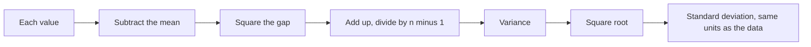
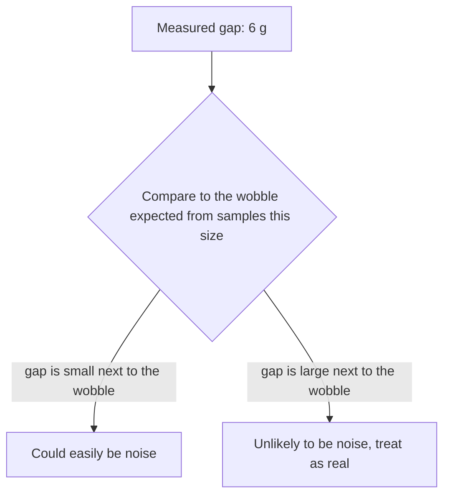

import Scenario from "../../../components/Scenario.astro";
import LevelIntro from "../../../components/LevelIntro.astro";
import PracticeCheck from "../../../components/PracticeCheck.astro";

export const unit = { track: "applied-math", unitSlug: "statistics" };

<Scenario label="Two bakeries claim different average loaf weights. You weigh 5 loaves from each.">
  <Fragment slot="facts">
    

      
🥖 <strong>Bakery A</strong> — 498, 502, 500, 497, 503 g (mean 500 g)

      
🍞 <strong>Bakery B</strong> — 496, 519, 506, 486, 523 g (mean 506 g)

      
❓ <strong>The gap</strong> — 6 g, but B's loaves swing from 486 to 523

    

    

      
A's range: 497 to 503 (6 g wide)

      

      
B's range: 486 to 523 (37 g wide)

      

    

  </Fragment>

You weigh five loaves from each bakery. Bakery A's loaves come out at 498, 502,
500, 497 and 503 grams, so they average 500 g. Bakery B's come out at 496, 519,
506, 486 and 523 grams, so they average 506 g. B's average is 6 g higher, but
B's loaves are all over the place while A's barely move. **If you weighed five
different loaves tomorrow, would B still come out ahead, or is that 6 g gap
just which five loaves happened to land on your scale?**

</Scenario>

<LevelIntro
  items={[
    "Mean and spread of a sample",
    "Variance and standard deviation",
    "Comparing a gap against the wobble",
  ]}
/>

## Why isn't the average enough?

The mean alone treats A and B as two single numbers. The loaves themselves tell
a different story: A's loaves sit within 3 g of 500, while B's sit up to 20 g
from 506.

| Bakery | Loaf weights (g)        | Mean | Sum of squared gaps | Variance (÷ 4) | Std. deviation |
| ------ | ----------------------- | ---- | ------------------- | -------------- | -------------- |
| A      | 498, 502, 500, 497, 503 | 500  | 26                  | 6.5            | 2.55 g         |
| B      | 496, 519, 506, 486, 523 | 506  | 958                 | 239.5          | 15.48 g        |

The standard deviation says how far a typical loaf sits from its own bakery's
mean. B's is about six times A's, which is why a 6 g gap in the means is not
very convincing yet.

Squaring keeps every gap positive and punishes big gaps more, which leaves the
answer in grams squared. The square root brings it back to grams.

<PracticeCheck track={unit.track} unitSlug={unit.unitSlug} topicId="spread" />

## What question does statistics actually answer?

**Is a bigger gap automatically more real?** No. The gap has to be compared with
how much it would wobble anyway when you re-sample. Statistics is the toolkit
for making that comparison concrete instead of guessing by eye.

The same question shows up everywhere a number comes from a sample. This
unit's second case is a website A/B test: 12 conversions out of 100 visitors
against 18 out of 100. A conversion rate is just a mean of ones and zeros, so
the same ideas apply, and L3 runs the real test on those numbers.

## Key terms

- **Mean** — the average, the center of the sample.
- **Variance / standard deviation** — the spread of individual values around
  the mean; the standard deviation is the square root of the variance.
- **Standard error** — how much the sample's _mean_ would wobble if you
  re-sampled, which shrinks as the sample grows (L2).
- **Confidence interval** — a range likely to contain the true value (L2).
- **Statistically significant** — a gap too large to be plausibly explained by
  that wobble alone, at a chosen threshold (L3).
- **Sample vs. population** — the loaves you weighed against all the loaves the
  bakery will ever bake. See `applied-math/measurement-theory` and
  `applied-math/probability-distributions-uniform` for the neighbouring ideas.
