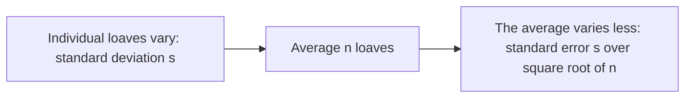
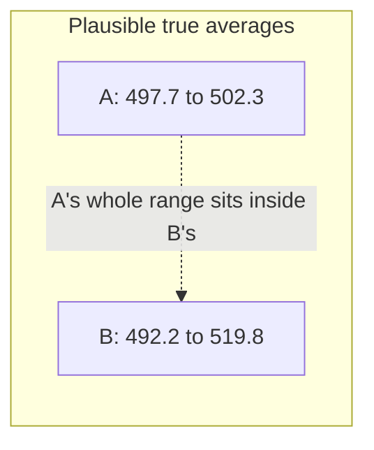

import LevelIntro from "../../../components/LevelIntro.astro";
import Checkpoint from "../../../components/Checkpoint.astro";
import PracticeCheck from "../../../components/PracticeCheck.astro";
import Plot from "../../../components/Plot.astro";

export const unit = { track: "applied-math", unitSlug: "statistics" };

L1 left the two bakeries with a 6 g gap in the means and a very different spread
inside each bakery. This level explains why the mean of five loaves is itself a
shaky number, how much it shakes, and what range you can honestly claim.

<LevelIntro
  items={[
    "Standard deviation vs. standard error",
    "How an interval narrows with more data",
    "What a 95% interval does and does not promise",
  ]}
/>

## If you weigh five new loaves, how far could the mean move?

**Standard deviation says how far individual loaves are from the mean. Is that
the same as how far the _mean_ would move if you re-sampled?** No. Individual
loaves vary by the standard deviation, but an average of several loaves smooths
some of that out. The wobble of the mean is the **standard error**:

$$SE = s / \sqrt n$$

where $$s$$ is the sample standard deviation and $$n$$ is the number of loaves.
For bakery B, $$s = 15.48$$ g:

| Loaves weighed (n) | Standard error of B's mean |
| ------------------ | -------------------------- |
| 5                  | 6.92 g                     |
| 20                 | 3.46 g                     |
| 80                 | 1.73 g                     |
| 500                | 0.69 g                     |

<Plot
  mark="line"
  x="n"
  y="se"
  xLabel="Loaves weighed (n)"
  yLabel="Standard error (g)"
  caption="Bakery B's spread held at 15.48 g: the wobble of the mean falls with the square root of n, so quadrupling the sample only halves it."
  data={[
    { n: 5, se: 6.92 },
    { n: 10, se: 4.89 },
    { n: 20, se: 3.46 },
    { n: 40, se: 2.45 },
    { n: 80, se: 1.73 },
    { n: 160, se: 1.22 },
    { n: 320, se: 0.87 },
    { n: 500, se: 0.69 },
  ]}
/>

More data never makes loaves more alike. It makes your _estimate_ of the average
steadier, and only slowly: to halve the wobble you need four times the loaves.

<Checkpoint question="You weigh 20 more of B's loaves and the standard deviation stays near 15.5 g. Did the loaves get more consistent, or did your estimate of the mean get steadier?">

Your estimate got steadier; the loaves are exactly as inconsistent as before.
The standard deviation describes the loaves and does not shrink with more
sampling, while the standard error is that spread divided by the square root of
the sample size, so it drops. Mixing the two up is the most common way to
overstate how precise a measurement is.

</Checkpoint>

<PracticeCheck
  track={unit.track}
  unitSlug={unit.unitSlug}
  topicId="standard-error"
/>

## What range can you honestly claim for the true average?

**Bakery B's five loaves average 506 g. Is the true average exactly 506?** No, it
is somewhere near it. A common rough rule builds the range from the mean plus
and minus about two standard errors:

| Bakery | Mean | Standard error | Rough range (mean ± 2 SE) |
| ------ | ---- | -------------- | ------------------------- |
| A      | 500  | 1.14 g         | 497.7 to 502.3 g          |
| B      | 506  | 6.92 g         | 492.2 to 519.8 g          |

A's range lies entirely inside B's. Bakery B's true average could be anywhere
from 492 to 520 g, which includes 500, so five loaves cannot tell the bakeries
apart. A caution: with only five loaves the exact multiplier is about 2.78, not 2,
so the honest range is wider still. The two-SE shortcut flatters small samples.

The same idea for a conversion rate, with the standard multiplier 1.96 for 95%:

| Visitors | Conversions | Observed rate | Approximate 95% interval |
| -------- | ----------- | ------------- | ------------------------ |
| 100      | 12          | 12%           | 5.6% to 18.4%            |
| 10,000   | 1,200       | 12%           | 11.4% to 12.6%           |

**What does "95%" promise?** It describes the method, not this one interval. If
you repeated the whole experiment many times, about 95% of the intervals built
this way would contain the true value. A wide interval is not a mistake; it is
the data admitting how little it knows yet.

<Checkpoint question="Two experiments both observe 12%. One has 100 visitors and the other 10,000. Which interval is wider, and does the narrow one prove the true rate is exactly 12%?">

The 100-visitor interval is far wider, roughly 5.6% to 18.4% against 11.4% to
12.6%. Even the narrow one only says the true rate is very likely within about
half a point of 12%, not that it equals 12%. More data buys a tighter range, not
certainty, which is why the next level asks whether a gap clears that range.

</Checkpoint>

<PracticeCheck
  track={unit.track}
  unitSlug={unit.unitSlug}
  topicId="confidence-interval"
/>

## What goes wrong at this level

- **Reading a wide interval as a measurement mistake.** It is the data honestly
  reporting how little it knows.
- **Using the standard deviation where the standard error belongs.** That makes a
  sample mean look far less precise than it is, and the reverse mistake makes it
  look far more precise.
- **Reading "95%" as "95% chance this interval holds the truth".** The 95% belongs
  to the repeated method; the true value is fixed and this interval either holds
  it or not.
