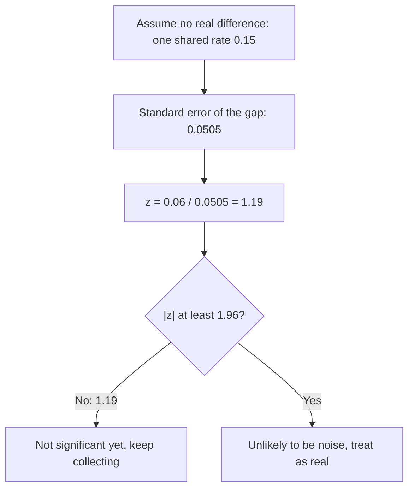

import Scenario from "../../../components/Scenario.astro";
import LevelIntro from "../../../components/LevelIntro.astro";
import Checkpoint from "../../../components/Checkpoint.astro";
import PracticeCheck from "../../../components/PracticeCheck.astro";
import Plot from "../../../components/Plot.astro";

export const unit = { track: "applied-math", unitSlug: "statistics" };

<Scenario label="The new button converted at 18% instead of 12%. The team wants to ship today.">
  <Fragment slot="facts">
    <div class="not-prose flex flex-col gap-2 text-sm text-slate-700 dark:text-slate-300">
      <div class="flex items-center gap-1.5"><span>🅰️</span> <strong>Old button</strong> — 12 conversions out of 100 visitors (12%)</div>
      <div class="flex items-center gap-1.5"><span>🅱️</span> <strong>New button</strong> — 18 conversions out of 100 visitors (18%)</div>
      <div class="flex items-center gap-1.5"><span>🎉</span> <strong>Team's reaction</strong> — "a 50% lift, ship it"</div>
    </div>
    <div class="not-prose mt-3 text-xs text-slate-600 dark:text-slate-400">
      <div>z-score needed: 1.96. z-score this result reaches: 1.19.</div>
      <div class="mt-1 h-2 w-full rounded bg-slate-200 dark:bg-slate-800"><div class="h-2 rounded bg-amber-500" style="width: 61%"></div></div>
    </div>
  </Fragment>

This is the bakery question again with conversion rates instead of grams. An
A/B test runs for a day: 12 of 100 visitors convert on the old button, 18 of 100
on the new one. The relative lift is 6 / 12 = 50%, which sounds enormous, and
the team wants to ship now. **With only 100 visitors per side, could a gap of
six conversions appear just from which 100 people showed up, even if the button
color changed nothing?**

</Scenario>

<LevelIntro
  items={[
    "The two-proportion z-test, step by step",
    "How much data this result needed",
    "Where the test misleads",
  ]}
/>

## Is a 6-point gap big next to its own wobble?

The test assumes the button changes nothing, so both groups share one rate, and
asks how surprising the observed gap would be under that assumption.

| Step                  | Value for this result                                      |
| --------------------- | ---------------------------------------------------------- |
| Old and new rates     | 12 / 100 = 0.12 and 18 / 100 = 0.18                        |
| Shared (pooled) rate  | (12 + 18) / (100 + 100) = 0.15                             |
| Standard error of gap | sqrt(0.15 × 0.85 × (1/100 + 1/100)) = 0.0505               |
| z (gap in SE units)   | (0.18 − 0.12) / 0.0505 = 1.19                              |
| Cutoff for 95%        | 1.96 (about two standard errors)                           |
| Verdict               | 1.19 < 1.96, not significant: the gap could be plain noise |



Notice what the verdict does not say. It does not say the new button is no
better. It says the data so far cannot separate a real 6-point lift from luck.

```js
function twoProportionZ(x1, n1, x2, n2) {
  const pooled = (x1 + x2) / (n1 + n2);
  const se = Math.sqrt(pooled * (1 - pooled) * (1 / n1 + 1 / n2));
  return (x2 / n2 - x1 / n1) / se;
}
twoProportionZ(12, 100, 18, 100); // 1.188
```

<PracticeCheck
  track={unit.track}
  unitSlug={unit.unitSlug}
  topicId="z-test-code"
/>

<Checkpoint question="If every count is multiplied by 10 (120 of 1,000 against 180 of 1,000), the rates stay 12% and 18%. Does z go up, down, or stay the same?">

It goes up, to about 3.76. The rates, and so the gap, are unchanged, but the
standard error divides by the group sizes under a square root, so ten times the
visitors shrinks the wobble by roughly three. The same gap now spans more
standard errors, and 3.76 clears 1.96 comfortably.

</Checkpoint>

## How much data would this result have needed?

**Holding 12% against 18% fixed, how large must each group be before the test
passes?** Stepping the group size up by 10 and rerunning the test, it first
crosses 1.96 at 260 visitors per group (z = 1.965). The interactive demo on this
page lets you drag that number yourself.

<Plot
  mark="line"
  x="n"
  y="z"
  xLabel="Visitors per group"
  yLabel="z-score"
  caption="Same 12% vs 18% result at every point. z crosses the 1.96 cutoff between 200 and 300 visitors per group."
  data={[
    { n: 100, z: 1.19 },
    { n: 150, z: 1.46 },
    { n: 200, z: 1.68 },
    { n: 260, z: 1.97 },
    { n: 300, z: 2.06 },
    { n: 500, z: 2.66 },
    { n: 1000, z: 3.76 },
    { n: 2000, z: 5.31 },
  ]}
/>

Size and sample interact. A much smaller lift can pass with enough data:

| Comparison               | Group size | z    | Significant? |
| ------------------------ | ---------- | ---- | ------------ |
| 12% vs 18% (6-point gap) | 100        | 1.19 | No           |
| 12% vs 18% (6-point gap) | 260        | 1.97 | Yes, barely  |
| 12% vs 13% (1-point gap) | 50,000     | 4.78 | Yes          |

So the 1-point lift is the more trustworthy of the two measurements, despite
looking far less exciting. "Significant" says the gap is unlikely to be noise;
it says nothing about whether the gap is large enough to matter commercially.

<PracticeCheck
  track={unit.track}
  unitSlug={unit.unitSlug}
  topicId="significance"
/>

## When does this test mislead?

| Failure mode                                | What it gets wrong                                                                                                           |
| ------------------------------------------- | ---------------------------------------------------------------------------------------------------------------------------- |
| Shipping on relative lift alone             | A 50% lift from 100 visitors can still be pure chance                                                                        |
| Reading "not significant" as "no effect"    | It only means the data so far cannot tell; more data may settle it                                                           |
| Peeking until z crosses 1.96, then stopping | Repeated looks inflate false positives; decide the sample size before the test                                               |
| Using this test for any comparison          | It fits two rates; comparing two averages (such as latency) needs a different test, such as a t-test, built on the same idea |

## This is one case, not the whole territory

The z-test above is a worked case: two groups of equal size, a yes/no outcome,
a 95% cutoff. Try extending it yourself. What changes if the groups are
different sizes, such as 100 against 400? What if the outcome is "minutes spent
on the page" instead of yes/no? What if you chose a stricter 99% cutoff, or had
checked the result on five different days before stopping? Each change leaves the
core question intact, a gap compared with its wobble, but changes how the wobble
is computed or how much to trust the verdict.
