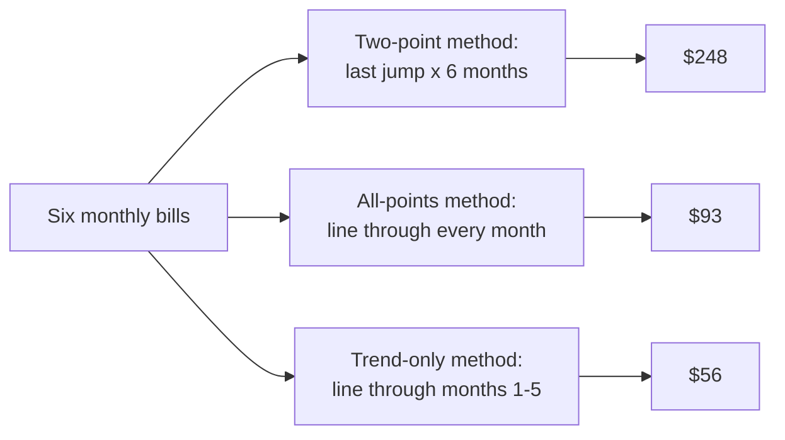

import Scenario from "../../../components/Scenario.astro";
import LevelIntro from "../../../components/LevelIntro.astro";
import PracticeCheck from "../../../components/PracticeCheck.astro";

export const unit = {
  track: "applied-math",
  unitSlug: "time-series-basics",
};

<Scenario label="Your electricity bill stayed near $52 for five months, then hit $80. Do you budget $248 for month 12?">
  <Fragment slot="facts">
    

      
📅 <strong>Months 1-5</strong> — $50, $52, $51, $53, $52

      
🔥 <strong>Month 6</strong> — $80 (the air conditioning ran nonstop)

      
🧮 <strong>The quick forecast</strong> — "+$28 last month, so +$28 a month for six more: $248"

    

    

      

        
Quick forecast for month 12$248

        

      

      

        
Line through all six months$93

        

      

      

        
Line through months 1-5 only$56

        

      

    

  </Fragment>

Your bill was around $52 every month. In month 6 it jumped to $80, so you
take the last step ($80 - $52 = $28 more) and keep adding it: by month 12
the bill would be $80 + 6 x $28 = $248. That seems absurd, but it is exactly
what "continue the latest change" produces. **The forecast used two of the six
numbers you have. Which part of that $28 jump is a new direction, and which
part is just one hot month?**

</Scenario>

<LevelIntro
  items={[
    "Trend versus noise",
    "Smoothing with a moving average",
    "Why extrapolation is risky",
  ]}
/>

## Is a jump a new direction or one odd month?

**You have six numbers in a row. What can you do with them that you cannot do
with two?** A **time series** is values recorded at regular intervals where
the order matters. Shuffle the six bills and the average stays $56.33, but the
story of "steady, then a spike" is gone.

Every series mixes two things:

| Part      | What it is                                 | In the bills                     |
| --------- | ------------------------------------------ | -------------------------------- |
| **Trend** | the direction the values are really moving | roughly flat near $52            |
| **Noise** | fluctuation that is not a change of course | month 6, if the heat was one-off |

Projecting a trend forward past your data is **extrapolation**. Two points
define a straight line every time, so a two-point trend cannot tell you whether
the jump was direction or noise.

Three methods, one dataset, three answers from $56 to $248. L2 shows where the
middle one comes from; the point here is that the answer depends on what you
decide the odd month was.

<PracticeCheck
  track={unit.track}
  unitSlug={unit.unitSlug}
  topicId="two-points-not-trend"
/>

## How do you see the trend through a jumpy series?

**If every month wiggles, how do you read the direction without trusting any
single month?** Average each value with its neighbours. A **moving average**
with a window of 3 replaces each value by the mean of itself and the two before
it, so one odd value is shared across three results instead of standing alone.

Applied to the first 12 weeks of product signups used later in this unit
(30, 33, 35, 38, 36, 41, 44, 42, 47, 50, 80, 120):

| Week | Signups | 3-week moving average      |
| ---- | ------- | -------------------------- |
| 9    | 47      | (44 + 42 + 47) / 3 = 44.3  |
| 10   | 50      | (42 + 47 + 50) / 3 = 46.3  |
| 11   | 80      | (47 + 50 + 80) / 3 = 59.0  |
| 12   | 120     | (50 + 80 + 120) / 3 = 83.3 |

The average climbs from 44.3 to 46.3 over weeks 9-10, then to 59.0 and 83.3 once
the viral weeks enter the window. A moving average lags behind a sudden change
and softens it, which is the trade for being steadier.

<PracticeCheck
  track={unit.track}
  unitSlug={unit.unitSlug}
  topicId="moving-average"
/>

## The same trap with signups

The interactive below uses twelve weeks of product signups. Weeks 1-10 climb
about 2 a week; a post goes viral and weeks 11 and 12 jump to 80 and 120. The
two-point forecast says 120 + 40 x 40 = 1,720 a week by week 52. A straight line
fitted through all twelve weeks says about 302. A line through weeks 1-10 only
says about 134.

| Method                  | Week-52 forecast |
| ----------------------- | ---------------- |
| Last jump, extended     | 1,720            |
| Line through 12 weeks   | about 302        |
| Line through weeks 1-10 | about 134        |

Drag the slider to change how big week 12's spike is and watch the 12-week line
move. L2 explains why the end of the data has that much pull.

## Key terms

- **Time series** — values recorded at regular intervals; the order matters.
- **Trend** — the underlying direction once noise is averaged out.
- **Noise** — the part of a value that does not fit the trend.
- **Moving average** — each value replaced by the mean of a window of recent values.
- **Extrapolation** — forecasting beyond the observed range by continuing a fitted trend.
- **Least squares regression** — the straight line that minimizes the total squared miss across all points (L2).

## What this unit covers

L2 explains least squares, why a point at the edge of the data pulls the line, and why
repeating seasonal patterns confuse a straight line. L3 computes the fit on the
signups, measures how good it is with R squared, and shows how the forecasts drift apart
the further out you project.
