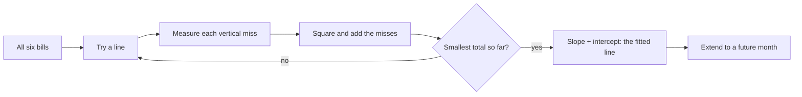

import LevelIntro from "../../../components/LevelIntro.astro";
import Checkpoint from "../../../components/Checkpoint.astro";
import PracticeCheck from "../../../components/PracticeCheck.astro";
import Plot from "../../../components/Plot.astro";

export const unit = {
  track: "applied-math",
  unitSlug: "time-series-basics",
};

L1 showed three methods giving $248, $93 and $56 for the same six electricity
bills. L2 explains where the $93 line comes from, why a late odd month pulls
it, and why a repeating yearly pattern can fool a line in a different way.

<LevelIntro
  items={[
    "Least squares in one picture",
    "Why the edge of the data pulls",
    "Seasonality hides the trend",
  ]}
/>

## What does "the best line through all the points" mean?

**Six bills never sit on one straight line. So what makes one line better than
another?** Measure the vertical miss between each bill and the line, square
each miss, and add them up. The line with the smallest total wins. That is
**least squares**, and it is written $$y = m x + c$$ where $$m$$ is the slope
(extra dollars per month) and $$c$$ is the intercept (where the line sits at
month 0).

| Piece | Meaning for the bills                  |
| ----- | -------------------------------------- |
| `x`   | month number                           |
| `y`   | predicted bill for that month          |
| slope | dollars the line adds each month: 4.34 |
| start | the line at month 0: $41.13            |

The line through all six bills is $$y = 4.34 x + 41.13$$. Month 12 gives
4.34 x 12 + 41.13 = $93.25. The line through months 1-5 only has slope 0.5 and
start $50.10, so month 12 gives $56.10.

Why square the misses instead of just adding them? Positive and negative misses
would cancel, and squaring also makes big misses count much more than small ones.

<Checkpoint question="One candidate line misses a bill by $2 and another misses a different bill by $10. How much more does least squares penalize the $10 miss?">

Twenty-five times as much, not five. The penalty is the squared miss: 2 x 2 = 4
and 10 x 10 = 100, and 100 / 4 = 25. That is the reason one extreme month can
drag the fitted line toward itself, which the next section depends on.

</Checkpoint>

<PracticeCheck
  track={unit.track}
  unitSlug={unit.unitSlug}
  topicId="least-squares-fit"
/>

## Why does the last month pull the line so hard?

**If month 6 is only one of six bills, why does it move the month-12 forecast
from $56 to $93?** Two reasons stack. Its miss from the old pattern is large
($80 versus about $53), and squaring makes a large miss expensive, so the line
tilts toward it. And it sits at the end of the range: a forecast is the line
extended past the end, so tilting the line around the end swings the far future
a lot. This extra pull of a point at the edge of the data is called **leverage**.

| Line fitted to     | Slope per month | Month-12 forecast |
| ------------------ | --------------- | ----------------- |
| Months 1-5 only    | 0.50            | $56.10            |
| All six months     | 4.34            | $93.25            |
| Last jump extended | 28.00           | $248.00           |

Should month 6 be deleted? Not automatically. If the heat wave was one-off it
is noise; if the apartment now has a bigger cooling bill every month it is a
real change. The data cannot tell you which, so the forecast should be reported
with that assumption stated.

<Checkpoint question="Why does a hot month at the end of the series move the month-12 forecast more than an equally hot month in the middle?">

The forecast is the fitted line extended beyond the last month. A point at the
end can rotate the line with nothing on its far side to hold it, so the rotation
shows up in the projected future. A point in the middle is held in place by
data on both sides, which limits how far it can tilt the line.

</Checkpoint>

## What if the pattern repeats every year?

**What if the six bills were just the start of a yearly cycle, with summer and
winter always higher?** Then a straight line is the wrong shape. Take eight
made-up quarterly bills (illustrative numbers, not measured): a steady rise of
$2 a quarter, plus a repeating seasonal bump of +30, -10, -20, 0 for the four
quarters.

| Quarter | 1   | 2   | 3   | 4   | 5   | 6   | 7   | 8   |
| ------- | --- | --- | --- | --- | --- | --- | --- | --- |
| Bill    | 122 | 84  | 76  | 98  | 130 | 92  | 84  | 106 |

Yearly averages are 95 and 103, so the real trend is up $8 a year. Yet the
least-squares line through all eight quarters has slope -0.38 and R squared
0.002: it says the bills are drifting down slightly and barely explains any of
the variation. The repeating pattern cancels the trend inside the line.

<Plot
  mark="line"
  x="quarter"
  y="bill"
  series="series"
  xLabel="Quarter"
  yLabel="Bill ($)"
  caption="Made-up quarterly bills. The actual series zigzags with the seasons; the fitted line is almost flat and slightly downward."
  data={[
    { quarter: 1, bill: 122, series: "Actual" },
    { quarter: 2, bill: 84, series: "Actual" },
    { quarter: 3, bill: 76, series: "Actual" },
    { quarter: 4, bill: 98, series: "Actual" },
    { quarter: 5, bill: 130, series: "Actual" },
    { quarter: 6, bill: 92, series: "Actual" },
    { quarter: 7, bill: 84, series: "Actual" },
    { quarter: 8, bill: 106, series: "Actual" },
    { quarter: 1, bill: 100.3, series: "Straight line" },
    { quarter: 8, bill: 97.7, series: "Straight line" },
  ]}
/>

The fix is to compare like with like. Quarter 9 is a Q1, so forecast it from
quarter 5 (the last Q1, $130) plus the yearly growth ($8): $138. The straight
line would say about $97.

| Method for quarter 9            | Forecast  |
| ------------------------------- | --------- |
| Straight line through all eight | about $97 |
| Same quarter last year + $8     | $138      |

<Checkpoint question="A series repeats every four steps and you fit one straight line to two full cycles. What can go wrong with the slope?">

It can be badly misleading, even the wrong sign. Within each cycle the
seasonal pattern itself rises and falls, and the line averages that tilt in with
the real trend. In the quarterly bills the two cancel, giving a slope of -0.38
when the true trend is +$2 a quarter. Comparing the same position in each cycle
(Q1 with Q1) removes the seasonal part before reading the trend.

</Checkpoint>

<PracticeCheck
  track={unit.track}
  unitSlug={unit.unitSlug}
  topicId="seasonality"
/>

## Failure modes at this level

- **Two points treated as a trend.** Any two points make a perfect line; that proves nothing about the data.
- **Late spike folded in silently.** A point at the edge pulls the forecast far more than "one of six" suggests.
- **Seasonal data fitted with one line.** The slope can be flat or even negative while the real trend rises.
