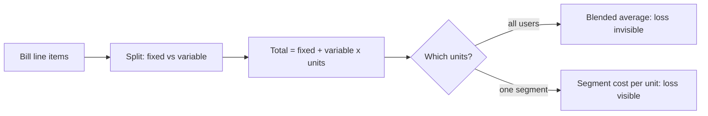

import LevelIntro from "../../../components/LevelIntro.astro";
import Checkpoint from "../../../components/Checkpoint.astro";
import PracticeCheck from "../../../components/PracticeCheck.astro";
import Plot from "../../../components/Plot.astro";

export const unit = {
  track: "applied-math",
  unitSlug: "unit-economics",
};

L1 split cost into fixed and variable and showed the lemonade stand's cost per cup
falling as the stall fee gets spread out. L2 asks the questions a real decision needs:
where does an average lie, when does a sale start paying for itself, and what do you do
with a cost that is paid once but used for months?

<LevelIntro
  items={[
    "Why the grain of a cost-per-unit figure matters",
    "Margin and break-even, computed",
    "Amortization of one-off costs",
  ]}
/>

## Why does a healthy average hide a losing tier?

**Finance reports one number for reply suggestions: about $0.41 of cost per user, against
$2.00 of revenue per user. That looks great. Why is the free tier still losing money?**

Because the average mixes two groups that behave very differently. Here is the same bill
cut at the grain of each segment. Fixed cost is split by user count (one allocation
choice, discussed in L3):

| Segment          | Users  | Suggestions | Fixed share | Variable cost | Total cost | Revenue |
| ---------------- | ------ | ----------- | ----------- | ------------- | ---------- | ------- |
| Free             | 40,000 | 1,000,000   | $2,666.67   | $11,000       | $13,666.67 | $0      |
| Paid             | 8,000  | 480,000     | $533.33     | $5,280        | $5,813.33  | $96,000 |
| Blended (48,000) | 48,000 | 1,480,000   | $3,200      | $16,280       | $19,480    | $96,000 |

The blended row is healthy: $96,000 of revenue against $19,480 of cost is a 79.7% margin.
The free row is a $13,666.67 loss every month, and the paid tier is quietly paying for it.

<Checkpoint question="The blended cost per user is $0.41, and the free tier's own cost per user is about $0.34. The free tier looks cheaper than average. So why is it the problem segment?">

Because cost per user is only half the comparison. The free tier costs $0.34 per user and
earns $0 per user, so every one of its 40,000 users loses about $0.34. The paid tier costs
about $0.73 per user but earns $12, so it wins by a wide margin. A cost-only average hides
the thing that matters, which is cost against revenue at the same grain. Compute the
figure per segment first, then blend if you need one company-wide number, never the other
way around.

</Checkpoint>

<PracticeCheck
  track={unit.track}
  unitSlug={unit.unitSlug}
  topicId="segment-grain"
/>

## When does a sale start paying for itself?

**The lemonade stand loses money at 10 cups. How many cups until it does not?** Each cup
sold at $2.00 costs $0.50 to make, so it leaves $1.50 toward the $20 stall fee. That
leftover is the **contribution margin**.

| Metric              | Formula                                     | Lemonade stand           | Paid tier                     |
| ------------------- | ------------------------------------------- | ------------------------ | ----------------------------- |
| Contribution margin | price - variable cost per unit              | 2.00 - 0.50 = $1.50      | 12 - (60 x 0.011) = $11.34    |
| Break-even units    | fixed cost ÷ contribution margin (round up) | 20 ÷ 1.50 = 13.33, so 14 | 3,200 ÷ 11.34 = 282.2, so 283 |

Check the lemonade stand by hand: 13 cups bring in $26 and cost $26.50 (a $0.50 loss), and
14 cups bring in $28 and cost $27 (a $1 profit). Break-even is a whole number of units, so
always round up.

<Plot
  mark="line"
  x="cups"
  y="dollars"
  series="line"
  xLabel="Cups sold in a day"
  yLabel="Dollars"
  caption="Revenue (2 x cups) against total cost (20 + 0.5 x cups). They cross between 13 and 14 cups; everything to the right is profit."
  data={[
    { cups: 0, dollars: 0, line: "revenue" },
    { cups: 10, dollars: 20, line: "revenue" },
    { cups: 20, dollars: 40, line: "revenue" },
    { cups: 30, dollars: 60, line: "revenue" },
    { cups: 0, dollars: 20, line: "total cost" },
    { cups: 10, dollars: 25, line: "total cost" },
    { cups: 20, dollars: 30, line: "total cost" },
    { cups: 30, dollars: 35, line: "total cost" },
  ]}
/>

The paid tier crossed its break-even at 283 users long ago, and now has 8,000. The free
tier is different: its contribution margin is $0 - (25 x $0.011) = **-$0.275** per user.
A negative margin means each extra user digs the hole deeper, so no volume ever breaks
even.

<Checkpoint question="A free user brings no revenue. If the team doubles the free user base, does the free tier's loss get better, worse, or stay the same?">

Worse. Each free user adds their own $0.275 of variable cost and no revenue to offset it,
so more free users means a bigger loss, not a smaller one. The only thing that grows
cheaper per user is the fixed share, and that does not turn a negative contribution margin
positive. Fixing a negative-margin segment takes a price above variable cost, or removing
the feature there.

</Checkpoint>

<PracticeCheck
  track={unit.track}
  unitSlug={unit.unitSlug}
  topicId="break-even-margin"
/>

## What about a cost you pay once but use for months?

**You buy a $60 cooler on day 1 and it lasts 30 stand-days. Should day 1 carry the whole
$60?** If it does, day 1 looks like a disaster and every other day looks like a bargain,
though nothing about the stand changed. Spread the cost over the days it serves:
$60 ÷ 30 = **$2 per day**.

That is straight-line **amortization**: `monthly cost = total cost ÷ months covered`.
The same logic applies to a one-time $9,600 migration (an assumed round figure) to a new
suggestion-model vendor, covering a 12-month contract: it costs **$800 per month**, so
every month's unit economics reflect the ongoing cost of running the feature rather than
when the invoice happened to be paid.

| Month | Recognized | Cumulative | Remaining |
| ----- | ---------- | ---------- | --------- |
| 1     | $800       | $800       | $8,800    |
| 2     | $800       | $1,600     | $8,000    |
| ...   | ...        | ...        | ...       |
| 12    | $800       | $9,600     | $0        |

<PracticeCheck
  track={unit.track}
  unitSlug={unit.unitSlug}
  topicId="amortization"
/>

L3 turns break-even into a small tested function, shows how the choice of allocation changes
a segment's story, and works the numbers end to end.
