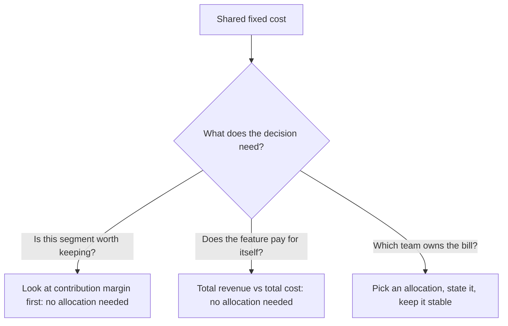

import Scenario from "../../../components/Scenario.astro";
import LevelIntro from "../../../components/LevelIntro.astro";
import Checkpoint from "../../../components/Checkpoint.astro";
import PracticeCheck from "../../../components/PracticeCheck.astro";

export const unit = {
  track: "applied-math",
  unitSlug: "unit-economics",
};

<Scenario label="Two spreadsheets, one bill">
  <Fragment slot="facts">
    <div class="not-prose flex flex-col gap-2 text-sm text-slate-700 dark:text-slate-300">
      <div class="flex items-center gap-1.5"><span>👥</span> <strong>By users</strong> — free tier carries $2,666.67 of fixed cost</div>
      <div class="flex items-center gap-1.5"><span>📈</span> <strong>By usage</strong> — free tier carries $2,162.16 of fixed cost</div>
      <div class="flex items-center gap-1.5"><span>🧾</span> <strong>Same bill</strong> — $19,480 in total either way</div>
    </div>
    <div class="not-prose mt-3 flex flex-col gap-1.5 text-xs text-slate-700 dark:text-slate-300">
      <div>
        <div class="flex justify-between"><span>Free-tier loss, split by users</span><span>$13,666.67</span></div>
        <div class="h-2 w-full overflow-hidden rounded-full bg-slate-200 dark:bg-slate-700"><div class="h-full rounded-full bg-rose-500 animate-fill-bar" style="--target-width: 100%"></div></div>
      </div>
      <div>
        <div class="flex justify-between"><span>Free-tier loss, split by usage</span><span>$13,162.16</span></div>
        <div class="h-2 w-full overflow-hidden rounded-full bg-slate-200 dark:bg-slate-700"><div class="h-full rounded-full bg-amber-500 animate-fill-bar" style="--target-width: 96.3%"></div></div>
      </div>
    </div>
  </Fragment>

Two analysts cost the same reply-suggestions feature from the same $19,480 bill. One
splits the $3,200 fixed cost by head count, the other by how many suggestions each
segment generated. They report two different free-tier losses and each insists the other
is wrong. **Who is right, and does the disagreement change the decision?**

</Scenario>

<LevelIntro
  items={[
    "Allocation methods and what they change",
    "Break-even as a small function with a guard",
    "A full worked run, and where it stops applying",
  ]}
/>

## How do two allocations of one bill both stay honest?

**Neither analyst made an arithmetic error.** Fixed cost belongs to the whole feature,
so any split is a modelling choice. Everything here is computed from the L1 assumptions
(round-number figures, not real prices):

| Allocation of the $3,200                   | Free-tier share | Paid-tier share | Free-tier total cost | Free-tier loss |
| ------------------------------------------ | --------------- | --------------- | -------------------- | -------------- |
| By users (40,000 : 8,000)                  | $2,666.67       | $533.33         | $13,666.67           | $13,666.67     |
| By usage (1,000,000 : 480,000 suggestions) | $2,162.16       | $1,037.84       | $13,162.16           | $13,162.16     |

The totals do not move: $2,666.67 + $533.33 and $2,162.16 + $1,037.84 both equal
$3,200. Allocation shifts blame between segments by $504.51 without changing the company's
bill. The decision is untouched because the free tier is a loss under either method: its
$11,000 of variable cost alone exceeds its $0 revenue.



<Checkpoint question="The team caps free users at 5 suggestions a month instead of 25. Does that fix the free tier, or just shrink the loss?">

It shrinks it without fixing it. Variable cost falls from 40,000 x 25 x $0.011 = $11,000 to
40,000 x 5 x $0.011 = $2,200, so the free tier's total cost drops from $13,666.67 to
$4,866.67 once its $2,666.67 fixed share is added back. But revenue is still $0, so the
segment still loses $4,866.67 every month and its contribution margin per user is still
negative at -$0.055. A cap is a mitigation for a negative-margin segment, and the real
fixes are a price above variable cost or removing the feature from that tier.

</Checkpoint>

## How do you turn break-even into something you can rerun?

**Pricing, volume and vendor rates change every quarter. Doing the division by hand again
risks a sign slip.** Break-even is the one place here where code earns its keep, because
the failure case (a margin of zero or less) must be handled on purpose:

```js
function breakEvenUnits(fixed, price, variablePerUnit) {
  const margin = price - variablePerUnit;
  if (margin <= 0) return Infinity; // no volume ever breaks even
  return Math.ceil(fixed / margin);
}
```

`breakEvenUnits(20, 2, 0.5)` returns 14 cups, and `breakEvenUnits(3200, 12, 0.66)`
returns 283 paid users. A free user has price 0, so the margin is negative and the answer
is `Infinity`, which is the honest answer rather than a negative count of users that is
easy to misread.

<PracticeCheck
  track={unit.track}
  unitSlug={unit.unitSlug}
  topicId="break-even-calc"
/>

## What does the full picture look like once it is all run?

| Question                        | Number                                |
| ------------------------------- | ------------------------------------- |
| Total monthly cost              | $3,200 + 1,480,000 x $0.011 = $19,480 |
| Paid-tier profit                | $96,000 - $5,813.33 = $90,186.67      |
| Paid-tier margin                | 93.9%                                 |
| Free-tier loss (split by users) | $13,666.67                            |
| Feature as a whole              | $96,000 - $19,480 = $76,520 profit    |
| Paid break-even                 | 283 users (8,000 actual)              |
| Free break-even                 | none (margin -$0.275 per user)        |

The feature as a whole is profitable, which is exactly why nobody noticed. Whether to keep
free access is a product decision: the free tier may bring in paying users later. Unit
economics does not make that call, but it replaces "shouldn't cost much" with a number the
decision can argue about.

**This is one case, not the whole territory.** Extend it yourself: what changes if the
paid price drops from $12 to $6? What if free users stay capped at 5 suggestions but the
GPU pool doubles to $6,400 once volume passes a threshold, so fixed cost is a staircase
and not a flat line? And what if you must justify the free tier as a marketing expense
paid for by a conversion rate you can only estimate? Work out which of the numbers above
still hold and which need new inputs before you present them.
