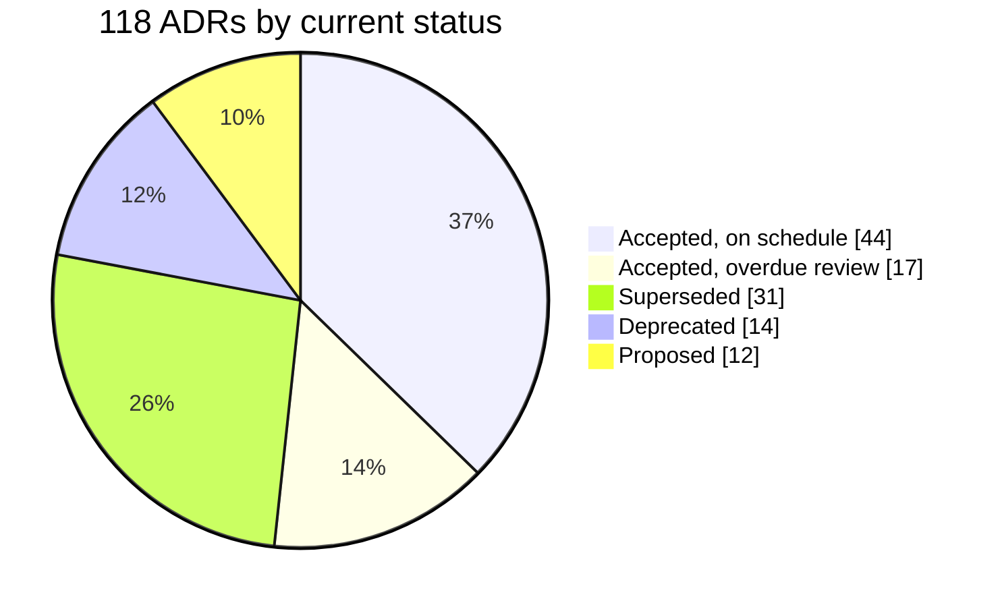
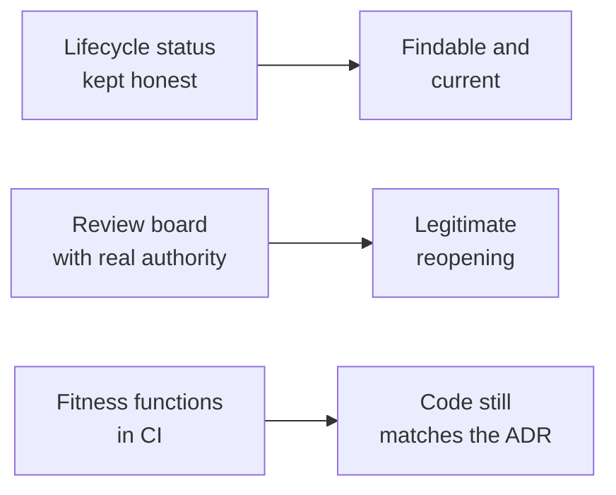

import Scenario from "../../../components/Scenario.astro";
import LevelIntro from "../../../components/LevelIntro.astro";
import PracticeCheck from "../../../components/PracticeCheck.astro";

export const unit = { track: "architecture", unitSlug: "adr-governance" };

<Scenario label="The decision was written down and accepted. Why is the same argument happening again?">
  <Fragment slot="facts">
    

      
118 ADRs on record

      

        ✅ Accepted, reviewed on time
        44
      

      

        

      

      

        🧟 Accepted, overdue for review
        17
      

      

        

      

    

    
Symptoms this week

    

      
🔍 Nobody can find ADR-042 in under ten minutes

      
🤷 Two other services already break it, unnoticed

      
🔁 The same debate restarts from scratch

    

  </Fragment>

Picture a household rule taped inside a kitchen cupboard: "no glass jars on the top shelf." Two years later a new housemate, who never opened that cupboard, puts a glass jar on the top shelf. Another housemate half-remembers the rule but not the reason. Nobody is careless. The rule simply isn't where the decision gets made.

Now the same thing at work. A payments engineer is about to add a synchronous call from the checkout service straight into the ledger service. A reviewer says "didn't we decide against this?" A search finds ADR-042, written fourteen months ago, status `accepted`, requiring event-driven writes to the ledger. Nobody currently on the team was there. Two other services already break it. **The org had a decision in writing. So why is the argument starting from zero?**

</Scenario>

Writing a decision down once does not keep it findable, current or enforced. At the scale of dozens of ADRs, something has to do that on purpose.

<LevelIntro
  items={[
    "Why ADRs decay as they pile up",
    "What each ADR status means",
    "Three mechanisms that keep records honest",
  ]}
/>

This unit assumes you know what a single ADR is (see `systems/trade-off-documentation`). The new problem is the pile: written by people who have since left, about systems that have since changed. Which ones are still true? Which one governs the code you are about to write?

## What decays when nobody tends the pile?

Three things rot, and each one has its own cure:

| What decays     | What it looks like                             | The cure          |
| --------------- | ---------------------------------------------- | ----------------- |
| Discoverability | Nobody can find the ADR that governs this code | Maintained status |
| Enforcement     | The code drifts away and no one notices        | Automated checks  |
| Legitimacy      | Reopening is either impossible or free-for-all | A review body     |

<PracticeCheck
  track={unit.track}
  unitSlug={unit.unitSlug}
  topicId="decay-problem"
/>

## What does a status actually tell you?

Suppose you open an ADR and its status reads `superseded`. **Do you follow it, ignore it, or look for something else?** The answer lives in a four-word vocabulary:

| Status       | Meaning                                        | Still governs new code? |
| ------------ | ---------------------------------------------- | ----------------------- |
| `proposed`   | Written, not yet ratified by the review body   | No                      |
| `accepted`   | Ratified and currently in force                | Yes                     |
| `superseded` | Replaced by a newer ADR, which it links to     | No, follow the link     |
| `deprecated` | No longer applies, and there is no replacement | No                      |

A status field that nobody updates is worse than no field: it tells every reader "trust me" with nothing behind the claim.

<PracticeCheck
  track={unit.track}
  unitSlug={unit.unitSlug}
  topicId="adr-status"
/>

## Which mechanism fixes which decay?

- **Lifecycle status** says whether a decision is in force, and a superseded one points to its replacement.
- **An architecture review board** (a standing group, not necessarily large or formal) can accept, reject or reopen decisions on a cadence, so "is this still current?" has an owner.
- **Fitness functions** are automated checks, usually in CI, that verify the codebase still honors a decision instead of relying on everyone remembering it.

<PracticeCheck
  track={unit.track}
  unitSlug={unit.unitSlug}
  topicId="three-mechanisms"
/>
