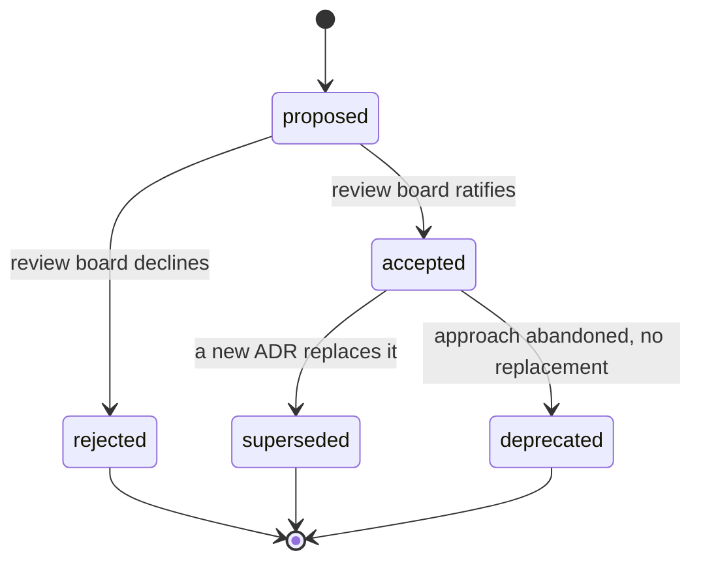
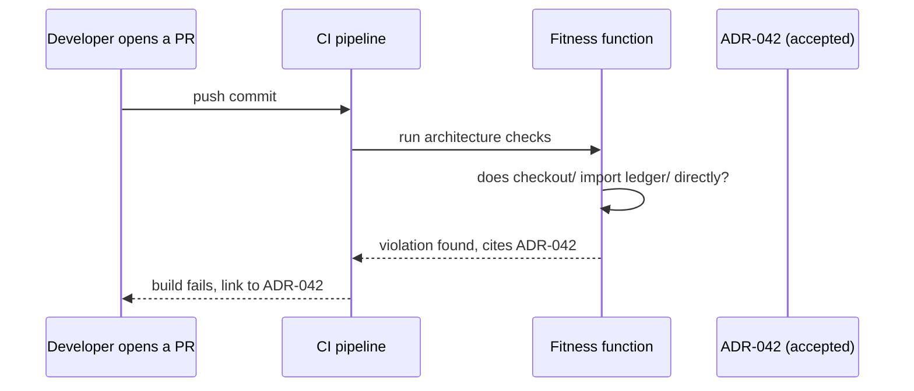

import Scenario from "../../../components/Scenario.astro";
import LevelIntro from "../../../components/LevelIntro.astro";
import Checkpoint from "../../../components/Checkpoint.astro";
import PracticeCheck from "../../../components/PracticeCheck.astro";

export const unit = { track: "architecture", unitSlug: "adr-governance" };

**Who is allowed to change an ADR from `accepted` to `superseded`, and what stops a drive-by edit in a random PR from doing it?** L1 named three mechanisms. This level connects them into one system instead of three habits a team half-follows.

<LevelIntro
  items={[
    "The status state machine and who moves it",
    "Reopening a decision and review cadence",
    "How a fitness function enforces an ADR",
  ]}
/>

## Why is the status field a state machine and not free text?

If `status: accepted` can be hand-edited to `deprecated` by anyone, the field is decoration. Treat it as a small state machine with fixed legal transitions, each requiring a specific actor:

The diagram shows two things a flat string cannot. **Every edge has an actor** (the review board, not whoever happens to edit the file), and **no edge leads back into `accepted`**. A superseded or deprecated ADR is not quietly restored by editing its status.

<Checkpoint question="A superseded ADR's status is hand-edited back to 'accepted' in a routine PR with the message 'reverting an old decision.' What is wrong, beyond etiquette?">

There is no legal edge from `superseded` back to `accepted`. Reviving an old decision is a new decision that happens to agree with an old one, so it needs the same ratification the original had. A plain status edit would leave every later reader unable to tell whether `accepted` was ratified by the board or slipped in by whoever touched the file that day.

</Checkpoint>

<PracticeCheck
  track={unit.track}
  unitSlug={unit.unitSlug}
  topicId="status-state-machine"
/>

## Why is "reopen it" a new ADR and not an edit?

<Scenario label="The re-litigation trap">
  <Fragment slot="facts">
    

      
📄 ADR-042: no synchronous ledger calls, accepted

      
🗣️ A newcomer argues the same trade-off again

      
❓ Nothing records that it was already argued

    

  </Fragment>

A newcomer who has never seen ADR-042 writes a design doc arguing for exactly the call it rejected. The reviewer who remembers ADR-042 has two bad options: block the doc by citing a record the author cannot evaluate, or let the whole argument run again from zero. **Is there a third option that does not depend on perfect memory?**

</Scenario>

Yes: make "propose reopening ADR-042" a first-class action. A **new ADR that explicitly targets the old one** ("ADR-089: revisit the synchronous-call ban") forces the proposal to state what has changed since, such as new information or changed constraints, and not just "I disagree." It also leaves a permanent, searchable record that the question was reopened and answered.

| Reopening path                                            | What it leaves behind                                  |
| --------------------------------------------------------- | ------------------------------------------------------ |
| Re-argue in a design doc or chat, ADR untouched           | The same debate, unrecorded, ready to repeat next time |
| New ADR targeting the old one, with "what changed" stated | A permanent record of the decision, its successor, why |

<Checkpoint question="Nothing about the constraints has changed since ADR-042; someone just prefers the other approach. Does the new-ADR path still apply?">

Yes, the mechanism is the same, but the "what changed" section has to honestly say "nothing changed; this is a preference reversal," which is a far harder case to win than "the constraint behind ADR-042 no longer holds." The path does not block reopening. It sets how honestly a reopening must justify itself, and that is what stops endless re-litigation without freezing every decision.

</Checkpoint>

<PracticeCheck
  track={unit.track}
  unitSlug={unit.unitSlug}
  topicId="reopen-as-new-adr"
/>

## How heavy should a review be?

**Should a naming convention and a decision to replace the primary datastore get the same review?** Clearly not, so the real design choice is a dial:

|                          | Lightweight (async, 1 to 2 reviewers)     | Heavyweight (scheduled board, quorum)                       |
| ------------------------ | ----------------------------------------- | ----------------------------------------------------------- |
| Turnaround               | Hours to a few days                       | Until the next meeting slot                                 |
| Best for                 | Reversible, single-team decisions         | Expensive to reverse, or cross-team blast radius            |
| Failure mode if overused | Rubber-stamping: depth drops to keep pace | Backlog: decisions pile up faster than the board hears them |

Neither end is correct. The mistake is one cadence for every decision regardless of reversal cost. Most working setups tier by blast radius: async by default, escalating to a scheduled board when a decision crosses team boundaries or is hard to undo. L3's demo shows what happens to the backlog when everything takes the slow path.

<PracticeCheck
  track={unit.track}
  unitSlug={unit.unitSlug}
  topicId="review-cadence"
/>

## How does a document become an enforced rule?

A status field and a review board both answer "is this decision still current?" Neither checks whether the code still matches it. That gap let two services break ADR-042 unnoticed. A **fitness function** is an automated check, typically run in CI on every PR, that verifies one architectural rule still holds and points back to the ADR that created it:

The check never needs to understand why ADR-042 says what it says. It verifies the observable consequence and hands the developer the reasoning exactly when it matters.

<Checkpoint question="Why does the failing build link to ADR-042 instead of only printing a lint-style message?">

Because the developer who just hit the failure is the one person who needs the reasoning right now, and a bare rule name gives them nothing to evaluate or argue with. The link turns a blocked build into a pointer at the decision and its "what changed?" path, so a legitimate objection becomes a new ADR instead of a workaround.

</Checkpoint>

<PracticeCheck
  track={unit.track}
  unitSlug={unit.unitSlug}
  topicId="fitness-function-role"
/>
