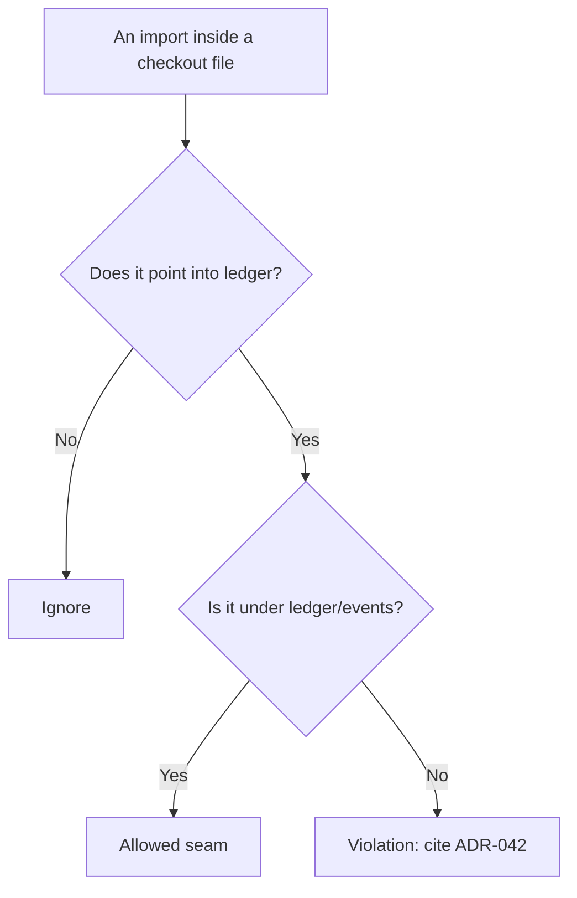
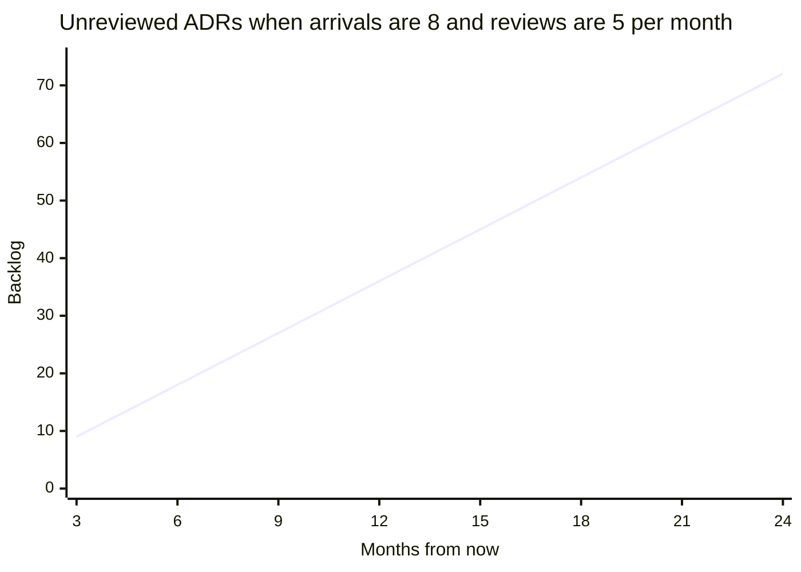

import Scenario from "../../../components/Scenario.astro";
import LevelIntro from "../../../components/LevelIntro.astro";
import Checkpoint from "../../../components/Checkpoint.astro";
import PracticeCheck from "../../../components/PracticeCheck.astro";

export const unit = { track: "architecture", unitSlug: "adr-governance" };

<Scenario label="Two different decays, two different checks">
  <Fragment slot="facts">
    

      
🧱 Decay 1: code violates a decision still in force

      
🧟 Decay 2: status says accepted, nobody has confirmed it in years

      
🤖 Neither shows up in a code review, both need a script

    

  </Fragment>

Think of a building with two separate problems: a wall someone knocked a hole in, and a fire extinguisher whose inspection tag expired two years ago. One is a physical fact you can inspect; the other is a date on a record. Nobody would expect one checklist item to catch both.

ADR governance has the same split. **Can one kind of check catch both a codebase drifting from an `accepted` decision and a decision whose own status went stale, or are these different problems?**

</Scenario>

Different problems. One scans source code for a forbidden dependency shape, the other scans the ADR records for an overdue date. Both are small, mechanical, and run in CI. Neither needs more than a list of facts as input, which is why this level uses tables instead of code.

<LevelIntro
  items={[
    "A boundary check over import lists",
    "A staleness scan over ADR records",
    "Backlog arithmetic and failure modes",
  ]}
/>

## What exactly does a boundary check compare?

ADR-042 says in prose: "checkout must never call ledger synchronously, only through the published event contract." To make that mechanical, you reduce it to a rule with three parts and one input.

| Rule part     | Value for ADR-042 |
| ------------- | ----------------- |
| `from` folder | `checkout`        |
| `to` folder   | `ledger`          |
| Allowed seam  | `ledger/events`   |

The input is a list of source files, each with the list of things it imports (a real setup extracts that list with a dependency-analysis tool; that step is separate from the rule itself). The check flags any import from a `checkout/` file that points into `ledger` and is not under the allowed seam:

| File                      | Import          | Result                                   |
| ------------------------- | --------------- | ---------------------------------------- |
| `checkout/place-order.ts` | `ledger/client` | Violation, a direct call into the ledger |
| `checkout/place-order.ts` | `checkout/cart` | Ignored, stays inside checkout           |
| `checkout/refund.ts`      | `ledger/events` | Allowed, goes through the seam           |
| `payments/report.ts`      | `ledger/client` | Ignored, the rule only covers checkout   |

<Checkpoint question="A checkout file imports 'ledger-events-legacy', which is neither 'ledger' nor anything under 'ledger/'. Does the rule flag it, and is that right?">

It is not flagged, because the rule only treats an import as crossing the boundary when it equals `ledger` or starts with `ledger/`. Whether that is correct depends on what lives there: if it is really part of the ledger under a confusing name, the rule has a gap worth fixing; if it is an unrelated module sharing a word, the rule behaves as intended. Any check built on folder names is only as accurate as the assumption that module boundaries match folder names.

</Checkpoint>

<PracticeCheck
  track={unit.track}
  unitSlug={unit.unitSlug}
  topicId="boundary-rule"
/>

## What does a staleness scan look at?

The boundary check trusts that ADR-042 is still current. Nothing verifies that except a person remembering to look. The second check reads the ADR records. Each record needs only three facts: an id, a status, and a `reviewBy` date for its next reconfirmation. The rule: skip anything that is not `accepted`, flag anything whose date is before today's, and sort the worst first.

| ADR     | Status       | Review by  | As of 2026-08-29 | Flagged?         |
| ------- | ------------ | ---------- | ---------------- | ---------------- |
| ADR-042 | `accepted`   | 2026-01-01 | 240 days overdue | Yes              |
| ADR-089 | `superseded` | 2025-06-01 | Not applicable   | No, not in force |
| ADR-101 | `accepted`   | 2026-09-01 | Not due yet      | No               |

The 240 is real arithmetic: January 1 to August 29 is 31 + 28 + 31 + 30 + 31 + 30 + 31 days to reach August 1, plus 28 more. Only `accepted` ADRs can go stale, because staleness means "still claims to govern the code, but nobody has confirmed it recently." A superseded ADR has nothing left to reconfirm. Run weekly, a scan like this produces the "17 accepted, overdue for review" number from L1 without anyone auditing 118 documents by hand.

<Checkpoint question="An ADR is 'proposed' and its reviewBy date is in the past. Does the staleness scan flag it?">

No, the status filter removes it before any date is compared. A proposal with a past date was never ratified, which is a different problem with a different signal ("this proposal stalled"), not "this decision needs reconfirming." Mixing the two would bury real stale decisions in a list of abandoned drafts.

</Checkpoint>

<PracticeCheck
  track={unit.track}
  unitSlug={unit.unitSlug}
  topicId="staleness-scan"
/>

## When does a review board's backlog grow without bound?

**If the board is busy, is the backlog a staffing problem or an arithmetic one?** Take the unit's demo numbers (an assumption for illustration): about 8 new ADRs arrive per month and the board reviews about 5.

| Arrivals per month | Reviews per month | Net change per month | Backlog after 12 months |
| ------------------ | ----------------- | -------------------- | ----------------------- |
| 8                  | 5                 | +3                   | 36                      |
| 8                  | 8                 | 0                    | 0 (no growth)           |
| 5                  | 8                 | -3                   | 0 (cleared)             |

The line is straight: three extra decisions each month, forever. The lesson is not the raw numbers but the sign of the gap. Once throughput exceeds arrivals, an existing backlog shrinks instead. This is also why tiering by blast radius works: it removes small decisions from the slow queue rather than hiring the board bigger. Drag the sliders in the demo above to see where the line bends.

<PracticeCheck
  track={unit.track}
  unitSlug={unit.unitSlug}
  topicId="backlog-math"
/>

## Where does governance itself fail?

| Situation                                                            | Worth the machinery?                                         |
| -------------------------------------------------------------------- | ------------------------------------------------------------ |
| Dozens of ADRs, several teams, decisions enforced by code boundaries | Yes, memory-based enforcement fails silently at this scale   |
| A five-person team with a handful of ADRs everyone has read          | Usually not yet, setup and upkeep cost more than they return |
| One team's internal convention with no cross-team blast radius       | Lightweight review is enough, a scheduled board is overkill  |

Failure modes that show up in practice:

- **The rubber-stamp board.** A board that never says no is adding latency, not judgment. Either the bar for reaching it is wrong or it has stopped reading.
- **Fitness functions that drift from their ADR.** If ADR-042 is amended to permit a second event type and the check's allowed seam is not updated, the check eventually blocks something the org wants or, worse, silently stops catching something it should.
- **Uniform governance regardless of blast radius.** Sending naming conventions through the same heavy board as a datastore replacement makes the board the bottleneck teams route around, informally, which recreates the silent violations this unit opened with.

<Checkpoint question="Why can an unmaintained fitness function be worse than having none?">

A check that fails builds for a rule the org has since changed teaches people to bypass checks, while a check that no longer covers the real rule gives false assurance that the decision is enforced. With no check, everyone at least knows enforcement is by memory. A check is only as trustworthy as the process that keeps it in step with the ADR it cites.

</Checkpoint>

<PracticeCheck
  track={unit.track}
  unitSlug={unit.unitSlug}
  topicId="governance-failure-modes"
/>

## This is a case, not the whole territory

Everything above is one rule, one date check and one arrival rate. **What would change if the rule were layered, such as "domain may import nothing from infra, and infra nothing from web," across three or more layers instead of two named folders? What if high blast-radius ADRs had to be reconfirmed every 90 days while low-stakes ones only yearly: is that a change to the scan's logic, or to the data each record carries? And what if the review board's capacity doubled but arrivals also doubled?** Rework the tables for your own version and compare which parts moved and which stayed.
