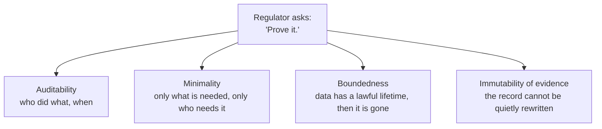

import Scenario from "../../../components/Scenario.astro";
import LevelIntro from "../../../components/LevelIntro.astro";
import PracticeCheck from "../../../components/PracticeCheck.astro";

export const unit = {
  track: "architecture",
  unitSlug: "architecture-for-compliance",
};

<Scenario label="An auditor asks who looked at one customer's file last year">
  <Fragment slot="facts">
    

      
The request

      
📋 "List every system and person that read customer 9911's tax ID in the last 12 months"

      
⏱️ Answer due in 5 business days

    

    
What the team has

    

      
🗄️ Rows are overwritten in place, old values are gone

      
📜 App logs are deleted after 30 days

      
🤷 Reads were never recorded at all

    

  </Fragment>

Larch Pay is a small payments app. Customers love it: it is fast, every
service owns its data, and releases ship daily. Then Compliance forwards a
short message from an auditor: _who looked at customer 9911's tax ID in
the last twelve months?_

The team opens the database and finds the current value, nothing else.
Rows are updated in place. Logs older than a month are gone. Nobody ever
wrote down a read. **The system works for every user, so why can it not
answer one simple question about its own past?**

</Scenario>

Because it was built to be _correct now_, and the auditor is asking it to
_prove, later_. Those are two different jobs. A user judges a system by
what it does at this moment; a regulator judges it by whether it can show,
on demand, that it behaved lawfully before. Evidence has to be carried
forward through time on purpose.

<LevelIntro
  items={[
    "The regulator as a stakeholder",
    "Four properties regulators ask for",
    "Why compliance cannot be added later",
  ]}
/>

## A stakeholder who shows up after the fact

Every architecture balances stakeholders. A regulator is an unusual one:
they never call your API and mostly appear _after_ something happened.

| Stakeholder | Typical demand                            | When they show up                   |
| ----------- | ----------------------------------------- | ----------------------------------- |
| User        | "Do the thing I asked, fast"              | Every request                       |
| Business    | "Do it cheaply, ship it quickly"          | Every planning cycle                |
| Regulator   | "Prove, later, that it was done lawfully" | Audits, incidents, subject requests |

Regimes differ (privacy laws, payment-card rules, audit frameworks), but
their architectural asks converge on four properties:

<PracticeCheck
  track={unit.track}
  unitSlug={unit.unitSlug}
  topicId="four-properties"
/>

## Why not add it later?

**If Larch Pay ships an audit trail next week, can it answer the auditor
about last year?** No. The trail starts remembering the day it ships; the
overwritten values and unrecorded reads before that day are not
recoverable by any amount of effort.

| Retrofit                                               | What is already lost or tangled                        |
| ------------------------------------------------------ | ------------------------------------------------------ |
| Audit trail on a system that overwrites rows           | Every day of history before the retrofit               |
| Field-level access on a table five services `SELECT *` | Five services' worth of assumptions to untangle        |
| Deletion schedule after years of keeping everything    | Years of data that may already be past its lawful life |

These four properties describe _how data flows and is stored_. They are
structural decisions, not a feature switched on at the end.

<PracticeCheck
  track={unit.track}
  unitSlug={unit.unitSlug}
  topicId="retrofit-limit"
/>

## What the next levels add

L2 gives each property its architectural pattern: an append-only log, a
classify-then-gate step, and a scheduled retention job. L3 works through
the sharpest edges: proving the log itself was not rewritten, and what
happens when a legal hold collides with a deletion deadline.
