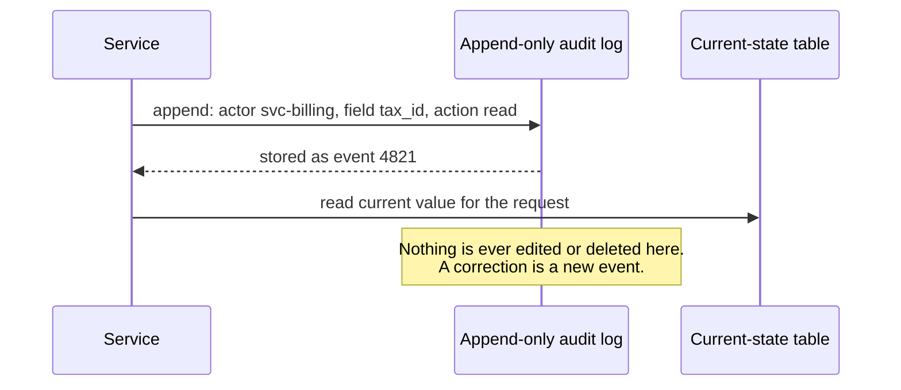
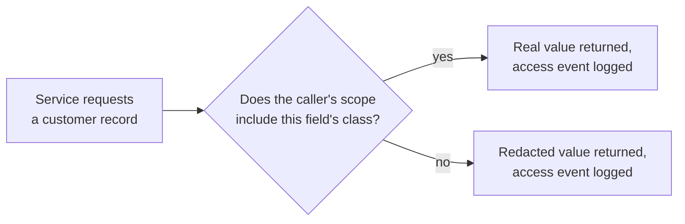
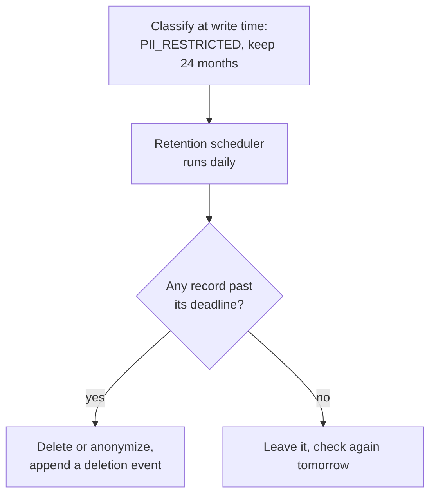

import Scenario from "../../../components/Scenario.astro";
import LevelIntro from "../../../components/LevelIntro.astro";
import Checkpoint from "../../../components/Checkpoint.astro";
import PracticeCheck from "../../../components/PracticeCheck.astro";

export const unit = {
  track: "architecture",
  unitSlug: "architecture-for-compliance",
};

L1 named four properties: auditability, minimality, boundedness, and
immutability of evidence. **What do they look like wired into a system
instead of listed on a slide?** Each maps to one pattern, and the three
patterns below fit together into a single shape.

<LevelIntro
  items={[
    "The append-only event log",
    "Classify data, then gate access",
    "Retention as a scheduled process",
  ]}
/>

## Auditability: why not just a `last_modified_by` column?

**If auditability means "record who touched it," would one extra column on
every table do?** No. A column holds only the _latest_ change, so it has
already forgotten everything before it. The auditor asked about twelve
months.

The standard shape is an **append-only event log**: never overwrite, always
append a new immutable record, and treat current state as something built
from the log.

This is the same idea event sourcing uses for business state (see
`architecture/event-driven-architecture`), applied to _access and change
events_. The log does not replace the operational database; it sits beside
it as the system's memory.

<Checkpoint question="A team adds a 'reason' field to each audit event and lets support staff edit it later if the original reason was unclear. Does this break the append-only property?">

Yes. Once any field of a written event can be edited, the log stops being a
record of the past: nobody can tell a genuine clarification from a
cover-up. The fix is not "nobody may ever correct anything"; it is that a
correction is itself a _new_ event ("event 4821's reason updated to X, by
agent Y, at time Z"). The original event stays exactly as written.

</Checkpoint>

<PracticeCheck
  track={unit.track}
  unitSlug={unit.unitSlug}
  topicId="append-only-log"
/>

## Minimality: classify the data, then gate access to it

<Scenario label="The policy nobody consults">
  <Fragment slot="facts">
    

      
📄 Policy: "PII is need-to-know only"

      
🗄️ The `users` table: every service's credential can read every column

      
🤷 No code ever compares a query to the policy

    

  </Fragment>

A new analytics service launches. Nobody grants it special access to the
tax ID column; it simply uses the same database credential every other
service uses, which already reads everything. The policy document says
need-to-know. **Is the document doing any work here?**

</Scenario>

Only as something to point to after the fact. A control is something that
is consulted when the request happens. So minimality is enforced
structurally: data is **classified**, and a **gate** checks the caller's
scope against each field's class.

| Classification   | Example fields           | Default access                           |
| ---------------- | ------------------------ | ---------------------------------------- |
| `PUBLIC`         | display name, plan tier  | Any authenticated service                |
| `INTERNAL`       | email, signup date       | Services with a documented business need |
| `PII_RESTRICTED` | tax ID, bank account no. | Named services only, every access logged |

The gate does two jobs: it decides _whether_ a caller sees the field, and
it appends an access event _either way_, because an attempted read of a
restricted field is itself something a regulator or investigator can ask
about.

Why fewer named services? Exposure adds up. The demo on this page assumes
each service granted access has the same independent yearly odds of being
compromised. With 3 services each able to query 50,000 customer records at
4% odds, the expected exposure is 3 x 50,000 x 0.04 = 6,000 records per
year; with 6 services it is 12,000. The odds are an assumption chosen for
illustration, but the linear shape is the point.

<Checkpoint question="A new analytics service asks for 'read access to the customer table to build dashboards', with no field list. What should the gate default to?">

The lowest class that satisfies the request: `PUBLIC` fields only, until
the team names the specific `INTERNAL` or `PII_RESTRICTED` fields it needs
and that need is reviewed. "Build dashboards" names no need for tax IDs.
The default posture is exclusion; "grant broad access and revoke if
someone complains" is the pattern that produces untracked exposure.

</Checkpoint>

<PracticeCheck
  track={unit.track}
  unitSlug={unit.unitSlug}
  topicId="classify-and-gate"
/>

## Boundedness: retention as a process, not a hope

**If the log and the gate both work, is the system done?** Not yet. Both
govern data _while it exists_. Neither decides how long it should exist,
and "someone will clean it up eventually" is not an enforced deadline.

Boundedness attaches a **retention period to the classification** and runs
a process that enforces it:

The deletion itself is logged. Deleting regulated data is not an exemption
from auditability; it is exactly what a regulator asks to see ("prove you
deleted what you said you would, and when").

<Checkpoint question="A scheduler deletes expired records every night but writes nothing to the audit log. A year later an auditor asks for proof that customer 4410's data was deleted on time. What can the team show?">

Nothing. The record is gone, and so is any evidence that it was deleted,
when, or by what rule. The deletion event is the evidence; without it
"we deleted it" is an assertion, not proof. L3 shows how this log is made
tamper-evident, and what happens when a legal hold forbids the deletion.

</Checkpoint>

<PracticeCheck
  track={unit.track}
  unitSlug={unit.unitSlug}
  topicId="retention-schedule"
/>
