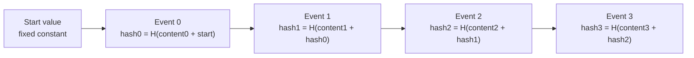
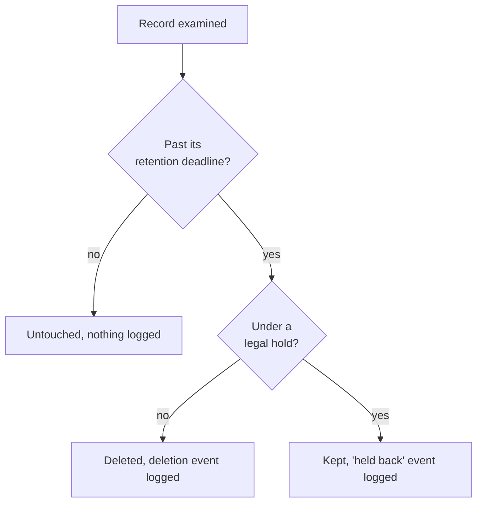

import Scenario from "../../../components/Scenario.astro";
import LevelIntro from "../../../components/LevelIntro.astro";
import Checkpoint from "../../../components/Checkpoint.astro";
import PracticeCheck from "../../../components/PracticeCheck.astro";

export const unit = {
  track: "architecture",
  unitSlug: "architecture-for-compliance",
};

<Scenario label="The log says what happened. Who says the log is honest?">
  <Fragment slot="facts">
    

      
🔗 Auditability: an append-only log

      
🚪 Minimality: a field-level gate

      
⏳ Boundedness: a retention job

      
⚖️ Edge cases: a quiet edit to the log, and a hold that forbids a deletion

    

  </Fragment>

Larch Pay now appends an event for every read. Then someone with raw
database access changes event 2 of the log, replacing the name of a
service that read a tax ID. The log is still "append-only" by convention,
and nothing in it shows the edit. **How could an auditor ever trust a
record that its own custodian could have rewritten?**

</Scenario>

L2 built three mechanisms. This level pushes on two of their hardest
edges: making the log _evidently_ unedited, and keeping retention lawful
when a deadline and a legal order disagree.

<LevelIntro
  items={[
    "A hash chain that exposes edits",
    "What a chain cannot catch",
    "Retention colliding with a legal hold",
  ]}
/>

## Piece 1: how can a log prove it was not rewritten?

An append-only rule is a convention. A direct `UPDATE` against the log's
storage bypasses it, and a plain table cannot tell. The fix is a **hash
chain**: each event stores a fingerprint (hash) computed over its own
content _plus the previous event's fingerprint_.

To **verify**, recompute every fingerprint from the start and compare with
what is stored. Now edit event 2's content in storage:

| Event | Stored hash | Recomputed from the stored content   | Verdict                                        |
| ----- | ----------- | ------------------------------------ | ---------------------------------------------- |
| 0     | hash0       | hash0                                | matches                                        |
| 1     | hash1       | hash1                                | matches                                        |
| 2     | hash2       | different (content changed)          | **first mismatch**                             |
| 3     | hash3       | built on the _stored_ hash2, not new | chain no longer consistent from event 2 onward |

Verification reports the first failing position, so investigators know
exactly where to start rather than comparing every event by hand.

<Checkpoint question="Someone edits event 4821 out of 9000. Does verification flag only that event?">

It reports 4821 as the first failure, but everything after it is also no
longer consistent, because each event's fingerprint was built on the one
before. That is a feature: the first mismatch is the earliest possible
point of tampering, which is where the investigation begins.

</Checkpoint>

<PracticeCheck
  track={unit.track}
  unitSlug={unit.unitSlug}
  topicId="hash-chain"
/>

### What the chain does not do

A chain makes a silent rewrite _detectable_; it does not make it
impossible, and it has two honest blind spots.

| Attack                                                | Does verification alone catch it?        | What closes the gap                                              |
| ----------------------------------------------------- | ---------------------------------------- | ---------------------------------------------------------------- |
| Edit one event's content                              | Yes                                      | Nothing more needed to detect it                                 |
| Edit a middle event and recompute every hash after it | No, the rebuilt chain is self-consistent | Store the latest hash somewhere the log's operators cannot write |
| Delete the last few events                            | No, the shorter chain is still valid     | Keep an externally held event count or latest hash               |
| Raw database access in the first place                | Detects after the fact only              | Real access control on the log's own storage                     |

So the chain is one layer: it works together with an externally anchored
head value and with strict access control on the log, not instead of them.

## Piece 2: the gate, in one sentence

The access gate from L2 needs no new theory here: for each field it
compares the caller's scope with the field's class, returns the real or
redacted value, and appends one event per field requested. Logging the
_denied_ attempts too is what lets an investigator notice a service that
keeps asking for tax IDs it is never given.

## Piece 3: retention when a legal hold says "keep it"

**What should the retention job do with a record that is past its deadline
but covered by a legal hold?** A hold (litigation, an investigation, a
regulator's order) requires keeping data beyond its normal lifetime;
deleting it then can itself be a violation. So the job's decision has three
outcomes, not two:

The held-back case is logged on purpose. An auditor will eventually ask
about a record that "should have been deleted eighteen months ago"; only
the logged skip lets the team prove it was a deliberate, lawful decision
and not an oversight.

### Worked example end to end

The job runs on 2026-08-29 over three records, all kept 24 months:

| Record | Created    | Months old | Past 24-month deadline? | Hold? | Outcome                 |
| ------ | ---------- | ---------- | ----------------------- | ----- | ----------------------- |
| 4410   | 2024-06-01 | 26         | yes                     | no    | deleted, deletion event |
| 5521   | 2024-01-01 | 31         | yes                     | yes   | kept, held-back event   |
| 6632   | 2026-06-01 | 2          | no                      | no    | untouched, no event     |

Months old counts calendar months between the creation month and the run
month. The audit log gains two events, and its chain is extended as usual.

<Checkpoint question="Record 5521 sits at 31 months with a 24-month period under a hold. The hold is lifted next month. What does the nightly job do, and is the timing a problem?">

On the first run after the hold lifts, 5521 is past its deadline and no
longer held, so it is deleted that night. This is by design: the delay is
at most one scheduler cycle. The real risk is a scheduler that silently
stopped running, which is a monitoring problem for the job, not a flaw in
the decision logic.

</Checkpoint>

<PracticeCheck
  track={unit.track}
  unitSlug={unit.unitSlug}
  topicId="legal-hold"
/>

Retention also has a storage side. The demo on this page assumes a steady
20,000 audit events per day: a 24-month window keeps 24 x 30 x 20,000 =
14,400,000 events resident, and halving the window to 12 months halves
that. A longer window gives more evidence for a late audit, but also more
sensitive history to secure and store. Retention windows trade evidence
against exposure; the number is chosen, not discovered.

## Where judgment, not mechanism, decides

| Situation                                                      | What the mechanisms do not solve                            |
| -------------------------------------------------------------- | ----------------------------------------------------------- |
| Two regulations disagree (delete at 12 months vs 36)           | A person must decide which applies, or satisfy the longer   |
| A hold arrives for data already deleted                        | Nothing restores it, so holds are checked _before_ deletion |
| A request to erase data that another rule requires you to keep | A documented exception process, not a code change           |

## This is a case, not the whole territory

Everything above is one slice: a payments app, tax IDs, an in-house log.
**What changes if the data is health records and the "regulator" is a
hospital's ethics board? What if the log lives in a shared service that
five teams write to at the same time: does a single chain still make
sense, or does each writer need its own, and who anchors the latest hash?
And what if the gate must allow a fraud service to read a tax ID only
while a specific case is open?** Redraw the diagrams for your version and
note which boxes moved and which stayed put.
