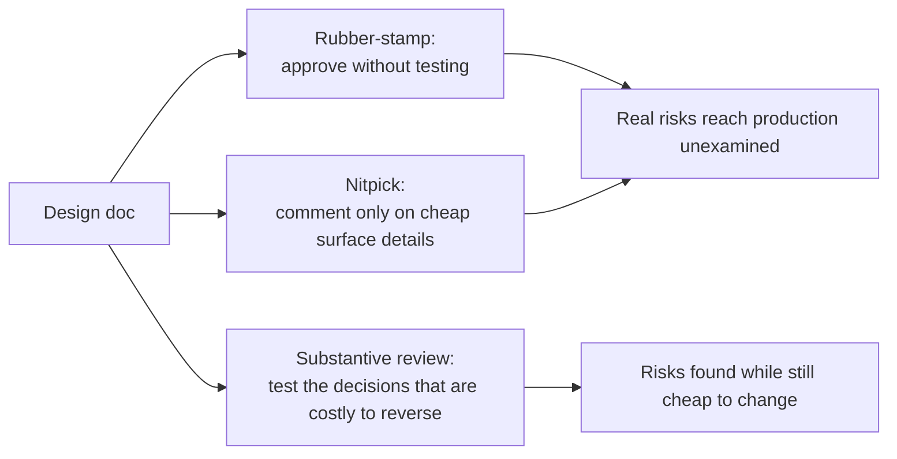

import Scenario from "../../../components/Scenario.astro";
import LevelIntro from "../../../components/LevelIntro.astro";
import PracticeCheck from "../../../components/PracticeCheck.astro";

export const unit = {
  track: "architecture",
  unitSlug: "architecture-review",
};

<Scenario label="The 18-page design doc">
  <Fragment slot="facts">
    

      
📄 <strong>The doc</strong> — 18 pages, proposing to replace a direct call with an event queue for order notifications

      
⏱️ <strong>Review window</strong> — 45 minutes before the meeting

      
👍 <strong>Reviewer A</strong> — 2 comments, both "LGTM"

      
🔤 <strong>Reviewer B</strong> — 11 comments, 9 on naming and formatting, 2 "LGTM"

      
🕳️ <strong>The gap</strong> — neither noticed the doc never says what happens when a notification fails to deliver

    

  </Fragment>

A design doc lands in the review queue: 18 pages, proposing that order
notifications move from a direct call to an event queue. The meeting is in
45 minutes. One reviewer skims it and leaves two comments, both "LGTM". The
other reads closely and leaves 11 comments, nine of them about heading
capitalization and a variable named `msg` that should be `message`. Neither
notices that the doc never says what happens when a notification fails to
deliver. **Which reviewer did their job, and did either of them?**

</Scenario>

Neither did. They failed in opposite directions for the same reason: neither
tested the design against the risks that make it break, cost too much, or be
hard to change later.

<LevelIntro
  items={[
    "Rubber-stamping and nitpicking",
    "Five question categories",
    "Four comment severities",
  ]}
/>

## What are the two ways to fail at the same job?

| Failure mode | What it looks like                                                   | Why it feels fine                  |
| ------------ | -------------------------------------------------------------------- | ---------------------------------- |
| Rubber-stamp | Fast approval, deference to the author, "someone else will catch it" | Efficient and collegial            |
| Nitpick      | Many comments on naming, formatting, phrasing                        | Looks rigorous: count the comments |
| Substantive  | Few comments, each tied to a real risk                               | Takes real thought, so it is rarer |

- Both avoid the harder work: forming an opinion on whether this specific
  design will hold up, and saying so.
- **The test:** if every comment on the review were addressed, would the
  design be any safer, cheaper, or more reliable? If not, the review did not
  do its job, however it felt to write.
- A review exists to catch decisions that are expensive to reverse while they
  are still cheap to change on paper. It is not a test of the author, a
  formatting audit, or a stage for the reviewer.

<PracticeCheck
  track={unit.track}
  unitSlug={unit.unitSlug}
  topicId="two-failure-modes"
/>

## What fixed set of questions keeps a review substantive?

**If you read top to bottom and react to whatever catches your eye, what do
you end up commenting on?** Surface details. A fixed checklist of five
categories, the same every time, forces the review onto the design itself.

| Category                            | The question                                               | What it protects against                   |
| ----------------------------------- | ---------------------------------------------------------- | ------------------------------------------ |
| Scale & load                        | Does it hold at 10x today's traffic? At a tenth of it?     | Designs that only work at the demoed scale |
| Failure modes & blast radius        | What happens when this specific component is down or slow? | Outages that spread further than planned   |
| Trade-offs & alternatives           | What else was considered, and why was this chosen?         | Decisions never compared to anything       |
| Reversibility & cost of being wrong | How hard is this to undo in six months?                    | Bets that quietly become permanent         |
| Operability & ownership             | Who is paged when it breaks, and can they debug it?        | Systems only their author can operate      |

<PracticeCheck
  track={unit.track}
  unitSlug={unit.unitSlug}
  topicId="five-categories"
/>

## How do you stop every comment reading as equally urgent?

**Does a naming preference deserve the same weight as a missing failure-mode
analysis?** Nitpicking is often not about the content of the comments but
about treating all of them as equal. Sort feedback by what it requires.

| Severity   | Meaning                                                       | Example                                     |
| ---------- | ------------------------------------------------------------- | ------------------------------------------- |
| Blocking   | A real risk; must be resolved before the design moves forward | No plan for a message that fails repeatedly |
| Should-fix | Meaningfully improves the design, but would not block alone   | No rollback plan stated for the cutover     |
| Question   | The reviewer genuinely does not know; the doc should say      | Was a simpler queue considered first?       |
| Nit        | A preference that costs nothing to skip, labeled optional     | `msg` versus `message`                      |

Rubber-stamping is a review with nothing in the first three rows. Nitpicking
is a review where everything landed in the last one.

<PracticeCheck
  track={unit.track}
  unitSlug={unit.unitSlug}
  topicId="severity-levels"
/>

## Key terms

Rubber-stamping, nitpicking, blast radius, reversibility, blocking vs.
non-blocking feedback, question categories.
