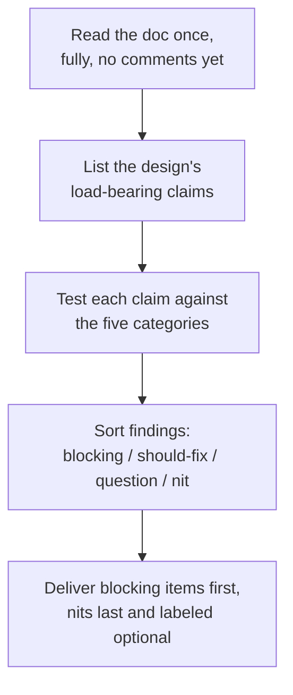

import LevelIntro from "../../../components/LevelIntro.astro";
import Checkpoint from "../../../components/Checkpoint.astro";
import PracticeCheck from "../../../components/PracticeCheck.astro";

export const unit = {
  track: "architecture",
  unitSlug: "architecture-review",
};

L1 named the two failure modes, the five question categories and the four
severities. L2 puts them into an actual flow, shows why the same review done
a month later matters less, and adds the one thing categories cannot fix:
how the feedback is delivered.

<LevelIntro
  items={[
    "The review flow in order",
    "Cost of change by stage",
    "The rigor and tone matrix",
  ]}
/>

## In what order should a reviewer actually work?

**Before writing a single comment, what comes first?** Not "read top to
bottom and react", which is how both failure modes happen by default.

A **load-bearing claim** is a statement the design depends on, such as "no
orders are lost". If it is wrong, the design is wrong. Reading the whole doc
first matters because commenting mid-read means reacting to what is cheap to
notice, which is surface detail.

<Checkpoint question="A reviewer comments on a naming choice in paragraph two, before reading the rest. Beyond being premature, what is the specific risk?">

Commenting mid-read locks attention onto whatever is in front of you, and
that is usually surface detail. The load-bearing claims often appear in later
sections or have to be inferred from the whole doc. A reviewer already three
naming comments deep has spent their attention before reaching the parts
worth spending it on.

</Checkpoint>

<PracticeCheck
  track={unit.track}
  unitSlug={unit.unitSlug}
  topicId="review-flow"
/>

## Why does review get more expensive the later it happens?

**Is a flaw caught in the doc the same flaw caught in production?** The flaw
is identical. What differs is how much has been built around the wrong
assumption. The figures below are a qualitative ordering, not measurements.

| Stage when caught  | What fixing it involves                                  | Relative cost |
| ------------------ | -------------------------------------------------------- | ------------- |
| Doc review         | Edit a page                                              | Lowest        |
| Prototype          | Rework a throwaway                                       | Low           |
| Mid-implementation | Rewrite code and any work that now depends on it         | High          |
| In production      | Migration, rollback plan, on a schedule the flaw chooses | Highest       |

This ordering is the economic case for review: it is the cheapest point in
the whole lifecycle to be wrong. It is also why the exercise of reviewing for
decisions that are **expensive to reverse** beats reviewing for polish.

<PracticeCheck
  track={unit.track}
  unitSlug={unit.unitSlug}
  topicId="cost-of-change"
/>

## Can a review ask exactly the right questions and still fail?

**Yes, if the author stops being able to hear it.** The categories decide
what gets asked; tone decides whether it lands.

|                        | Low rigor                                             | High rigor                                                     |
| ---------------------- | ----------------------------------------------------- | -------------------------------------------------------------- |
| **Collaborative tone** | Rubber-stamping: friendly, nothing tested             | The target: real risks surfaced, author able to act on them    |
| **Adversarial tone**   | Nitpicking dressed as toughness: volume, no substance | Correct but ignored: author turns defensive and stops engaging |

<Checkpoint question="A reviewer finds a genuine blocking issue but writes 'I can't believe this wasn't considered.' The finding was right. What went wrong?">

The rigor was right: a real blocking issue in the correct category. The tone
turned a fixable design gap into a judgment on the author. The matrix's
bottom-right cell is exactly this case, and its outcome is not that the
finding is ignored on the merits but that the author gets defensive and the
review stops being a collaboration on the design.

</Checkpoint>

<PracticeCheck
  track={unit.track}
  unitSlug={unit.unitSlug}
  topicId="rigor-and-tone"
/>
