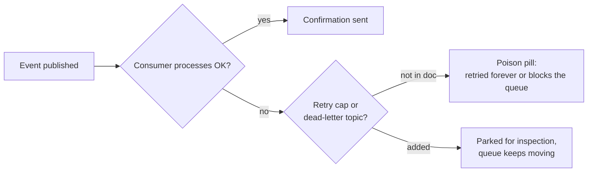

import Scenario from "../../../components/Scenario.astro";
import LevelIntro from "../../../components/LevelIntro.astro";
import Checkpoint from "../../../components/Checkpoint.astro";
import PracticeCheck from "../../../components/PracticeCheck.astro";

export const unit = {
  track: "architecture",
  unitSlug: "architecture-review",
};

<Scenario label="The notification-service migration doc">
  <Fragment slot="facts">
    

      
📄 <strong>Proposal</strong> — replace a synchronous call from the order service to the notification service with a message topic called <code>order.events</code>

      
🧑‍💻 <strong>Author</strong> — first design doc written solo

      
⏱️ <strong>Stated motivation</strong> — checkout waits on notification delivery (the doc assumes about 180 ms)

    

  </Fragment>

The doc's opening paragraph: _"Today the order service calls the notification
service synchronously and waits, adding about 180 ms to every checkout. This
proposal publishes an event to a topic that the notification service consumes
asynchronously. This removes the latency from the checkout path entirely."_
The motivation is plausible and the design is reasonable. **Reading only that
paragraph, is there anything worth asking yet, or is it too early to tell?**

</Scenario>

It is early, but not too early. "Removes the latency entirely" is true for
the checkout request, yet says nothing about what happens to a notification
once it is published. That is the first load-bearing claim. L2's flow says to
read the whole doc before reacting, so hold it and keep reading.

<LevelIntro
  items={[
    "Testing a doc's claims against the categories",
    "Sorting findings by severity",
    "One finding, two tones",
  ]}
/>

## What do the doc's other claims leave unsaid?

Three more claims from the doc:

> _"Each event is processed independently."_

> _"If the notification service is down, the topic retains events for 7
> days, so no orders are lost."_

> _"This is a drop-in replacement. Rollout is a single deploy: ship the
> producer and consumer together, cut over, done."_

**Which categories does each touch, and what does it leave unsaid?**

| Doc claim                                   | Category it invites                   | What the doc does not say                                                                               |
| ------------------------------------------- | ------------------------------------- | ------------------------------------------------------------------------------------------------------- |
| "Each event is processed independently"     | Failure modes & blast radius          | What happens to an event that fails repeatedly: skipped, retried forever, or blocking those behind it   |
| "Retains events for 7 days, no orders lost" | Reversibility & cost of being wrong   | Retention is durability, not delivery: is processing at-least-once, and is a duplicate email acceptable |
| "Drop-in replacement, single deploy"        | Operability & ownership; Scale & load | No parallel run, no rollback plan, no word on orders in flight during the cutover                       |

<Checkpoint question="'No orders are lost' refers to retention, not to how the consumer processes events. Why is that worth a comment rather than close enough?">

Durability and correct processing are different guarantees. Retention means
the bytes are not lost; it says nothing about whether each event is processed
once, at least once, or skipped after a crash mid-processing. If delivery is
at-least-once, a customer can get a duplicate confirmation, a real bug hidden
behind a true but incomplete claim. Nitpicking never finds this, because it
requires reading the claim critically rather than reacting to its wording.

</Checkpoint>

<PracticeCheck
  track={unit.track}
  unitSlug={unit.unitSlug}
  topicId="claim-testing"
/>

## How do those findings sort?

Following L2's flow, read fully then sort. Six comments result:

| Severity   | Category                            | Comment                                                                                                                                   |
| ---------- | ----------------------------------- | ----------------------------------------------------------------------------------------------------------------------------------------- |
| Blocking   | Failure modes & blast radius        | No handling for an event that fails repeatedly. Without a retry cap or a dead-letter topic, one bad event can stall everything behind it. |
| Blocking   | Reversibility & cost of being wrong | State the delivery guarantee and whether sending is idempotent, since duplicates are a customer-facing outcome.                           |
| Should-fix | Operability & ownership             | No rollback plan. Run the new path beside the old one behind a flag before fully cutting over.                                            |
| Should-fix | Scale & load                        | No expected event volume. Say whether today's volume and 10x it fit the proposed configuration.                                           |
| Question   | Trade-offs & alternatives           | Was a simpler background job queue considered first? Not objecting; the reasoning belongs in the doc.                                     |
| Nit        | none                                | Two spellings of the same service name. Optional.                                                                                         |

Two blocking, two should-fix, one question, one clearly labeled nit. Nothing
is dressed up as more urgent than it is, and nothing substantive is buried.

<PracticeCheck
  track={unit.track}
  unitSlug={unit.unitSlug}
  topicId="severity-in-context"
/>

## Same finding, two comments: does the wording change the outcome?

**Adversarial:** _"There's no error handling here at all. This would fall over
immediately in production."_

**Collaborative:** _"What happens if one event fails to process, say the SMS
provider rejects one number? Does it retry forever, get skipped, or block the
events behind it? I think this needs a retry cap or dead-letter topic before
it ships, but happy to talk through options if there is a reason it is out of
scope."_

Both name the same blocking gap. The first delivers a verdict about the design
and, implicitly, the author. The second asks an answerable question, states the
position (fix before shipping) and leaves room for context the reviewer lacks.

<Checkpoint question="The first phrasing is shorter and more direct. Using L2's matrix, why is that efficiency false economy?">

Length is not the variable that decides whether the design gets fixed; the
author's ability to engage is. The matrix predicts a defensive response to
high-rigor adversarial feedback: a back-and-forth about tone, or a fix to the
literal words instead of the underlying gap. A slightly longer comment the
author can act on at once is faster in the way that matters, time to a fixed
design.

</Checkpoint>

<PracticeCheck
  track={unit.track}
  unitSlug={unit.unitSlug}
  topicId="tone-in-practice"
/>

## What changes if the stakes change?

This review is one case, not the whole territory. The design pattern here
(at-least-once delivery, no stated idempotency) carried low stakes: a
duplicate email is an annoyance. Change the stakes and the same finding
changes severity.

| If the same design carried... | Duplicate delivery means          | The idempotency finding becomes     |
| ----------------------------- | --------------------------------- | ----------------------------------- |
| An order-confirmation email   | An annoyed customer               | Blocking, but a quick fix           |
| A payment-confirmation event  | A customer possibly charged twice | Blocking, and a design-level rework |
| An internal analytics counter | A slightly inflated count         | Should-fix or question              |

**Extend it yourself.** What would change about which findings are blocking
if the author were not new but the most experienced architect on the team,
presenting in a live meeting rather than a written doc? Which of the five
categories would you test first for a design whose failure is irreversible,
and which would move down? What would you ask if the doc had no alternatives
section at all?

<PracticeCheck
  track={unit.track}
  unitSlug={unit.unitSlug}
  topicId="stakes-change"
/>
