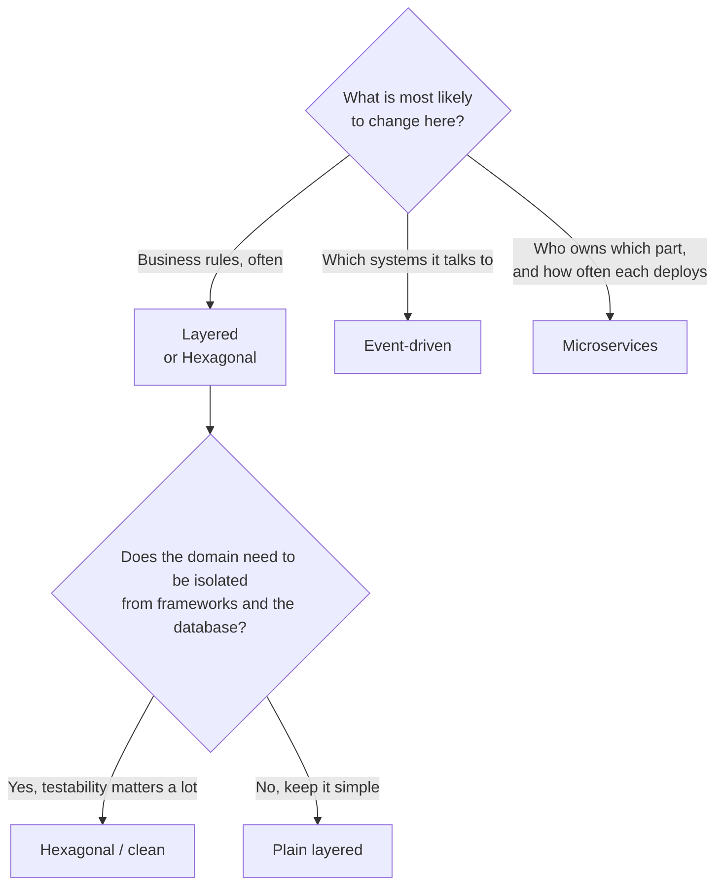

import Scenario from "../../../components/Scenario.astro";
import LevelIntro from "../../../components/LevelIntro.astro";
import PracticeCheck from "../../../components/PracticeCheck.astro";

export const unit = {
  track: "architecture",
  unitSlug: "architecture-styles",
};

<Scenario label="Two people propose two different shapes for the same small shop's checkout. Which one is right?">
  <Fragment slot="facts">
    
The team

    

      
🧑‍💻 <strong>3 engineers</strong>, one codebase

      
📈 <strong>Pricing rules</strong> change most weeks

      
🔌 <strong>One new integration</strong>: a loyalty-points partner that is slow and sometimes down

    

    
Two proposals

    

      
🧱 "Split into microservices now"

      
📦 "Just add another folder"

    

  </Fragment>

Three engineers own a checkout service. Pricing rules change most weeks,
because marketing keeps inventing new discount conditions. A partner team
wants to award loyalty points whenever an order is priced, but their system is
slow and sometimes down. One engineer says "split this into microservices now,
before it's a mess." Another says "just add a folder for the loyalty logic and
move on."

| Proposal                     | What it optimizes for              | What it risks                                                            |
| ---------------------------- | ---------------------------------- | ------------------------------------------------------------------------ |
| Split into microservices now | Independent deploys, team autonomy | Network calls, partial failure, several deploy pipelines for 3 people    |
| Add another folder           | Speed today                        | The pricing logic and the loyalty-notification logic get welded together |

**Neither proposal starts from what actually varies here: the team size, how
often the rules change, and how unreliable the loyalty partner is. Does either
one respond to those facts, or only to a mood?**

</Scenario>

<LevelIntro
  items={[
    "The four recurring architectural styles",
    "What each one optimizes for and costs",
    "Four questions to ask before picking one",
  ]}
/>

## What makes a style a decision rather than a badge?

**If both proposals sound reasonable, what would tell a real decision from a
fashionable one?** A style is a name for a recurring shape that answers a
recurring set of pressures. It is a bet about which kind of change will hurt
most, made before the pain shows up. A quick test is whether you can finish
this sentence:

> "We are choosing this because our **X** is going to change or grow, and this
> style protects against that."

If you cannot name the X, the style was picked for its name. That is a
buzzword, not a decision.

<PracticeCheck
  track={unit.track}
  unitSlug={unit.unitSlug}
  topicId="style-not-badge"
/>

## What are the four styles, and what does each one trade?

Four shapes recur constantly. None is ranked above another; each protects
against a different kind of pain.

| Style             | Shape in one line                                                                 | Buys                                          | Costs                                                    |
| ----------------- | --------------------------------------------------------------------------------- | --------------------------------------------- | -------------------------------------------------------- |
| Layered           | Horizontal layers: screen, business rules, data access; each calls the one below  | Cheapest to start, easy to explain            | Nothing stops rules from leaking into the wrong layer    |
| Hexagonal / clean | Business rules in the center; outside tools plug in through ports the center owns | Testable core, swappable infrastructure       | More files and more indirection                          |
| Event-driven      | Parts announce what happened; others react later                                  | A slow or down consumer does not block sender | Data is correct a little later; bugs trail across a log  |
| Microservices     | The running system is split into independently deployed services                  | Teams release without waiting on each other   | Network calls, partial failure, one pipeline per service |

An everyday picture: a layered app is one office with departments. Hexagonal
keeps the core business rule in the middle and makes outside tools plug in.
Event-driven is leaving a ticket in an inbox for another team to handle later.
Microservices are separate offices that release on their own schedule but now
have to talk over a real channel.

<PracticeCheck
  track={unit.track}
  unitSlug={unit.unitSlug}
  topicId="four-styles"
/>

## Which four questions decide it?

**Before any code, what do you ask?** Four questions, in this order of
usefulness:

1. **What changes most often: the business rules, or the set of systems we
   talk to?** Rules favor layered or hexagonal; integrations favor
   event-driven.
2. **How many people, and how many teams, will touch this?** One person gains
   nothing from microservices; separate teams gain a lot from not waiting on
   each other's deploys.
3. **What does "coupled" cost if we get it wrong?** A tangled layered app is
   fixed with a refactor in one repository. Tangled services mean a
   coordinated multi-team deploy.
4. **Can we afford data that is correct a little later?** If the loyalty
   points must be right the instant the order is placed, an event-driven
   design has bought a bug, not a feature.

<PracticeCheck
  track={unit.track}
  unitSlug={unit.unitSlug}
  topicId="four-questions"
/>

## Key terms

| Word                 | Plain meaning in this unit                                   |
| -------------------- | ------------------------------------------------------------ |
| deployment           | publishing a version so it runs in production                |
| service              | a running app boundary with its own deployment               |
| network call         | one running service asking another running service for work  |
| event                | a message saying something happened, like `OrderPriced`      |
| eventual consistency | data may be correct a little later, not instantly everywhere |

## What the next levels cover

L2 draws the same checkout feature all four ways and shows where each one
fails differently. L3 builds one pricing service four times and checks each
version against the rule that checkout must never fail because loyalty is down.
Deeper dives live in `architecture/hexagonal-clean-architecture`,
`architecture/event-driven-architecture`, `architecture/domain-driven-design`
and `product-domain/bounded-contexts`.
